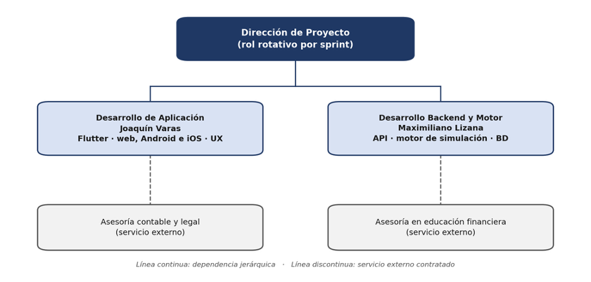
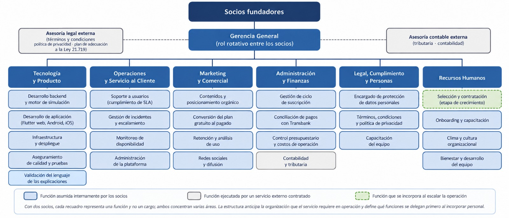
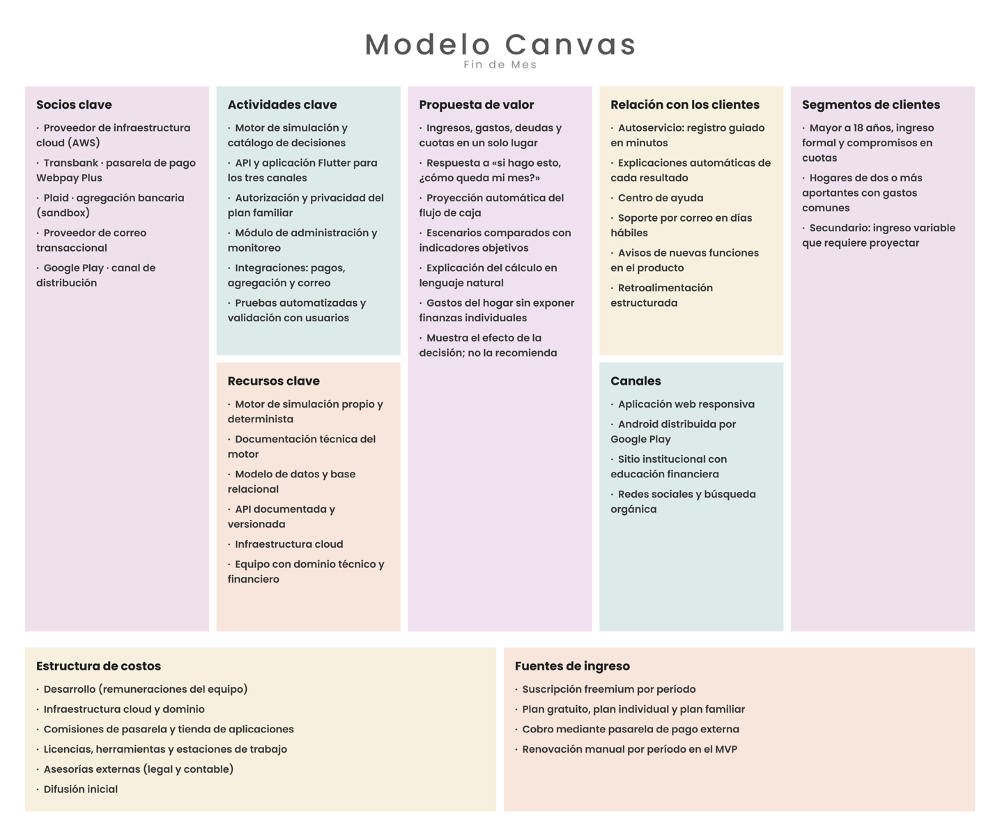
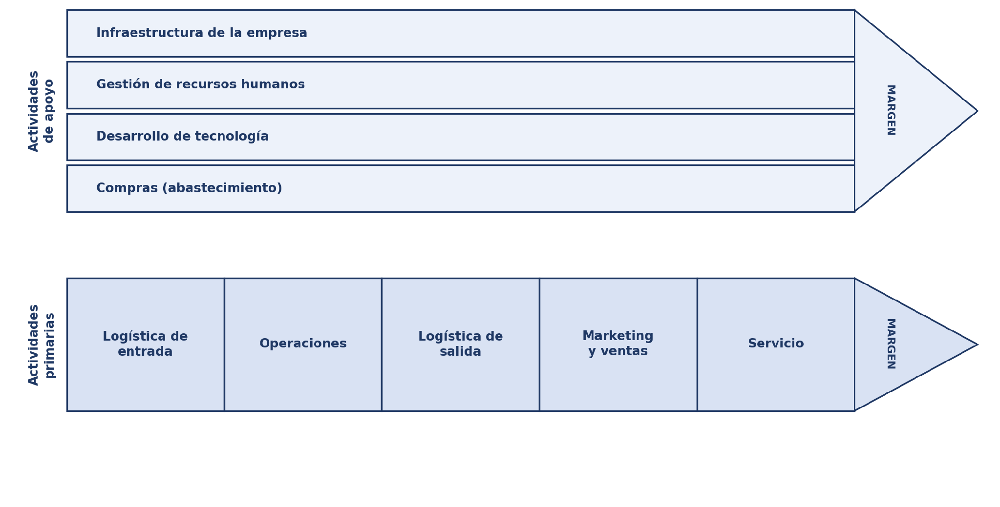
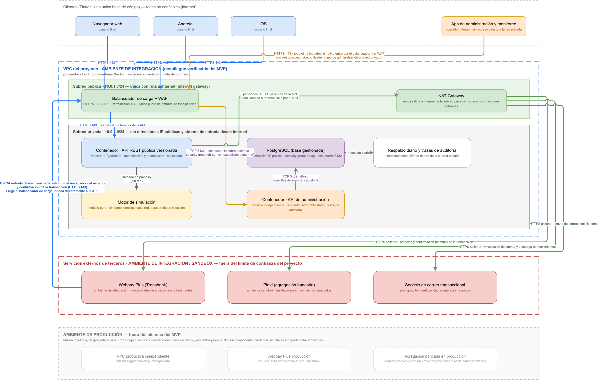
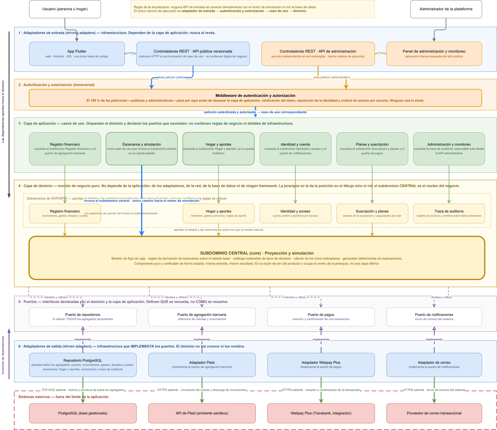
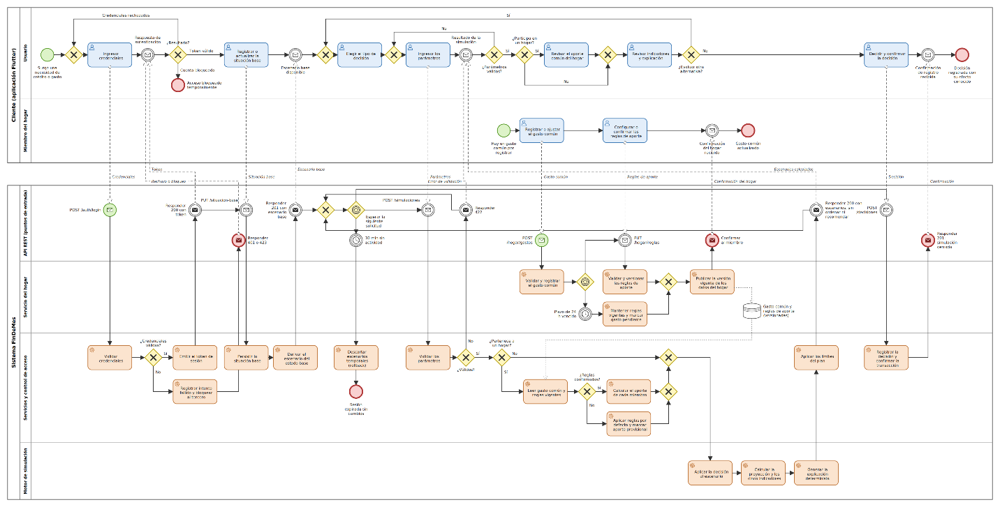
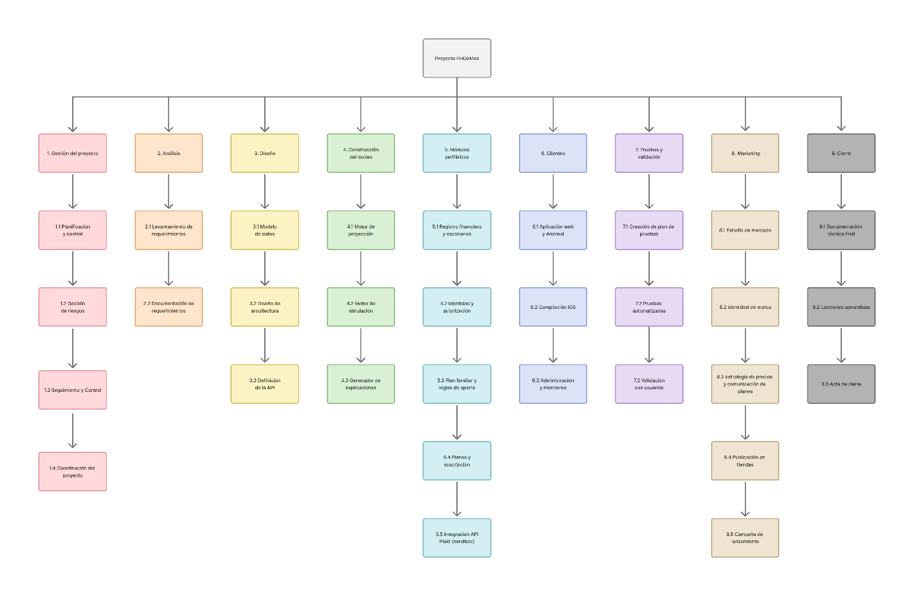
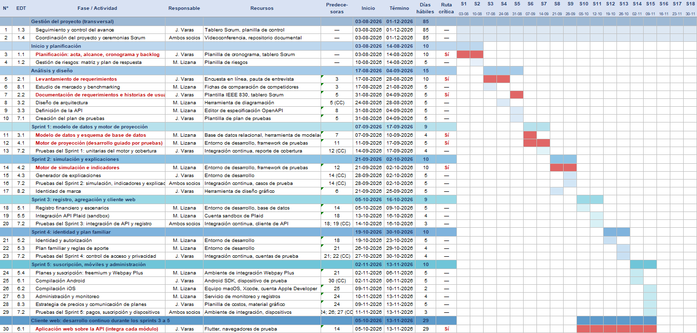
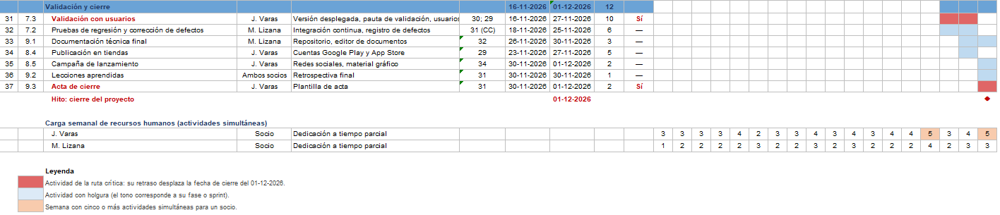

> [Cuadro de texto]
> **FORMULACIÓN DEL PROYECTO**
> 
> **Fin de Mes**

> [Cuadro de texto]
> **Asignatura: Proyecto de Título**
> 
> **Carrera:** Ingeniería en Informática
> 
> **Sección:** D-IEI-N8-P1-C3/D
> 
> **Académico guía:** Armin Vladimir Brun Rüth
> 
> **Integrantes del equipo:** Joaquín Varas y Maximiliano Lizana
> 
> **Fecha de entrega**
> 
> 07-09-2026

**Contenido**

**Índice de tablas**

**Índice de ilustraciones**

# I. Introducción

El presente informe corresponde a la formulación del Proyecto de Título Fin de Mes, una plataforma SaaS que permite a personas y hogares en Chile llevar el registro de sus ingresos, gastos, deudas y cuotas, y simular cómo una decisión determinada afectaría el resultado de sus meses siguientes. El documento reúne el diagnóstico del problema abordado, el levantamiento de requerimientos, el marco teórico que sustenta la propuesta, los objetivos comprometidos, la metodología de trabajo, la definición de la arquitectura TI y el reconocimiento de la arquitectura empresarial en la que la solución será implementada.

El problema que motiva el proyecto no se agota en el registro económico: el registro es necesario, pero por sí solo no responde las preguntas que la persona se hace al momento de decidir. Las personas suelen saber, con mayor o menor precisión, cuánto ganan y en qué gastan; lo que resulta difícil es responder preguntas prospectivas concretas: si comprometo una cuota adicional este mes, ¿en qué semana se acaba el dinero?, ¿cuál de dos alternativas de compra deja el mes en mejor posición?, ¿cuánto margen real queda después de todos los compromisos ya adquiridos? Esta dificultad se agudiza en un mercado con alta presencia de crédito de consumo y compra en cuotas, donde cada decisión individual parece menor pero se acumula sobre el flujo de los meses siguientes, y donde el costo de la decisión no se percibe al tomarla sino varios meses después, cuando ya no es reversible.

Las herramientas disponibles hoy resuelven este problema de manera parcial. Las aplicaciones de finanzas personales operan de forma retrospectiva y responden «en qué gasté», pero no «qué pasará si». Las planillas de cálculo permiten proyectar, pero trasladan al usuario la construcción y el mantenimiento del modelo. Los simuladores de crédito entregan la cuota de un producto aislado sin situar en el presupuesto completo. Y las herramientas de gestión compartida del hogar exigen transparencia total entre los miembros o no ofrecen espacio común alguno, sin contemplar el caso intermedio, que es el más frecuente.

Fin de Mes responde a esa brecha mediante tres componentes. El primero es un módulo de registro que permite al usuario mantener ordenados sus ingresos, sus gastos fijos y variables, sus deudas y las cuotas que aún debe pagar. El segundo es un motor de proyección y simulación de escenarios, que constituye el núcleo del sistema y que toma ese registro para calcular cómo evolucionaría el saldo del usuario y cómo lo afectaría una decisión concreta, como realizar una compra en cuotas o asumir un gasto nuevo. El tercero es un plan familiar que permite a varios miembros de un hogar administrar conjuntamente un espacio de gastos comunes manteniendo la privacidad de sus finanzas individuales.

Es necesario precisar desde ya el límite de la propuesta: el sistema no recomienda cursos de acción, no califica una decisión como buena o mala y no sugiere productos financieros. Se limita a mostrar, en términos verificables, cómo quedaría el mes del usuario si la decisión evaluada se ejecutara. La conclusión y la decisión son siempre del usuario.

A lo largo del informe se justifica cuantitativamente la relevancia del problema con datos de la Comisión para el Mercado Financiero y del Banco Central de Chile, se documentan los requerimientos mediante historias de usuario y requerimientos no funcionales asociados a la norma ISO/IEC 25010, se formulan el objetivo general y ocho objetivos específicos verificables, se justifica la adopción de Scrum como metodología adaptativa y se define una arquitectura hexagonal con enfoque API-first cuya elección se sustenta en una evaluación comparativa. Asimismo, se abordan de manera explícita las consideraciones éticas del proyecto, en particular el resguardo de la privacidad entre miembros de un mismo hogar, el cumplimiento anticipado de la Ley 21.719 sobre protección de datos personales y la delimitación expresa de la plataforma como herramienta de registro y simulación que no emite recomendaciones ni constituye asesoría financiera. (BCN, 2024)

Finalmente, cabe destacar un criterio de diseño transversal al proyecto: la independencia del núcleo respecto de los servicios externos. El cálculo se realiza íntegramente en un motor propio y determinista, y los datos residen en la base de datos de la plataforma. Las integraciones funcionales externas son la pasarela de pago Webpay Plus de Transbank, necesaria para cobrar la suscripción y que un usuario del plan gratuito nunca utiliza; la API de agregación de Plaid, que automatiza la carga de movimientos y que el usuario puede sustituir por el registro manual; y el servicio de correo transaccional, empleado para la verificación de la cuenta, la recuperación de contraseña y los avisos del sistema. Las tres se resuelven mediante adaptadores en la periferia y ninguna interviene en el cálculo. A ellas se suman la infraestructura y la distribución detalladas en la Tabla 45: el proveedor cloud, la base de datos gestionada y Google Play. Esta decisión acota el riesgo operativo y mantiene el producto utilizable aunque cualquiera de los dos servicios deje de estar disponible.

# II. Identificación del Problema

## 2.1 Actualización y justificación del problema

Fin de Mes constituye un emprendimiento de base tecnológica del sector fintech, orientado al segmento de finanzas personales y familiares, cuyo producto es una plataforma de software entregada bajo modelo de servicio (SaaS). El proyecto no se plantea como un ejercicio de demostración: su finalidad es poner en el mercado un producto que resuelva un problema real de los hogares chilenos, y las decisiones de alcance, arquitectura y presupuesto que se documentan a lo largo del informe se adoptan bajo ese criterio.

El problema abordado corresponde a una problemática existente, previamente identificada en el análisis del entorno financiero de los hogares chilenos y actualizada para el presente proyecto con la información pública más reciente. La Tabla 1 presenta el cuadro comparativo entre la situación observada en el momento de la detección inicial y la situación vigente, con el fin de determinar si hubo cambios en el alcance de la problemática.

*Tabla 1. Comparación de la situación pasada y actual del problema abordado*

| **Dimensión** | **Situación anterior (año según indicador)** | **Situación más reciente (año según indicador)** | **Variación y lectura** |
|---|---|---|---|
| Deuda mediana de las personas | $2.321.000 aproximadamente (junio 2023) | $1.680.453 (junio 2025) | Disminuye. El nivel de deuda típico baja, pero no desaparece el compromiso mensual del ingreso. |
| Carga financiera mediana | 16,1 % del ingreso mensual (junio 2023) | 11,9 % del ingreso mensual (junio 2025) | Disminuye. Aun así, más de uno de cada diez pesos del ingreso está comprometido antes de comenzar el mes. |
| Personas sobreendeudadas (más del 50 % del ingreso destinado a deuda) | 19,1 % de los deudores (junio 2023) | 14,1 % de los deudores (junio 2025) | Disminuye, pero se mantiene un grupo relevante que compromete más de la mitad de su ingreso. |
| Alfabetización financiera | Puntaje CMF-CAF 2016: 13,1 puntos (última medición disponible al momento de la detección) | Puntaje CMF-CAF 2023: 12,2 puntos, bajo el promedio OCDE (13,0) | Empeora. Retrocede especialmente la dimensión de comportamiento, que incluye planificación y resiliencia. |
| Uso de presupuesto en el hogar | Aproximadamente la mitad de los hogares declara llevar presupuesto | Persiste la baja proporción de hogares que planifica y compara productos antes de contratar | Sin cambios sustantivos. La brecha es de práctica y de herramientas, no solo de información. |
| Oferta de herramientas digitales | Aplicaciones centradas en el registro y la categorización del gasto pasado | La oferta crece en registro y agregación, pero no en simulación prospectiva ni en gestión compartida con privacidad | El alcance del problema se mantiene: la brecha específica que aborda el proyecto sigue vigente. |

*Fuente:* (Elaboración propia, 2026) *a partir de*  (CMF, 2026)

La conclusión del cuadro comparativo es que, si bien los indicadores agregados de endeudamiento mejoraron entre 2023 y 2025, el alcance de la problemática abordada por el proyecto no se redujo. La mejora se explica principalmente por factores macroeconómicos —descenso de la Tasa de Política Monetaria, aumento del ingreso real y menor dinamismo del crédito de consumo— y no por un cambio en la capacidad de planificación de los hogares, dimensión en la que los indicadores de comportamiento financiero incluso retrocedieron. En consecuencia, la brecha específica que el proyecto pretende cubrir se mantiene plenamente vigente

### 2.1.1 Descripción de la organización.

Fin de Mes es un emprendimiento tecnológico en etapa de formulación, impulsado por el equipo de trabajo, orientado al desarrollo de una plataforma de finanzas personales y familiares. Su formalización jurídica no forma parte del alcance de este proyecto. La organización no cuenta con operación comercial previa, por lo que su descripción corresponde a la del emprendimiento que se pretende poner en marcha con la ejecución del proyecto.

#### A) Antecedentes de la Organización.

Tipo y rubro. Fin de Mes es un emprendimiento tecnológico orientado al desarrollo de software de finanzas personales y familiares, con especialización en el subsector fintech y un modelo de servicio por suscripción. Su actividad económica principal es el desarrollo y explotación de software bajo modelo de suscripción (Software as a Service). No es una institución financiera: no capta dinero del público, no otorga crédito, no intermedia productos financieros ni mueve fondos, por lo que no queda sujeta a la fiscalización de la Comisión para el Mercado Financiero en calidad de entidad financiera.

Posicionamiento de mercado. El emprendimiento busca posicionarse en un espacio que la oferta actual atiende de forma incompleta: la simulación prospectiva de decisiones financieras del hogar. La estrategia de posicionamiento es de diferenciación por foco. Mientras las aplicaciones de finanzas personales compiten en cobertura de registro y agregación bancaria, Fin de Mes compite en capacidad de respuesta a la pregunta «si hago esto, ¿cómo queda económicamente mi mes?», complementada con un modelo de administración familiar que preserva la privacidad individual. El mercado objetivo inicial es Chile, con foco en personas mayores a 18 años con ingreso formal, compromisos en cuotas y hogares de dos o más aportantes.

Misión. Entregar a las personas y a los hogares una herramienta que les permita mantener ordenada su situación financiera y ver con anticipación cómo una decisión afectaría sus meses siguientes, con información comprensible, verificable y resguardando su privacidad, sin decirles qué hacer.

Visión. Convertirse, hacia 2030, en la plataforma de referencia en Chile para el registro y la proyección financiera de los hogares, reconocida por la claridad y la exactitud de sus proyecciones, por su independencia tecnológica y por su modelo de privacidad entre miembros de una misma familia.

Valores y compromiso ético. El emprendimiento adhiere de manera explícita a cinco compromisos que condicionan decisiones de diseño del producto y que se retoman a lo largo del informe: (i) la plataforma calcula y muestra, pero no recomienda: no emite juicios sobre la conveniencia de una decisión ni constituye asesoría financiera, lo que se declara de forma visible en la interfaz; (ii) la información de un miembro del hogar nunca se expone a otro sin su consentimiento; (iii) no se comercializan datos de los usuarios ni se recomiendan productos financieros de terceros a cambio de retribución; (iv) el vencimiento de una suscripción nunca implica pérdida de información del usuario; y (v) la información financiera del usuario no se cede ni se comercializa a terceros: las integraciones funcionales externas del sistema son la pasarela de pago Webpay Plus, de Transbank, la API de agregación de movimientos de Plaid y el servicio de correo transaccional, todas resueltas mediante adaptadores en la periferia de la arquitectura y ninguna de ellas interviniente en el cálculo del núcleo.

#### B) Estructura organizacional de proyecto (organigrama)

La estructura del emprendimiento corresponde a una estructura simple o plana, propia de una organización en etapa temprana con un equipo reducido y comunicación directa. El organigrama se compone de una dirección de proyecto de carácter rotativo y dos líneas técnicas a cargo de los socios fundadores, con dos funciones de apoyo contratadas externamente:

•    Dirección de Proyecto. Responsable de la planificación, el control de avance, la relación con los interesados y la coordinación general. Es un rol rotativo: la conducción de cada iteración recae alternadamente en uno de los dos socios, de modo que ambos mantengan visión completa del proyecto.

•    Desarrollo de Aplicación (Joaquín Varas). Responsable de las interfaces web, Android e iOS construidas sobre una única base de código en Flutter, y de la experiencia de usuario.

•    Desarrollo Backend y Motor de Simulación (Maximiliano Lizana). Responsable del núcleo de cálculo, del modelo de datos, de la API, del módulo de administración y monitoreo y de la integración con la pasarela de pago.

•    Asesoría contable y legal (servicio externo). Términos y condiciones, política de privacidad y adecuación a la Ley 21.719.

•    Validación de contenidos de educación financiera (interna). El equipo revisa el lenguaje de las explicaciones entregadas por el motor de simulación, sin recurrir a un servicio externo.

*Ilustración 1. Organigrama del equipo del emprendimiento Fin de Mes*

> **Contenido de la figura:**
> Raíz: Dirección de Proyecto (rol rotativo por sprint).
> Dependen jerárquicamente (línea continua) dos áreas: Desarrollo de Aplicación — Joaquín Varas (Flutter: web, Android e iOS; UX) y Desarrollo Backend y Motor — Maximiliano Lizana (API, motor de simulación, BD).
> Servicios externos contratados (línea discontinua): Asesoría contable y legal (bajo Aplicación) y Asesoría en educación financiera (bajo Backend).

*Fuente:* (Elaboración propia, 2026)

La estructura considera dos socios fundadores con dedicación completa al desarrollo y dos servicios externos contratados por especialidad. La decisión de no incorporar una tercera persona en esta etapa responde a la escala del emprendimiento: el costo fijo de un integrante adicional no se justifica antes de validar la propuesta con usuarios reales, y la separación de responsabilidades entre aplicación y backend cubre la totalidad de los componentes del producto.

#### C) Estructura organizacional funcional (organigrama)

La Figura 2 presenta la estructura funcional que requiere la operación del servicio, distinta del equipo de proyecto de la Figura 1. Se definen cinco áreas: Tecnología y Producto, Operaciones y Servicio al Cliente, Marketing y Comercial, Administración y Finanzas, y Legal, Cumplimiento y Personas, esta última necesaria por el encargado de protección de datos que exige la Ley 21.719. Con dos socios, cada recuadro representa una función y no un cargo: el color distingue lo asumido internamente, lo delegado a servicios externos y lo que se incorporará al escalar la operación.

*Ilustración 2. Organigrama funcional del emprendimiento Fin de Mes*

> **Contenido de la figura:**
> Raíz: Socios fundadores → Gerencia General (rol rotativo entre los socios). Asesorías externas laterales: legal (términos y condiciones, política de privacidad, plan de adecuación a la Ley 21.719) y contable (tributaria, contabilidad).
> Seis áreas con sus funciones:
> - Tecnología y Producto: desarrollo backend y motor de simulación; desarrollo de aplicación (Flutter web, Android, iOS); infraestructura y despliegue; aseguramiento de calidad y pruebas; validación del lenguaje de las explicaciones.
> - Operaciones y Servicio al Cliente: soporte a usuarios (cumplimiento de SLA); gestión de incidentes y escalamiento; monitoreo de disponibilidad; administración de la plataforma.
> - Marketing y Comercial: contenidos y posicionamiento orgánico; conversión del plan gratuito al pagado; retención y análisis de uso; redes sociales y difusión.
> - Administración y Finanzas: gestión de ciclo de suscripción; conciliación de pagos con Transbank; control presupuestario y costos de operación; contabilidad y tributaria (servicio externo).
> - Legal, Cumplimiento y Personas: encargado de protección de datos personales; términos, condiciones y política de privacidad; capacitación del equipo.
> - Recursos Humanos: selección y contratación (se incorpora al escalar); onboarding y capacitación; clima y cultura organizacional; bienestar y desarrollo del equipo.
> Leyenda: azul = función asumida por los socios; gris = servicio externo contratado; verde discontinuo = función que se incorpora al escalar. Con dos socios, cada recuadro es una función y no un cargo.

*Fuente:* (Elaboración propia, 2026)

#### D) Lienzo CANVAS

Por tratarse de un emprendimiento, la descripción del modelo de negocio se realiza mediante el lienzo CANVAS propuesto por (Osterwalder y Pigneur, 2010), que se presenta en la Figura 3.

*Ilustración 3. Lienzo CANVAS de Fin de Mes*

*Fuente:* (Elaboración propia, 2026)

> **Contenido de la figura:**
> - Socios clave: proveedor de infraestructura cloud (AWS); Transbank (Webpay Plus); Plaid, agregación bancaria (sandbox); proveedor de correo transaccional; Google Play como canal de distribución.
> - Actividades clave: motor de simulación y catálogo de decisiones; API y aplicación Flutter para los tres canales; autorización y privacidad del plan familiar; módulo de administración y monitoreo; integraciones (pagos, agregación, correo); pruebas automatizadas y validación con usuarios.
> - Recursos clave: motor de simulación propio y determinista; documentación técnica del motor; modelo de datos y base relacional; API documentada y versionada; infraestructura cloud; equipo con dominio técnico y financiero.
> - Propuesta de valor: ingresos, gastos, deudas y cuotas en un solo lugar; respuesta a «si hago esto, ¿cómo queda mi mes?»; proyección automática del flujo de caja; escenarios comparados con indicadores objetivos; explicación del cálculo en lenguaje natural; gastos del hogar sin exponer finanzas individuales; muestra el efecto de la decisión, no la recomienda.
> - Relación con los clientes: autoservicio (registro guiado en minutos); explicaciones automáticas de cada resultado; centro de ayuda; soporte por correo en días hábiles; avisos de nuevas funciones; retroalimentación estructurada.
> - Canales: aplicación web responsiva; Android por Google Play; sitio institucional con educación financiera; redes sociales y búsqueda orgánica.
> - Segmentos: mayores de 18 años con ingreso formal y compromisos en cuotas; hogares de dos o más aportantes con gastos comunes; secundario: ingreso variable que requiere proyectar.
> - Estructura de costos: desarrollo (remuneraciones); infraestructura cloud y dominio; comisiones de pasarela y tienda; licencias, herramientas y estaciones de trabajo; asesorías externas (legal y contable); difusión inicial.
> - Fuentes de ingreso: suscripción freemium por período; plan gratuito, individual y familiar; cobro mediante pasarela externa; renovación manual por período en el MVP.

#### E) Cadena de valor

La cadena de valor se construye siguiendo el modelo de (Porter, 1985), conservando la nomenclatura original de sus nueve actividades: cinco primarias —logística de entrada, operaciones, logística de salida, marketing y ventas, y servicio— y cuatro de apoyo —infraestructura de la empresa, gestión de recursos humanos, desarrollo de tecnología y compras—. La Figura 4 presenta el diagrama y la Tabla 2 desarrolla el contenido de cada actividad en el caso de Fin de Mes.

*Ilustración 4. Cadena de valor de Fin de Mes según el modelo de Porter*

> **Contenido de la figura:**
> Plantilla genérica de Porter (sin contenido específico; el detalle por actividad está en la tabla de la sección «Cadena de valor»).
> Actividades de apoyo: infraestructura de la empresa; gestión de recursos humanos; desarrollo de tecnología; compras (abastecimiento). Actividades primarias: logística de entrada; operaciones; logística de salida; marketing y ventas; servicio. Ambas convergen en el margen.

*Fuente:* (Elaboración propia, 2026)

*Tabla 2. Cadena de valor de Fin de Mes*

| **Tipo** | **Actividad** | **Contenido en Fin de Mes** |
|---|---|---|
| Primaria | Logística de entrada | Captación del insumo principal del negocio, que es información y no material: levantamiento de requerimientos con usuarios, análisis de la competencia, definición del modelo financiero y del catálogo de decisiones a simular. Incluye el diseño del flujo de registro con el que el usuario ingresa sus propios datos. |
| Primaria | Operaciones | Transformación de ese insumo en producto: diseño e implementación del motor de simulación, la API, los módulos de registro, hogar, identidad y suscripción, y la aplicación Flutter. Incluye las pruebas unitarias del motor y las pruebas de control de acceso. |
| Primaria | Logística de salida | Puesta del producto a disposición del cliente: despliegue en la infraestructura cloud, publicación de la aplicación Android en Google Play, distribución de la versión iOS mediante perfil de desarrollo, versionado de la API y publicación de su documentación. |
| Primaria | Marketing y ventas | Contenido educativo orientado a búsqueda orgánica, presentación de la comparación de planes dentro del producto, conversión del plan gratuito al pagado y difusión en redes sociales. |
| Primaria | Servicio | Soporte a usuarios, corrección de defectos, mantenimiento evolutivo, monitoreo de disponibilidad y análisis de la retroalimentación recibida. |
| Apoyo | Infraestructura de la empresa | Gestión del emprendimiento, contabilidad, control presupuestario, planificación financiera y gestión de la relación con proveedores. |
| Apoyo | Gestión de recursos humanos | Definición y rotación de roles entre los socios, capacitación técnica y, en etapas posteriores, incorporación de nuevos integrantes al equipo. |
| Apoyo | Desarrollo de tecnología | Evaluación y selección de tecnologías, definición de la arquitectura, diseño del modelo de datos, automatización de pruebas e integración continua. Es la actividad de apoyo que más incide en el margen, por cuanto determina el costo de incorporar cada nueva función. |
| Apoyo | Compras (abastecimiento) | Contratación de la infraestructura cloud, la pasarela de pago, el dominio, la cuenta de desarrollador y las asesorías externas. |

*Fuente:* (Elaboración propia, 2026)

#### F) Cuadro de Mando Integral

El Cuadro de Mando Integral se construye siguiendo las cuatro perspectivas propuestas por (Kaplan y Norton, 1996). Los umbrales se expresan con desigualdades estrictas para evitar ambigüedad entre las categorías «óptimo» y «tolerable».

*Tabla 3. Cuadro de Mando Integral (CMI) de Fin de Mes*

| **Perspectiva** | **Objetivo** | **Indicador** | **Meta** | **Frecuencia** | **Óptimo** | **Tolerable** | **Deficiente** |
|---|---|---|---|---|---|---|---|
| Cliente | Aumentar la base de usuarios activos | Tasa de crecimiento de usuarios activos mensuales | Crecer más de 15 % trimestral en el primer año | Trimestral | > 15 % | 10 % a 15 % | < 10 % |
| Cliente | Sostener la satisfacción del usuario | Proporción de valoraciones positivas en la tienda de aplicaciones | Mantener sobre 85 % de valoraciones positivas | Mensual | > 85 % | 75 % a 85 % | < 75 % |
| Financiera | Convertir usuarios gratuitos en pagados | Tasa de conversión a plan pagado | Superar el 5 % de conversión al término del primer año | Mensual | > 5 % | 3 % a 5 % | < 3 % |
| Financiera | Controlar el costo de infraestructura por usuario | Costo mensual de infraestructura por usuario activo | Mantener el costo unitario bajo el umbral definido | Mensual | < $200 | $200 a $350 | > $350 |
| Procesos internos | Asegurar la corrección del motor de cálculo | Cobertura de pruebas automatizadas del motor de simulación | Superar el 90 % de cobertura de líneas del núcleo | Por sprint | > 90 % | 80 % a 90 % | < 80 % |
| Procesos internos | Cumplir el compromiso de cada iteración | Porcentaje de historias comprometidas y completadas por sprint | Completar más del 85 % de lo comprometido | Por sprint | > 85 % | 70 % a 85 % | < 70 % |
| Aprendizaje y crecimiento | Fortalecer la capacidad técnica del equipo | Número de capacitaciones o certificaciones por integrante al año | Al menos una por integrante | Anual | > 1 | 1 | < 1 |
| Aprendizaje y crecimiento | Aprender del uso real del producto | Número de mejoras incorporadas a partir de retroalimentación de usuarios por trimestre | Incorporar más de tres mejoras por trimestre | Trimestral | > 3 | 2 a 3 | < 2 |

*Fuente:* (Elaboración propia, 2026)

#### G) Estándares adoptados y normativa aplicable

El proyecto adopta explícitamente los estándares y normativas que se detallan en la Tabla 4. Su adopción no es declarativa: cada uno se traduce en artefactos concretos comprometidos en el desarrollo.

*Tabla 4. Estándares adoptados y normativa aplicable*

| **Ámbito** | **Estándar o norma** | **Aplicación concreta en el proyecto** |
|---|---|---|
| Gestión de proyectos | Guía del PMBOK, 7.ª edición (Project Management Institute, 2021) | Registro de interesados, estructura de desglose del trabajo, matriz RACI, gestión de riesgos y control de avance. |
| Requerimientos | Historias de usuarios (Cohn, 2004); IEEE Std 830-1998 como referencia para los requerimientos no funcionales | Los requerimientos funcionales se documentan como historias de usuario con criterios de aceptación; los no funcionales se documentan de forma estructurada. |
| Calidad de producto | ISO/IEC 25010 | Los requerimientos no funcionales se clasifican según las características de calidad de la norma: funcionalidad, eficiencia, compatibilidad, usabilidad, fiabilidad, seguridad, mantenibilidad y portabilidad. |
| Desarrollo | Scrum (Schwaber y Sutherland, 2020) | Sprints de dos semanas, backlog priorizado, revisión y retrospectiva, y rotación del rol de líder. |
| Gestión de servicios | ITIL 4 (referencial) | Definición de acuerdos de nivel de servicio (SLA) y de nivel operacional (OLA), y clasificación de incidentes por criticidad. |
| Protección de datos | Ley 21.719 sobre protección de datos personales, con entrada en vigencia el 1 de diciembre de 2026; Ley 19.628 mientras aquella no rija plenamente | Registro de actividades de tratamiento, base de licitud del tratamiento, derechos de acceso, rectificación, cancelación, oposición y portabilidad, procedimiento de notificación de brechas y minimización de datos recolectados. |
| Seguridad de la aplicación | OWASP ASVS y OWASP Top Ten (referencial) | Lista de verificación de seguridad aplicada a la API, control de acceso por recurso y pruebas específicas de autorización entre perfiles del hogar. |
| Medios de pago | Documentación técnica de Transbank para Webpay Plus | Integración en ambiente de integración, confirmación de la transacción desde el backend e idempotencia de la activación del plan. No se almacenan datos de tarjeta. |

*Fuente:* (Elaboración propia, 2026)

#### H) Arquitectura tecnológica y de aplicaciones

La arquitectura tecnológica y de aplicaciones prevista para el emprendimiento se resume en la Tabla 5, y se representa en la Figura 5 (infraestructura de despliegue) y en la Figura 6 (arquitectura de aplicaciones). Su justificación detallada se desarrolla en el capítulo VII.

*Tabla 5. Arquitectura tecnológica y de aplicaciones*

| **Capa** | **Componente** | **Tecnología prevista** | **Función** |
|---|---|---|---|
| Presentación | Aplicación multiplataforma | Flutter (Dart) | Una única base de código genera la aplicación web, Android e iOS. Evita mantener tres implementaciones separadas de la misma interfaz y reduce a un tercio el esfuerzo de cada cambio de pantalla. |
| Presentación | Panel de administración y monitoreo | Aplicación independiente, desplegada fuera del sitio público | Administración de usuarios, revisión de incidentes y monitoreo operativo. No se aloja dentro de la aplicación de cara al usuario. |
| Aplicación | API REST pública versionada | Node.js con TypeScript | Expone la funcionalidad destinada al usuario final. Punto único de acceso para los clientes Flutter. |
| Aplicación | API de administración | Node.js con TypeScript, expuesta solo en red restringida | Servicio separado del anterior, sin ruta accesible desde internet, que atiende exclusivamente al panel interno. |
| Dominio | Motor de simulación | Módulo puro en TypeScript, sin dependencias de infraestructura | Recibe un estado financiero y un conjunto de decisiones y devuelve la proyección con sus indicadores y explicación. |
| Datos | Base de datos relacional | PostgreSQL | Persistencia del estado base, escenarios, hogares, reglas de aporte y suscripciones. |
| Infraestructura | Cómputo y despliegue | Contenedores sobre proveedor cloud, servicios sin estado | Permite escalamiento horizontal y despliegues sin interrupción. |
| Integración | Pasarela de pago | Webpay Plus (Transbank), ambiente de integración | Procesamiento del pago de la suscripción. Integración funcional externa del sistema, junto con la API de agregación de movimientos y el servicio de correo transaccional. No se almacena información de tarjetas. |
| Integración | API de agregación de movimientos | Plaid (ambiente sandbox) | Carga automatizada de cuentas, saldos y movimientos del usuario. Segunda integración externa del sistema, resuelta mediante adaptador y prescindible para el núcleo: el registro manual la sustituye. |
| Transversal | Autenticación y autorización | Tokens JWT y control de acceso por recurso | Verifica identidad y aplica la regla de privacidad entre miembros del hogar. |
| Transversal | Observabilidad | Registro estructurado de eventos, trazas de auditoría y alertas hacia el panel interno | Evidencia operativa exigida por la Ley 21.719 y diagnóstico de incidentes. |

*Fuente:* (Elaboración propia, 2026)

Dos decisiones de esta tabla requieren justificación explícita, por apartarse de lo que sería una elección por omisión.

Adopción de Flutter como tecnología única de presentación. El producto debe estar disponible en web, Android e iOS. Implementar cada canal con su tecnología nativa —por ejemplo, una aplicación web en JavaScript, otra en Kotlin para Android y otra en Swift para iOS— implicaría mantener tres bases de código que resuelven exactamente el mismo problema de interfaz, con tres ciclos de prueba y tres oportunidades de divergencia funcional. Flutter permite escribir la interfaz una vez y compilarla para los tres destinos. Para un equipo de dos personas, esta decisión no es una preferencia técnica sino la condición que hace viable cubrir tres plataformas dentro del plazo del proyecto. La lógica de negocio, en todo caso, no reside en el cliente: permanece en el backend, de modo que la elección de la tecnología de presentación no compromete la arquitectura del núcleo.

Separación física del módulo de administración y monitoreo. Las funciones administrativas —gestión de usuarios, revisión de incidentes, consulta de métricas operativas— no se implementan como una sección privilegiada dentro de la aplicación pública, sino como una aplicación independiente que consume una API distinta, desplegada en una red restringida y sin ruta accesible desde internet. El motivo es de seguridad: si el panel administrativo se aloja en la misma aplicación que usan los clientes, cualquier vulnerabilidad de esa aplicación —una escalada de privilegios, una falla en el control de sesión, una ruta expuesta por error— pone al alcance de un atacante externo funciones que afectan a la totalidad de los usuarios. Al separar ambos planos, la superficie de ataque de las funciones administrativas deja de estar publicada en internet. Esta decisión se traduce en los requerimientos RNF21 y RNF22 y en las historias de usuario HU22 a HU25.

> **[Comentario de revisión — Revisión de correcciones, 2026-09-21]**
> CORRECCIÓN PENDIENTE DEL DIAGRAMA. Qué cambiar y cómo: (1) Direccionalidad de los servicios externos: invertir las flechas hacia Webpay Plus, Plaid y el proveedor de correo transaccional. Todas deben salir desde la API (cliente) hacia el servicio externo (servidor), porque son peticiones HTTPS salientes. La única entrada legítima desde Transbank es el retorno del navegador del usuario y la confirmación de la transacción: dibujarla llegando al balanceador de carga, nunca directamente a la API. (2) Segmentación de red: dibujar dos subredes rotuladas dentro de la VPC. Subred pública: balanceador de carga o WAF y NAT gateway. Subred privada: contenedor de la API pública, contenedor de la API administrativa y PostgreSQL. (3) Base de datos: PostgreSQL sin dirección IP pública, accesible solo desde la subred privada por el puerto 5432 y restringida por grupo de seguridad. Indicarlo con una etiqueta en el conector. (4) Acceso administrativo: eliminar la flecha directa desde la aplicación de administración hacia la red restringida. El tráfico administrativo debe entrar por el mismo balanceador o WAF, pasar por la autenticación con segundo factor y solo entonces alcanzar la API administrativa. (5) Salida a internet: agregar un NAT gateway en la subred pública como única salida de la subred privada hacia Webpay, Plaid y el correo transaccional. (6) Ambientes: separar el diagrama en dos bloques rotulados, "Integración / sandbox" (Webpay Plus en integración y Plaid en sandbox) y "Producción". Ningún componente de prueba puede aparecer dentro del bloque productivo. (7) Leyenda: agregar una leyenda que distinga flujo de datos, flujo de administración y límite de confianza, y marcar con un candado los tramos cifrados con TLS.

> **Contenido de la figura:**
> Clientes (redes no confiables): navegador web, Android e iOS (usuario final, una base de código Flutter) y app de administración y monitoreo (operador interno, sin acceso directo a la red privada). Todo entra por HTTPS 443 al balanceador; el tráfico administrativo también entra por el balanceador y el WAF.
> VPC del proyecto — ambiente de integración (contenedores Docker, servicios sin estado):
> - Subred pública 10.0.1.0/24 (única con ruta a internet): balanceador de carga + WAF (TLS 1.2+, terminación TLS, único punto de entrada) y NAT Gateway (única salida a internet de la subred privada; no acepta conexiones entrantes).
> - Subred privada 10.0.2.0/24 (sin IP públicas ni ruta de entrada): contenedor de la API REST pública versionada (Node.js + TypeScript, autenticación y autorización, sin estado), que llama en proceso (sin red) al motor de simulación (módulo puro, sin dependencias hacia red, BD ni sesión); contenedor de la API de administración (servicio independiente, segundo factor obligatorio, traza de auditoría); PostgreSQL gestionado (sin IP pública, security group db-sg, solo puerto 5432 desde la subred privada); respaldo diario y trazas de auditoría (almacenamiento cifrado).
> Salidas HTTPS por el NAT hacia servicios externos en integración/sandbox (fuera del límite de confianza): Webpay Plus (creación y commit de la transacción; credenciales de prueba, sin cobros reales), Plaid sandbox (vinculación de cuenta y descarga de movimientos) y correo transaccional (verificación, recuperación y avisos).
> Única entrada desde Transbank: retorno del navegador del usuario y confirmación de la transacción (HTTPS 443), que llega al balanceador, nunca directamente a la API.
> Ambiente de producción (fuera del alcance del MVP): misma topología en una VPC independiente con credenciales, BD y respaldos propios; Webpay Plus producción requiere afiliación comercial; la agregación en producción requiere convenio con un proveedor con cobertura de bancos chilenos. (vectorial: [ilustracion-05-arquitectura-infraestructura.svg](imagenes-informes/ilustracion-05-arquitectura-infraestructura.svg))

*Ilustración 5. Arquitectura de infraestructura y despliegue*

*Fuente:* (Elaboración propia, 2026)

> **[Comentario de revisión — Revisión de correcciones, 2026-09-21]**
> CORRECCIÓN PENDIENTE DEL DIAGRAMA. Qué cambiar y cómo: (1) Ninguna API de entrada puede conectarse directamente al motor de simulación. Redibujar el flujo entrante como: adaptador de entrada (controlador REST) → capa de aplicación (casos de uso) → dominio. (2) Autenticación y autorización: insertar un bloque transversal (middleware) inmediatamente después de los controladores y antes de la capa de aplicación, por el que pase el 100 % de las peticiones, incluidas las administrativas. (3) Módulos huérfanos: integrar "Escenarios" y "Hogar y aportes" como casos de uso de la capa de aplicación, con sus puertos hacia el dominio. Hoy aparecen aislados y sin conexión con el resto. (4) Dirección de dependencias (arquitectura hexagonal): todas las flechas de dependencia deben apuntar hacia el dominio. El dominio no puede depender de infraestructura. Representar los puertos como interfaces declaradas en el dominio o en la aplicación e implementadas por los adaptadores. (5) Subdominios (DDD): ubicar Proyección y Simulación como subdominio central (core), y Suscripción, Hogar e Identidad como subdominios de soporte. No relegar el núcleo a una capa inferior del dibujo. (6) Adaptadores de salida (Plaid, Webpay, correo): invertir las flechas; salen desde el adaptador hacia el servicio externo. El dominio nunca los referencia de forma directa, solo a través del puerto. (7) Persistencia: conectar el repositorio PostgreSQL a todos los agregados persistentes —usuario, movimientos, deudas, hogar y suscripción—, no a un único módulo.

> **Contenido de la figura:**
> Regla: ninguna API de entrada se conecta directamente con el motor ni con la base de datos. Único camino: adaptador de entrada → autenticación y autorización → caso de uso → dominio. Las dependencias apuntan hacia el dominio; los adaptadores de salida implementan puertos (inversión de dependencias).
> 1. Adaptadores de entrada: App Flutter (web, Android, iOS) → controladores REST de la API pública versionada (traducen HTTP a un caso de uso, sin lógica de negocio); Panel de administración y monitoreo → controladores REST de la API de administración (servicio independiente en red restringida, misma cadena de ejecución).
> 2. Middleware de autenticación y autorización (transversal): el 100 % de las peticiones, públicas y administrativas, pasa por aquí (verificación del token, resolución de identidad y control de acceso por recurso).
> 3. Capa de aplicación (casos de uso, sin reglas de negocio ni infraestructura): Registro financiero (usa el puerto de agregación bancaria); Escenarios y simulación (único caso de uso que invoca el subdominio central); Hogar y aportes; Identidad y cuenta (puerto de notificaciones); Planes y suscripción (puerto de pagos); Administración y monitoreo (traza de auditoría, solo desde la API administrativa).
> 4. Capa de dominio (pura, sin framework): subdominios de soporte — Registro financiero (movimientos, gastos, deudas y cuotas), Hogar y aportes (miembros, gastos comunes, reglas de aporte), Identidad y acceso (cuenta, sesión, permisos por recurso), Suscripción y planes (estados y capacidades por plan), Traza de auditoría (accesos y cambios sobre datos personales) — que aportan estado y restricciones al SUBDOMINIO CENTRAL: proyección y simulación (modelo de flujo de caja, derivación de escenarios sobre el estado base, catálogo extensible de decisiones, cinco indicadores, generador determinista de explicaciones).
> 5. Puertos (qué se necesita, no cómo): repositorios; agregación bancaria; pagos; notificaciones.
> 6. Adaptadores de salida: repositorio PostgreSQL (TCP 5432, persiste todos los agregados); adaptador Plaid (sandbox); adaptador Webpay Plus (integración); adaptador de correo. Más allá, los sistemas externos fuera del límite de la aplicación. (vectorial: [ilustracion-06-arquitectura-aplicaciones.svg](imagenes-informes/ilustracion-06-arquitectura-aplicaciones.svg))

*Ilustración 6. Arquitectura de aplicaciones*

*Fuente:* (Elaboración propia, 2026)

#### I) Unidades de negocio afectadas

*Tabla 6. Unidades de negocio afectadas*

| **Unidad** | **Efecto de la puesta en marcha del proyecto** |
|---|---|
| Desarrollo de producto | Concentra el mayor esfuerzo del proyecto. Debe incorporar la disciplina de mantener el motor de simulación como componente puro y verificable, con pruebas automatizadas por cada tipo de decisión incorporado. |
| Operaciones y soporte | Se crea la función de atención a usuarios, con compromisos de respuesta formalizados en los acuerdos de nivel operacional y un procedimiento de escalamiento de incidentes. |
| Finanzas y administración | Se incorpora la gestión del ciclo de suscripción: conciliación de pagos con el proveedor de la pasarela, control de estados de suscripción y emisión de comprobantes. |
| Legal y cumplimiento | Debe elaborar términos y condiciones, política de privacidad y registro de actividades de tratamiento, y ejecutar el plan de adecuación a la Ley 21.719 antes de su entrada en vigencia. |
| Marketing | Asume la generación de contenido educativo y la medición de la conversión entre el plan gratuito y el pagado, indicador central del modelo de negocio. |

*Fuente:* (Elaboración propia, 2026)

#### J) Diagnóstico de la situación actual

El diagnóstico se realizó mediante análisis de fuentes oficiales, revisión de la oferta existente en el mercado y aplicación de instrumentos de levantamiento con usuarios, cuyos resultados se detallan en el capítulo III. Sus conclusiones son las siguientes.

En primer lugar, la gestión financiera del hogar se realiza mayoritariamente sin un modelo de proyección. La evidencia disponible indica que una proporción significativa de los hogares no elabora presupuesto de manera sistemática ni compara alternativas antes de contratar un producto financiero, y que el índice de comportamiento financiero —dimensión que agrupa precisamente la planificación y la resiliencia— retrocedió entre las mediciones de 2016 y 2023 (CMF y CAF, 2023).

En segundo lugar, cuando existe un intento de proyección, este se apoya en planillas de cálculo construidas y mantenidas manualmente. Esta alternativa permite proyectar, pero traslada al usuario la construcción del modelo, el control de las fórmulas y la interpretación del resultado. Comparar dos alternativas obliga a duplicar y editar la planilla, procedimiento lento y propenso a error.

En tercer lugar, la oferta de aplicaciones de finanzas personales resuelve principalmente el registro y la categorización del gasto ya ocurrido. Para caracterizarla se analizaron cinco competidores concretos, seleccionados por ser los referentes del segmento y por cubrir los distintos modelos de operación existentes: dos con agregación bancaria automática (Fintonic y Finerio), uno de registro manual (Monefy), uno híbrido con funciones de hogar (Wallet de BudgetBakers) y la categoría de aplicaciones bancarias nacionales. A ellos se suman las dos alternativas no digitales que el segmento efectivamente utiliza: la planilla de cálculo y la asesoría profesional. La Tabla 7 presenta el análisis comparativo.

*Tabla 7. Análisis comparativo de competidores concretos*

| **Competidor** | **Modelo de datos** | **Qué resuelve bien** | **Limitación frente al problema abordado** |
|---|---|---|---|
| Fintonic (fintonic.com) | Agregación bancaria automática. Opera bajo licencia del Banco de España y normativa PSD2. | Centraliza cuentas y tarjetas de múltiples entidades, categoriza los movimientos de forma automática, emite alertas por comisiones y cobros duplicados y calcula un indicador de salud financiera. | Su eje es la fotografía del presente y del pasado. No permite construir una alternativa hipotética y contrastarla contra la situación actual. Además, opera en España y México, no en Chile. |
| Finerio (finerio.mx) | Agregación bancaria mediante open banking. Nació como aplicación de finanzas personales y derivó hacia infraestructura de agregación para terceros. | Organiza todas las cuentas del usuario en un solo lugar, admite además el registro manual del gasto en efectivo y clasifica automáticamente los movimientos para seguimiento del presupuesto. | Está orientada al control presupuestario y no a la evaluación anticipada de una decisión. Su giro hacia el modelo B2B confirma que el valor que capturó fue la agregación de datos, no la proyección. Opera en México. |
| Monefy (monefy.com) | Registro íntegramente manual. Sin vinculación con cuentas bancarias. | Registro de un gasto en muy pocos toques, categorías personalizables, modo presupuesto, respaldo en la nube del propio usuario y uso compartido entre dispositivos. Es la referencia en baja fricción de registro. | Es un registrador de gastos, no un proyector. No modela cuotas pendientes ni deudas con vencimiento, y por lo tanto no puede anticipar en qué mes el saldo deja de alcanzar. |
| Wallet, de BudgetBakers (budgetbakers.com) | Modelo híbrido: agregación bancaria en los mercados donde está disponible, complementada con registro manual. | Presupuestos por categoría, seguimiento de deudas y cuentas compartidas entre varios usuarios, que es la funcionalidad más cercana al plan familiar de Fin de Mes. | El espacio compartido opera bajo transparencia total: quien accede a la cuenta compartida ve la totalidad de los movimientos. No contempla el caso intermedio de coordinar gastos comunes preservando la privacidad de las finanzas individuales. |
| Aplicaciones de la banca nacional | Datos propios de la institución. Cada aplicación conoce únicamente los productos contratados con ese banco. | Información exacta y en tiempo real de saldos, movimientos, cupos y cuotas de la propia institución, sin necesidad de registro por parte del usuario. Incluyen simuladores de crédito precisos. | Visión parcial: cada aplicación conoce solo su propia institución, y el simulador evalúa el producto de forma aislada, sin situarlo en el presupuesto completo del usuario ni junto a los compromisos ya vigentes con otras entidades. |
| Planilla de cálculo | Ingreso manual, modelo construido por el propio usuario. | Flexibilidad total del modelo y proyección posible a cualquier horizonte. Es hoy la única alternativa que efectivamente permite proyectar. | Traslada al usuario la construcción del modelo, el control de las fórmulas y la interpretación del resultado. Comparar dos alternativas obliga a duplicar y editar la planilla. |
| Asesoría financiera profesional | Entrevista y documentación aportada por el cliente. | Análisis personalizado y de alta calidad, con criterio experto sobre la situación completa. | Su costo y disponibilidad la hacen inaccesible para decisiones cotidianas y de bajo monto individual, que son precisamente las que se acumulan. |

*Fuente:* (Elaboración propia, 2026) *a partir de la documentación pública de cada producto, consultada en agosto de 2026.*

Del análisis se desprenden tres conclusiones. La primera es que ninguno de los competidores analizados permite construir un escenario hipotético y contrastarlo contra la situación actual: todos, con distinto grado de automatización, responden «en qué gasté» y ninguno responde «qué pasará si». La segunda es que la agregación bancaria automática constituye la ventaja competitiva principal de Fintonic y Finerio, y su ausencia es la limitación más relevante que enfrenta este proyecto, materia que se analiza en detalle en el punto 2.1.3. La tercera es que la coordinación de gastos de hogar preservando la privacidad individual no está resuelta por ninguno: Wallet ofrece cuentas compartidas, pero bajo transparencia total.

### 2.1.2  Descripción del problema

El problema que aborda el presente proyecto es la dificultad de las personas y de los hogares para anticipar si el dinero alcanzará durante todo el mes y para dimensionar el impacto de una decisión financiera antes de tomarla, en ausencia de herramientas que combinen proyección automática del flujo de caja, comparación de alternativas y gestión compartida de gastos del hogar con resguardo de la privacidad individual.

El problema se manifiesta en tres situaciones concretas y observables. La primera es la imposibilidad de determinar el momento del período en que el saldo se vuelve insuficiente: la persona conoce su ingreso y sus gastos, pero no el punto exacto en que ambos dejan de calzar. La segunda es la incapacidad de comparar objetivamente dos alternativas de decisión —por ejemplo, una compra en tres cuotas frente a la misma compra en seis— porque no existe un indicador común que permita contrastarlas sobre el propio presupuesto. La tercera es la ausencia de una forma de coordinar los gastos comunes del hogar sin obligar a los integrantes a exponer sus finanzas individuales, lo que deriva en conflictos de privacidad o, alternativamente, en la renuncia a coordinar.

Es importante delimitar lo que el problema no es. No se trata de un problema de acceso al crédito ni de un problema de asesoría financiera profesional. Tampoco se trata únicamente de registrar el gasto pasado: el registro es el insumo necesario, pero la dificultad aparece después, cuando esa información debe proyectarse hacia adelante. Se trata específicamente de un problema de anticipación: la información necesaria existe y está en poder del propio usuario, pero no está organizada de manera que permita responder preguntas prospectivas en el momento en que la decisión se toma.

### 2.1.3 Análisis de la agregación bancaria como brecha competitiva

El análisis de la competencia obliga a abordar de manera explícita la principal desventaja de la propuesta. Fintonic y Finerio sincronizan las cuentas bancarias del usuario y obtienen con ello una visión completa y actualizada de su economía sin exigir esfuerzo alguno de registro. Fin de Mes construye esa misma capacidad mediante la API de agregación de Plaid, pero durante esta etapa solo puede ejercitarla contra su ambiente de pruebas, de modo que en la puesta en marcha inicial la visión del usuario sigue dependiendo en parte del registro que él mismo alimenta. Dado que la calidad de una proyección depende directamente de la calidad de los datos de entrada, esta diferencia no es menor: una proyección construida sobre un registro incompleto puede inducir a error precisamente en el momento en que el usuario más confía en ella. Corresponde entonces precisar por qué esa capacidad no puede operar todavía sobre cuentas reales en Chile. El acceso a la información bancaria de un cliente por parte de un tercero está regulado por la Ley 21.521, que promueve la competencia e inclusión financiera a través de la innovación y la tecnología, publicada en enero de 2023, cuyo Título III crea el Sistema de Finanzas Abiertas (BCN, 2023). La Comisión para el Mercado Financiero dictó la normativa que lo regula mediante la Norma de Carácter General N.º 514, y en junio de 2026 publicó una modificación que pospuso su entrada en vigencia hasta julio de 2027, atendiendo a la complejidad de su implementación (CMF, 2023). En consecuencia, durante todo el período de desarrollo de este proyecto el mecanismo formal de agregación bancaria no se encuentra operativo en Chile, y el raspado de credenciales queda descartado por exigir al usuario entregar sus claves de acceso a un tercero, práctica que los contratos bancarios prohíben expresamente y que resulta incompatible con los compromisos de protección de datos asumidos por el emprendimiento. El proyecto resuelve esta restricción integrando la API de Plaid en su ambiente de pruebas: la funcionalidad se construye y se verifica de extremo a extremo con instituciones y movimientos simulados, sin exponer información real de ningún usuario.

Lo que el marco regulatorio impide no es construir la agregación, sino operar con datos bancarios reales antes de julio de 2027. Frente a ello se adoptan tres decisiones. La primera es de diseño de producto: dado que el registro manual sigue siendo la fuente principal de datos mientras la agregación no opere sobre cuentas reales, este se orienta a capturar la estructura del presupuesto —ingresos, compromisos recurrentes y cuotas con su plazo restante— y no la totalidad de las transacciones diarias, de modo que un registro realizado una vez conserve su validez durante varios meses sin necesidad de actualización constante. La segunda es incorporar la importación de cartolas en formato de archivo, que la mayoría de los bancos chilenos permite descargar, como vía intermedia que reduce la carga de digitación sin requerir credenciales ni integración alguna. La tercera es de posicionamiento: el adaptador desarrollado contra Plaid aísla al núcleo del proveedor, de modo que la incorporación al Sistema de Finanzas Abiertas, en calidad de proveedor de servicios basados en información, consista en reemplazar ese adaptador cuando el sistema entre en vigencia, y no en rehacer el producto.

Cabe señalar, finalmente, que la agregación bancaria y la simulación prospectiva resuelven problemas distintos y no sustitutos. La agregación mejora la calidad del dato de entrada; la simulación es lo que se hace con ese dato. Los competidores que agregan cuentas siguen sin responder qué ocurrirá si el usuario compromete una cuota adicional. En consecuencia, la desventaja identificada no invalida la propuesta, pero sí acota su alcance inicial y define con claridad su principal línea de evolución.

## 2.2  Justificación del problema

### 2.2.1  Relevancia del problema

La relevancia del problema se sustenta en tres órdenes de evidencia: la magnitud del segmento afectado, la persistencia del fenómeno pese a la mejora de los indicadores agregados y la brecha documentada en capacidades de planificación financiera.

Respecto de la magnitud, el *Informe de Endeudamiento 2025* de la Comisión para el Mercado Financiero establece que, a junio de 2025, la deuda mediana de las personas alcanzó $1.680.453 y la carga financiera mediana se ubicó en 11,9 % del ingreso mensual (CMF, 2026). Más relevante para este proyecto es el indicador de sobreendeudamiento: un 14,1 % de los deudores destina más de la mitad de su ingreso mensual al pago de deuda (CMF, 2026a). Se trata de un grupo para el cual el margen de error en una decisión de gasto es estructuralmente reducido, y para el cual anticipar el mes de quiebre del saldo no es un ejercicio de optimización sino una necesidad práctica.

Respecto de la persistencia, la comparación presentada en la Tabla 1 muestra que la mejora de los indicadores de deuda entre 2023 y 2025 se explica principalmente por factores macroeconómicos —descenso de la Tasa de Política Monetaria, aumento del ingreso real y menor dinamismo del crédito de consumo— y no por un cambio en la capacidad de planificación de los hogares. En consecuencia, se trata de una mejora del entorno y no de una mejora de la capacidad, por lo que el problema se mantiene latente y susceptible de agravarse ante un cambio de ciclo.

Respecto de la brecha en capacidades, la Segunda Encuesta de Medición de Capacidades Financieras en América Latina situó a Chile en 12,2 puntos de educación financiera, por debajo del promedio de la OCDE (13,0 puntos) y por debajo del propio resultado del país en 2016 (13,1 puntos), con una caída específica en la dimensión de comportamiento (CMF, 2023)›. De manera complementaria, los datos de alfabetización financiera de la Encuesta Financiera de Hogares 2024 del Banco Central de Chile muestran que solo un 6 % de los hogares cuyo informante tiene educación básica responde correctamente las tres preguntas del estándar internacional, proporción que asciende a 27 % en hogares con educación superior (Banco Central de Chile, 2025). Esta brecha justifica un requisito de diseño central del proyecto: los resultados de la simulación no pueden entregarse como cifras aisladas, sino que deben acompañarse de una explicación en lenguaje natural que identifique el factor determinante del resultado.

Adicionalmente, la relevancia del problema tiene una dimensión de impacto social. Una decisión de consumo mal dimensionada no produce un efecto inmediato perceptible, sino un deterioro acumulativo del flujo de los meses siguientes. Una herramienta que hace visible ese efecto antes de que la decisión se ejecute actúa preventivamente, en un ámbito donde las intervenciones habituales —renegociación, refinanciamiento, cobranza— actúan cuando el daño ya se produjo.

### 2.2.2  Complejidad del problema

La complejidad del problema es multidimensional y admite al menos cinco componentes.

Complejidad de modelamiento. Representar la situación financiera de un hogar exige modelar entidades de naturaleza distinta —ingresos recurrentes y esporádicos, gastos fijos y variables, deudas con cuotas pendientes y calendarios de vencimiento, saldo inicial— y proyectarlas conjuntamente sobre un horizonte de varios meses. La dificultad se acentúa porque el modelo debe permitir derivar escenarios hipotéticos sin alterar el estado base, lo que impone una separación estricta entre el dato registrado y el dato calculado.

Complejidad de interpretación. El resultado de una proyección es intrínsecamente técnico. Entregarlo a un usuario con alfabetización financiera limitada exige traducir indicadores a un lenguaje comprensible y, sobre todo, explicar la causa del resultado. Esta explicación debe ser determinista y trazable respecto del cálculo, de modo que exista consistencia verificable entre el número mostrado y el texto que lo acompaña.

Complejidad de privacidad y autorización. El plan familiar exige que varias personas compartan un espacio común mientras mantienen privadas sus finanzas individuales. Esto no se resuelve con una restricción de interfaz sino con un modelo de autorización que garantice el flujo unidireccional de la información: desde el espacio común hacia los perfiles individuales, nunca en sentido inverso. Se trata de una restricción que debe verificarse mediante pruebas específicas de control de acceso, dado que su incumplimiento constituiría una vulneración de la confianza del usuario y, potencialmente, de la normativa de protección de datos.

Complejidad de adherencia. Mientras la agregación no opere sobre cuentas bancarias reales en Chile, la calidad de la proyección depende en buena medida de la fidelidad del registro manual. Un registro exigente produce abandono; un registro insuficiente produce proyecciones poco confiables. Resolver esta tensión requiere un diseño de registro orientado a capturar la estructura del presupuesto —compromisos recurrentes y cuotas— más que la totalidad de las transacciones diarias.

Complejidad ética y de responsabilidad. Una plataforma que proyecta consecuencias financieras puede ser interpretada por el usuario como una recomendación, lo que excedería el alcance del proyecto y generaría una responsabilidad no asumida. El proyecto aborda este dilema con una regla de producto explícita: el sistema calcula y muestra, pero no recomienda. No ordena las alternativas por conveniencia, no destaca una opción por sobre otra, no emite juicios de valor sobre la decisión evaluada y no sugiere productos financieros de terceros. Se limita a exhibir los indicadores calculados de cada escenario y a explicar cómo se obtuvieron, dejando la conclusión en manos del usuario. Esta regla se declara de forma visible en la interfaz y condiciona el diseño de las pantallas de comparación de escenarios.

# III.  Levantamiento de Requerimientos

## 3.1  Determinación de los instrumentos a utilizar

Con el propósito de documentar las necesidades de los usuarios y sustentar el diseño de la solución, el equipo definió un conjunto de instrumentos de levantamiento complementarios entre sí. La combinación busca cubrir tres planos distintos: lo que las personas declaran hacer, lo que efectivamente hacen y lo que la oferta existente ya resuelve. La Tabla 8 detalla cada instrumento, su objetivo, la población a la que se aplica y el resultado obtenido.

*Tabla 8. Instrumentos de levantamiento de requerimientos aplicados*

| **Instrumento** | **Objetivo** | **Población y muestra** | **Principales hallazgos** |
|---|---|---|---|
| Observación estructurada de tareas | Observar cómo una persona resuelve, con sus herramientas actuales, una pregunta prospectiva concreta. | 6 participantes resolviendo el caso «determinar en qué mes se produce el déficit» con planilla de cálculo. | El tiempo de resolución es alto y la tasa de error en la identificación del mes de quiebre es significativa. La mayor dificultad está en incorporar correctamente las cuotas pendientes. |
| Análisis de la competencia (benchmarking) | Determinar qué resuelve la oferta existente y qué deja sin resolver. | Revisión de aplicaciones de finanzas personales, simuladores de crédito y aplicaciones de gastos compartidos disponibles en Chile. | Ninguna alternativa combina proyección prospectiva, comparación de escenarios y espacio compartido con privacidad individual. Resultados en la Tabla 7. |
| Grupo de discusión | Explorar la aceptación del plan familiar y los límites de privacidad tolerados entre miembros de un hogar. | 2 sesiones con 4 y 5 participantes que comparten gastos de hogar. | Existe alta disposición a compartir gastos comunes y muy baja disposición a exponer ingresos y deudas individuales. Se confirma la pertinencia del modelo de flujo unidireccional. |
| Lluvia de ideas del equipo | Generar y priorizar tipos de decisión a incorporar en el catálogo del motor de simulación. | Equipo de proyecto, con posterior priorización según valor percibido y esfuerzo de implementación. | Se priorizaron cinco tipos de decisión para el MVP, definidos en la Tabla 11. |

*Fuente:* (Elaboración propia, 2026)

Los instrumentos se aplicaron entre los meses previos a esta formulación. Los tamaños muestrales consignados en la Tabla 8 corresponden a los participantes efectivamente alcanzados; dado su carácter no probabilístico, los resultados se interpretan como evidencia exploratoria que orienta el diseño del producto y no como inferencia generalizable a la población.

## 3.2  Detalle de los requerimientos

Dado que el proyecto adopta una metodología adaptativa, los requerimientos funcionales se documentan como historias de usuario con criterios de aceptación verificables, siguiendo la propuesta de Cohn (2004). Las historias cubren los cuatro roles que interactúan con el sistema: el visitante no autenticado, el usuario registrado —en sus variantes de plan gratuito y plan pagado—, el administrador de hogar y el administrador de la plataforma. Los requerimientos no funcionales se clasifican según las características de calidad de la norma ISO/IEC 25010. Siguiendo la recomendación de la plantilla del informe, el cuerpo del documento presenta la síntesis de ambos conjuntos y su trazabilidad hacia los objetivos del producto, mientras que el detalle completo —enunciado, prioridad y criterios de aceptación de cada requerimiento— se traslada a los Anexos A y B.

### 3.2.1  Requerimientos funcionales: historias de usuario

El backlog inicial reúne 43 historias de usuario agrupadas en diez épicas y priorizadas mediante el método MoSCoW. La Tabla 9 resume esa estructura y asocia cada épica al objetivo del producto que contribuye a satisfacer, de modo que la trazabilidad entre requerimiento y objetivo quede establecida en el cuerpo del informe. Las dieciséis historias clasificadas como Must Have corresponden al camino mínimo que debe estar operativo para que la solución responda al problema: registro del estado base, proyección, creación de escenarios, simulación, explicación del resultado, identidad y privacidad entre miembros del hogar.

*Tabla 9. Síntesis de historias de usuario por épica*

| **Épica** | **Nombre de la épica** | **Rol principal** | **Historias incluidas** | **N.º** | **Prioridad MoSCoW** | **Objetivo del producto** |
|---|---|---|---|---|---|---|
| E1 | Registro de la situación financiera | Usuario registrado | HU01 a HU04, HU36 | 5 | 4 M, 1 S | OP1 |
| E2 | Proyección del flujo de caja mensual | Usuario registrado | HU05, HU39 | 2 | 2 M | OP2 |
| E3 | Escenarios y simulación de decisiones | Usuario registrado | HU06 a HU09, HU11 | 5 | 3 M, 2 S | OP3 |
| E4 | Explicación del resultado en lenguaje natural | Usuario registrado | HU10 | 1 | 1 M | OP4 |
| E5 | Plan familiar, gastos comunes y reglas de aporte | Administrador de hogar y miembro del hogar | HU12 a HU16, HU31 | 6 | 1 M, 5 S | OP5 |
| E6 | Identidad, sesión y gestión de la cuenta | Visitante y usuario registrado | HU17, HU17.1 a HU17.4, HU21 | 6 | 3 M, 3 S | OP1 y OP6 |
| E7 | Planes, suscripción y pago en línea | Usuario registrado | HU18 a HU20, HU38 | 4 | 3 S, 1 W | OP6 |
| E8 | Administración y monitoreo de la plataforma | Administrador de la plataforma | HU22 a HU26 | 5 | 3 S, 2 C | OP7 |
| E9 | Sitio público y modo demostración | Visitante | HU27 a HU30, HU32 a HU35 | 8 | 2 M, 3 S, 2 C, 1 W | OP1 y OP6 |
| E10 | Exclusiones declaradas por diseño | Usuario registrado | HU37 | 1 | 1 W | No aplica |
|  | Total |  |  | 43 | 16 M, 20 S, 4 C, 3 W |  |

*Fuente: Elaboración propia (2026). M: Must Have. S: Should Have. C: Could Have. W: Won't Have. El detalle de cada historia, con su necesidad, propósito y criterios de aceptación, se presenta en la Tabla A1 del Anexo A.*

### 3.2.2  Requerimientos no funcionales

Los requerimientos no funcionales se clasifican según las características de calidad de la norma ISO/IEC 25010 y se enuncian de forma verificable, evitando formulaciones ambiguas. Se definieron 29 requerimientos, distribuidos en las siete características que la norma reconoce como pertinentes para este tipo de solución. La Tabla 10 presenta la síntesis por característica y la exigencia verificable más representativa de cada una; el enunciado completo de los 29 requerimientos se encuentra en el Anexo B. La concentración de exigencias en seguridad —ocho requerimientos, cuatro de ellos obligatorios— responde a que la plataforma trata datos financieros personales y opera bajo la Ley 21.719.

*Tabla 10. Síntesis de requerimientos no funcionales según ISO/IEC 25010*

| **Característica de calidad** | **Códigos** | **N.º** | **Prioridad MoSCoW** | **Exigencia verificable representativa** |
|---|---|---|---|---|
| Eficiencia de desempeño | RNF01, RNF02, RNF26 | 3 | 1 M, 1 S, 1 C | La proyección de un horizonte de doce meses se calcula en menos de 300 milisegundos. |
| Fiabilidad | RNF03 a RNF05, RNF27 | 4 | 1 M, 2 S, 1 W | El motor de simulación es determinista: la misma entrada produce siempre el mismo resultado. |
| Seguridad | RNF06 a RNF10, RNF21, RNF22, RNF29 | 8 | 4 M, 3 S, 1 W | El control de acceso se verifica en el servidor para cada recurso y la plataforma no almacena datos de tarjetas de pago. |
| Usabilidad | RNF11 a RNF13 | 3 | 1 M, 2 S | Todo indicador presentado va acompañado de una explicación en lenguaje natural. |
| Mantenibilidad | RNF16 a RNF18, RNF25 | 4 | 1 M, 2 S, 1 C | El motor de simulación no tiene dependencias hacia la base de datos, la sesión ni la interfaz, y su cobertura de pruebas supera el 90 %. |
| Portabilidad | RNF19, RNF20 | 2 | 1 M, 1 S | La totalidad de la funcionalidad destinada al usuario final está disponible en web, Android e iOS. |
| Compatibilidad | RNF14, RNF15, RNF23, RNF24, RNF28 | 5 | 1 M, 2 S, 1 C, 1 W | La aplicación se construye desde una única base de código en Flutter para los tres canales. |
| Total |  | 29 | 10 M, 13 S, 3 C, 3 W |  |

*Fuente: Elaboración propia (2026) sobre la clasificación de características de calidad de la norma ISO/IEC 25010. M: Must Have. S: Should Have. C: Could Have. W: Won't Have. El enunciado completo de cada requerimiento se presenta en la Tabla A2 del Anexo B.*

# IV.  Marco Teórico

El marco teórico se organiza en cinco ejes que sustentan, respectivamente, la existencia del problema, el enfoque de la solución, la forma de comunicar sus resultados, las decisiones de arquitectura y el modelo de negocio adoptado. Cada eje se apoya en fuentes seleccionadas mediante un proceso de búsqueda en revistas indexadas, publicaciones de organismos oficiales chilenos y literatura técnica de referencia en ingeniería de software. La referencia completa de cada obra citada se encuentra en el capítulo de referencias bibliográficas, elaborado conforme a la norma APA en su séptima edición.

## 4.1  Comportamiento financiero de los hogares y alfabetización financiera

La investigación sobre alfabetización financiera ha establecido de manera consistente la asociación entre el nivel de conocimiento financiero y la calidad de las decisiones económicas de las personas. (Lusardi y Mitchell, 2014), en su revisión publicada en el Journal of Economic Literature, documentan que niveles bajos de alfabetización financiera se asocian con menor planificación, mayor uso de crédito costoso y menor capacidad de afrontar imprevistos. Esta relación es particularmente relevante para el presente proyecto porque delimita el perfil del usuario destinatario: una persona que no necesariamente puede interpretar por sí sola una proyección financiera, y para quien el resultado debe entregarse acompañado de una explicación.

En el contexto chileno, la Segunda Encuesta de Medición de Capacidades Financieras en América Latina, aplicada en Chile por el Banco de Desarrollo de América Latina y el Caribe en conjunto con la Comisión para el Mercado Financiero, reportó un puntaje nacional de 12,2 puntos, inferior al promedio de la OCDE y al resultado obtenido por el propio país en 2016, con un retroceso concentrado en la dimensión de comportamiento, que agrupa la planificación presupuestaria y la resiliencia financiera (CMF y CAF, 2023). La Encuesta Financiera de Hogares 2024 del Banco Central de Chile complementa este diagnóstico al mostrar la fuerte asociación entre nivel educativo y respuesta correcta a las tres preguntas del estándar internacional de alfabetización financiera, con un 6 % de respuestas correctas en hogares cuyo informante tiene educación básica frente a un 27 % en hogares con educación superior (Banco Central de Chile, 2025).

Desde la economía del comportamiento, dos conceptos explican por qué la información disponible no basta. El primero es la contabilidad mental descrita por (Thaler, 1999) en el Journal of Behavioral Decision Making, según la cual las personas asignan el dinero a categorías separadas y evalúan cada decisión de forma aislada en lugar de considerar el presupuesto agregado, lo que explica que una cuota se compare contra el ingreso mensual sin considerar los compromisos ya vigentes. El segundo es el sesgo del presente, que lleva a sobreponderar el beneficio inmediato de una compra frente a su costo distribuido en los meses siguientes. Ambos fenómenos apoyan la hipótesis central del proyecto: hacer visible y comparable la consecuencia futura de una decisión en el momento mismo en que se evalúa puede modificar la decisión adoptada.

## 4.2  Proyección de flujo de caja y simulación de escenarios

La proyección de flujo de caja es una técnica ampliamente establecida en la gestión financiera, tradicionalmente aplicada al ámbito empresarial y trasladable a las finanzas del hogar. Consiste en estimar, para cada período de un horizonte definido, las entradas y salidas de dinero y el saldo resultante. Su valor no reside en la exactitud de cada cifra individual sino en la identificación de los períodos en que el saldo resulta insuficiente.

El análisis de escenarios, o análisis «qué pasaría si», complementa la proyección al permitir evaluar variantes de la situación base bajo supuestos alternativos. En el diseño de este proyecto, un escenario se define como una copia lógica del estado financiero base sobre la cual se aplica un conjunto de decisiones tipificadas, se proyecta sobre un horizonte de meses y se evalúa mediante un conjunto de indicadores comparables. La propiedad esencial es que el escenario nunca modifica el estado base: se deriva de él, lo que permite crear múltiples alternativas simultáneas y descartarlas sin consecuencia sobre los datos reales del usuario. Esta propiedad, que en el ámbito de la programación corresponde a la inmutabilidad del estado de origen, es la que hace posible la comparación entre alternativas.

La literatura sobre sistemas de información distingue entre sistemas descriptivos, que informan lo ocurrido, sistemas predictivos, que estiman lo que ocurriría bajo determinados supuestos, y sistemas prescriptivos, que indican qué curso de acción conviene adoptar. La oferta actual de aplicaciones de finanzas personales se sitúa mayoritariamente en la primera categoría. El presente proyecto se sitúa deliberadamente en la segunda y excluye de forma expresa la tercera: el sistema calcula y muestra escenarios, pero no ordena ni pondera las alternativas, no destaca una opción como preferible y no emite juicio sobre la decisión evaluada. Esta delimitación no es una limitación técnica sino una decisión de diseño, fundada en que prescribir un curso de acción financiera constituiría asesoría y supondría una responsabilidad que el proyecto no asume.

## 4.3  Diseño de la explicación y comunicación del resultado

Dado el nivel de alfabetización financiera documentado en el punto 4.1, la comunicación del resultado constituye un requisito funcional y no un elemento accesorio de la interfaz. El proyecto adopta un enfoque de explicación basada en reglas deterministas sobre los propios indicadores calculados, en lugar de recurrir a componentes generativos o a servicios externos. Esta decisión tiene cuatro fundamentos: garantiza consistencia entre la cifra mostrada y el texto que la acompaña; permite verificar la explicación mediante casos de prueba; evita introducir en un dominio financiero una fuente de variabilidad no controlada; y mantiene la independencia tecnológica de la plataforma, al no requerir el envío de información financiera del usuario a un proveedor externo. La explicación identifica el factor que determina el resultado y describe cómo se obtuvo, de modo que la salida del sistema no sea un número aislado sino un cálculo trazable. Debe subrayarse que la explicación es descriptiva y no prescriptiva: señala, por ejemplo, en qué mes el saldo se vuelve negativo y qué compromiso lo origina, pero no indica al usuario qué debería hacer al respecto.

## 4.4  Arquitectura de software: núcleo puro, modularidad y enfoque API-first

La decisión arquitectónica central del proyecto se apoya en el patrón de arquitectura hexagonal, también denominado de puertos y adaptadores, formulado por (Cockburn, 2005). Este patrón establece que la lógica de negocio debe ubicarse en un núcleo independiente de la infraestructura, comunicándose con el exterior a través de puertos que los adaptadores implementan. La consecuencia práctica es que el núcleo puede ejercitarse sin base de datos, sin sesión de usuario y sin interfaz gráfica.

Esta orientación es coherente con los principios de diseño dirigido por el dominio formulados por (Evans, 2003) en Domain-Driven Design, que sitúan el modelo del dominio en el centro del sistema, y con la regla de dependencia unidireccional según la cual los módulos periféricos dependen del núcleo y nunca a la inversa. (Fowler, 2002), en Patterns of Enterprise Application Architecture, documenta las consecuencias de no observar esta separación en aplicaciones empresariales: la lógica de negocio se dispersa entre la interfaz y la persistencia, y cada nuevo canal obliga a reimplementarla.

El enfoque API-first complementa lo anterior: la totalidad de la funcionalidad se expone mediante una interfaz propia, documentada y versionada, y los clientes web y móvil se construyen como consumidores de esa interfaz sin lógica de negocio propia. Conviene precisar que este enfoque se refiere a la API que la plataforma expone hacia sus propios clientes. El consumo de interfaces de terceros es un asunto distinto: la solución integra dos API externas, la pasarela de pago y el agregador de movimientos de Plaid, ambas resueltas mediante adaptadores en la periferia, de modo que el núcleo de cálculo permanece ejecutable sin ellas. (Richardson, 2018), en Microservices Patterns, señala que la principal ventaja de este enfoque, incluso en sistemas que no adoptan una arquitectura de microservicios, es que la incorporación de nuevos canales no requiere modificar el núcleo ni reimplementar reglas.

En cuanto a la verificación, la práctica de desarrollo guiado por pruebas descrita por (Beck, 2002) en Test-Driven Development: By Example resulta especialmente aplicable a un componente determinista como el motor de simulación, cuyo comportamiento puede especificarse mediante casos con resultado esperado conocido. Esta es la razón por la cual el proyecto compromete un umbral explícito de cobertura de pruebas sobre el núcleo y no sobre el sistema completo: es en el núcleo donde reside el riesgo técnico principal.

Finalmente, la calidad del producto se organiza según las características definidas por la norma ISO/IEC 25010, que proporciona el vocabulario utilizado para clasificar los requerimientos no funcionales presentados en la Tabla 10.

## 4.5  Privacidad por diseño y marco normativo aplicable

El modelo de privacidad del plan familiar se sustenta en los siete principios fundamentales de privacidad por diseño formulados por (Cavoukian, 2011) para la Oficina del Comisionado de Información y Privacidad de Ontario, en particular los de privacidad como configuración predeterminada y de privacidad incorporada al diseño. Aplicados a este proyecto, ambos principios se traducen en una regla concreta y verificable: la información fluye desde el espacio común del hogar hacia los perfiles individuales, nunca en sentido inverso.

Desde el punto de vista normativo, la Ley 21.719 sobre protección de datos personales, publicada el 13 de diciembre de 2024 y con entrada en vigencia el 1 de diciembre de 2026, establece un marco alineado con los estándares internacionales: crea la Agencia de Protección de Datos Personales, incorpora los derechos de acceso, rectificación, cancelación y oposición junto con la portabilidad, exige la notificación de brechas de seguridad y eleva sustantivamente el nivel de las sanciones (BCN, 2024). Dado que la vigencia plena de la ley coincide con el período de desarrollo del proyecto, la adecuación no se plantea como una tarea posterior sino como un requisito de diseño incorporado desde la formulación, expresado en los requerimientos RNF06 a RNF10 y en la historia de usuario HU21.

## 4.6  Modelo SaaS, freemium e integración de medios de pago

El modelo de software como servicio implica que el producto se entrega mediante suscripción y que el proveedor mantiene la operación de la plataforma. El modelo freemium, ampliamente documentado en la literatura sobre negocios digitales, ofrece una versión gratuita funcional que permite al usuario comprender la propuesta de valor antes de decidir el pago. Su condición de viabilidad es que la versión gratuita entregue valor real y que la diferencia con la versión pagada se sitúe en capacidades avanzadas y no en la utilidad básica del producto.

Respecto de la integración de medios de pago, esta constituye, junto con la API de agregación de movimientos de Plaid y el servicio de correo transaccional, una de las dependencias externas funcionales que el proyecto asume, y en su caso lo hace por una razón normativa antes que técnica: el procesamiento de tarjetas requiere infraestructura autorizada, cuyo desarrollo propio excede el alcance del proyecto y expondría innecesariamente datos sensibles. La documentación técnica de Transbank para Webpay Plus establece que la confirmación de la transacción debe realizarse desde el comercio contra el proveedor y no depender del retorno del navegador del usuario, que puede fallar aunque la transacción haya sido exitosa (Transbank, 2026). De este requisito se deriva directamente el requerimiento RNF04 sobre idempotencia de la activación del plan, así como la decisión de no almacenar datos de tarjeta en la plataforma. Cabe destacar que esta integración es periférica respecto de la función del producto: el registro, la proyección y la simulación operan sin ella, y un usuario del plan gratuito nunca la utiliza.

# V.  Objetivos del Proyecto

## 5.1  Solución tecnológica

### 5.1.1  Formulación de la solución

Sustentado en el marco teórico expuesto, se formula el desarrollo de Fin de Mes, una plataforma SaaS de registro y simulación financiera para personas y hogares. El usuario registra su situación financiera base —ingresos, gastos fijos y variables, deudas con sus cuotas pendientes y el saldo inicial del período— y, a partir de ese registro, el sistema construye automáticamente una proyección del flujo de caja mensual. Sobre esa proyección, el usuario crea escenarios: variantes hipotéticas de su situación en las que aplica una o más decisiones y observa el resultado comparado contra la situación base.

La plataforma entrega valor en dos planos complementarios. El primero es el registro mismo: un lugar único y ordenado donde el usuario mantiene sus ingresos, sus gastos fijos y variables, sus deudas y las cuotas que aún debe pagar, con visibilidad de cuántas quedan pendientes y en qué mes terminan. El segundo, y más distintivo, es la capacidad de responder de forma inmediata y comprensible a preguntas del tipo «si hago esto, ¿cómo queda mi mes?». Cada escenario entrega indicadores objetivos y una explicación en lenguaje natural del factor que determina el resultado, de modo que el usuario no solo reciba un número sino que comprenda cómo se obtuvo.

Debe subrayarse el límite funcional de la solución, que constituye a la vez una decisión de diseño y un compromiso ético: Fin de Mes muestra el efecto de una decisión, pero no la recomienda. Frente a dos escenarios comparados, el sistema presenta los indicadores de ambos sin ordenarlos por conveniencia, sin destacar uno como preferible y sin emitir juicio sobre la decisión evaluada. Tampoco sugiere productos financieros, plazos ni instituciones. La interpretación del resultado y la decisión corresponden íntegramente al usuario, y así se declara de forma visible en la interfaz.

La solución se compone de siete módulos funcionales. El motor de simulación, que constituye el núcleo, proyecta el flujo de caja, aplica las decisiones, calcula los indicadores y genera la explicación. El registro financiero captura de forma estructurada la situación financiera del usuario, le permite mantenerla actualizada y provee la entrada del motor. El módulo de escenarios crea, almacena y compara las variantes derivadas del estado base. El plan familiar habilita un espacio compartido de hogar con perfiles individuales privados y reglas de aporte configurables. El módulo de identidad y autorización resuelve la autenticación, los perfiles y el control de acceso entre miembros. La gestión de planes y suscripción controla el acceso por plan, integra la pasarela de pago y administra el ciclo de vida de la suscripción. Finalmente, el módulo de administración y monitoreo, que se ejecuta como aplicación separada y no accesible desde internet, permite atender soporte, vigilar la disponibilidad del servicio y conservar la traza de auditoría exigida por la normativa de protección de datos.

#### a)  Motor de simulación: núcleo de la solución

El motor de simulación constituye el núcleo del sistema y el principal aporte técnico del proyecto. Se implementa como un componente puro: recibe un estado financiero y un conjunto de decisiones, y devuelve una proyección con sus indicadores, sin acceder a la base de datos, sin depender de la sesión del usuario y sin conocer la interfaz que lo invoca. Una decisión es una operación tipificada que altera la proyección; los tipos contemplados en el MVP se presentan en la Tabla 11.

*Tabla 11. Tipos de decisión soportados por el motor de simulación*

| **Tipo de decisión** | **Parámetros** | **Efecto sobre la proyección** |
|---|---|---|
| Compra en N cuotas | Monto total, número de cuotas, mes de inicio | Incorpora una cuota mensual desde el mes indicado y durante N meses. |
| Alta o modificación de gasto fijo | Monto, mes de inicio, carácter permanente o acotado | Suma o modifica un compromiso recurrente en todos los meses del rango indicado. |
| Gasto único | Monto, mes específico | Suma un egreso en un único mes del horizonte. |
| Adelanto o prepago de deuda | Deuda de origen, monto del prepago, mes de aplicación | Aplica un egreso puntual y reduce o extingue las cuotas pendientes de la deuda seleccionada. |
| Variación de ingreso | Monto de la variación, mes de inicio, carácter permanente o acotado | Aumenta o disminuye el ingreso mensual en el rango indicado. |

*Fuente:* (Elaboración propia, 2026)

Los tipos de decisión se modelan como un catálogo extensible: cada tipo implementa un contrato común que define cómo altera la proyección. Agregar un tipo nuevo consiste en implementar ese contrato y registrarlo en el catálogo, sin modificar el motor ni los módulos que lo consumen. Este mecanismo es el que sostiene la afirmación de que la plataforma crece por adición y no por reescritura, y se verifica de forma empírica mediante el criterio comprometido en el objetivo específico OE3.

Cada escenario proyectado entrega el conjunto acotado de indicadores presentado en la Tabla 12, seleccionados por ser directamente interpretables por un usuario sin formación financiera y por corresponder a las variables que se miden en la validación.

*Tabla 12. Indicadores de resultado del motor de simulación*

| **Indicador** | **Definición** | **Lectura para el usuario** |
|---|---|---|
| Saldo mínimo proyectado | Menor saldo alcanzado dentro del horizonte de proyección. | Cuán ajustado queda el peor momento del período. |
| Mes de quiebre | Primer mes en que el saldo proyectado se vuelve negativo, si ocurre. | Cuándo, concretamente, no alcanza el dinero. |
| Margen mensual disponible | Diferencia entre ingresos y compromisos totales de cada mes. | Cuánto queda realmente libre cada mes. |
| Carga de deuda sobre ingreso | Proporción del ingreso mensual comprometida en cuotas y deudas. | Grado de compromiso del ingreso futuro. |
| Variación respecto del escenario base | Diferencia de cada indicador entre el escenario evaluado y el escenario base. | Cuánto mejora o empeora la decisión evaluada. |

*Fuente:* (Elaboración propia, 2026)

#### b)  Plan familiar y modelo de privacidad

El plan familiar responde al caso de uso que las herramientas existentes atienden de manera deficiente: varias personas que comparten gastos del hogar y necesitan coordinarlos sin renunciar a la privacidad de sus finanzas individuales. Su estructura contempla cuatro elementos. Cada miembro mantiene un perfil individual con su propio registro de ingresos, gastos, deudas y escenarios, privado e inaccesible para el resto, incluido quien administra la suscripción. El espacio común contiene el registro compartido de los gastos del hogar, visible para todos los miembros. Las reglas de aporte configuran cómo se distribuye cada gasto común, admitiendo partes iguales, porcentajes definidos o asignación a miembros determinados. Y la proyección integrada incorpora automáticamente el aporte que corresponde a cada miembro como un compromiso dentro de su proyección individual, sin exponer el resto de su presupuesto a los demás.

El principio de diseño que rige el modelo es explícito: la información fluye desde el espacio común hacia los perfiles individuales, nunca en sentido inverso. Un miembro conoce cuánto debe aportar al hogar y ve la totalidad de los gastos comunes, pero no puede acceder al ingreso, deudas, gastos personales ni escenarios de otro miembro. Este principio se implementa como restricción en el modelo de autorización del servidor y se verifica mediante pruebas automatizadas específicas de control de acceso, conforme al requerimiento RNF08.

#### c)  Modelo de negocio y gestión de la suscripción

*Tabla 13. Comparativo de planes del modelo freemium*

| **Capacidad** | **Gratuito** | **Pagado** | **Familiar** |
|---|---|---|---|
| Registro base y proyección mensual | Sí | Sí | Sí |
| Simulación de escenarios | Limitada | Ilimitada | Ilimitada |
| Comparación de escenarios | Un escenario frente a la base | Múltiples escenarios | Múltiples escenarios |
| Historial de meses | Mes vigente | Histórico completo | Histórico completo |
| Simulación de prepagos definidos por el usuario | No | Sí | Sí |
| Alertas avanzadas y reportes (fuera del MVP) | No | Sí | Sí |
| Perfiles múltiples y espacio común | No | No | Sí |

*Fuente:* (Elaboración propia, 2026)

El MVP integra Webpay Plus en ambiente de integración, bajo un esquema de renovación manual por período. La plataforma no desarrolla infraestructura de pagos propia ni almacena datos de tarjeta. La activación del plan no depende del retorno del navegador del usuario: el backend confirma la transacción directamente con el proveedor y la operación de activación es idempotente, de modo que confirmaciones repetidas no generan activaciones ni cobros duplicados. La Tabla 14 detalla los estados de la suscripción.

*Tabla 14. Estados de la suscripción y efecto sobre el acceso*

| **Estado** | **Descripción** | **Efecto sobre el acceso** |
|---|---|---|
| Gratuito | Usuario sin suscripción vigente. | Acceso a las capacidades del plan gratuito. |
| Pendiente | Transacción iniciada y no confirmada. | Se mantiene el plan anterior hasta confirmar. |
| Activa | Pago confirmado y período vigente. | Acceso completo al plan contratado. |
| Por vencer | Período próximo a expirar. | Acceso completo, con aviso de renovación. |
| Vencida | Período expirado sin renovación. | Degradación al plan gratuito, sin pérdida de datos. El espacio común del hogar queda en modo de solo lectura. |
| Fallida | Transacción rechazada por el proveedor. | Se mantiene el plan anterior y se informa el rechazo. |
| Cancelada | El usuario desiste de la renovación. | Vigencia hasta el término del período ya pagado. |

*Fuente:* (Elaboración propia, 2026)

### 5.1.2  Alcance y restricciones

El alcance se acota de forma intencional para concentrar el esfuerzo de desarrollo en el aporte central del proyecto, que es el motor de simulación y la planificación familiar con resguardo de privacidad. La Tabla 15 delimita explícitamente qué se incluye y qué queda fuera.

*Tabla 15. Alcance del producto: incluido y excluido*

| **Incluido en el alcance del MVP** | **Excluido del alcance del MVP** |
|---|---|
| Proyección automática del flujo de caja mensual sobre un horizonte configurable. | Movimiento de dinero real, transferencias o custodia de fondos. |
| Creación, edición, eliminación y comparación de escenarios de simulación. | Emisión de documentos tributarios o facturación electrónica. |
| Explicación en lenguaje natural de cómo se obtuvo el resultado de cada escenario. | Recomendaciones, rankings de alternativas o juicios sobre la conveniencia de una decisión. |
| Plan familiar con perfiles privados, espacio común y reglas de aporte configurables. | Almacenamiento de datos de tarjeta y cobro recurrente automático mediante tokenización. |
| Modelo freemium con control de acceso por plan y límites de uso diferenciados. | Asesoría financiera personalizada, sugerencia de productos, plazos o instituciones financieras. |
| Integración con Webpay Plus en ambiente de integración, con renovación manual por período. | Pruebas de carga bajo tráfico real de producción. |
| Modelo de estados de suscripción y degradación controlada del servicio al expirar. | Panel de administración accesible desde internet o alojado dentro de la aplicación pública. |
| Aplicación web, Android e iOS construidas desde una única base de código en Flutter, todas como clientes de la API propia. | Aplicación de escritorio para computadores |
| Aplicación de administración y monitoreo desplegada separada del sitio público, en red restringida. | Consumo de API de terceros distintas de la pasarela de pago y del agregador de movimientos. |
| Motor de cálculo propio, determinista y ejecutable sin servicios externos. | Multimoneda y operación fuera de Chile. |

*Fuente:* (Elaboración propia, 2026)

Restricciones del proyecto: La primera restricción deriva de un criterio de diseño deliberado: la independencia del núcleo respecto de los servicios externos. El cálculo se realiza en un motor propio y determinista, y la información reside en la base de datos de la plataforma. La solución consume tres interfaces de terceros, todas prescindibles para el funcionamiento del núcleo: la pasarela de pago Webpay Plus, cuya integración obedece a que el procesamiento de tarjetas requiere infraestructura autorizada y que no interviene en el plan gratuito; la API de agregación de Plaid, que durante el proyecto opera únicamente contra su ambiente de pruebas; y el servicio de correo transaccional, encapsulado en un adaptador. De esto último se sigue una contrapartida que se asume expresamente: mientras la agregación no pueda operar sobre cuentas reales en Chile, la calidad de la proyección sigue dependiendo de la fidelidad del registro que el usuario mantiene.

Una segunda restricción es que el sistema no emite recomendaciones. Frente a un escenario desfavorable, la plataforma informa el resultado y su causa, pero no propone un curso de acción alternativo. Esta restricción es de diseño y no será levantada en etapas posteriores. Adicionalmente, la integración de pago se desarrolla y prueba en el ambiente de integración de Transbank y no en ambiente productivo. La habilitación de cobros reales queda fuera del alcance de esta etapa y dependerá del cumplimiento futuro de los requisitos comerciales del proveedor, ajenos al desarrollo. El código de integración es el mismo en ambos ambientes, por lo que el paso a producción corresponde principalmente a un cambio de credenciales y configuración, y no al desarrollo de una nueva integración.

Una tercera restricción corresponde a las plataformas de escritorio. El MVP contempla una aplicación web y aplicaciones móviles para Android e iOS desarrolladas desde una base de código común en Flutter, pero no incluye el desarrollo ni la distribución de una aplicación nativa de escritorio para Windows, macOS o Linux. Esta exclusión responde a una delimitación del alcance del proyecto, priorizando los canales de acceso definidos para la validación inicial de la propuesta. La eventual incorporación de una versión de escritorio queda reservada para una etapa posterior y requerirá las adaptaciones, pruebas y mecanismos de distribución correspondientes a dichas plataformas.

Finalmente, la escalabilidad de carga se aborda como propiedad del diseño —servicios sin estado y cálculo determinista, que admiten escalamiento horizontal— y se declara explícitamente que no se somete a prueba bajo tráfico real dentro del alcance del MVP.

## 5.2  Impacto de la solución

### 5.2.1  Proceso de negocio afectado

El proceso de negocio afectado por la solución es el proceso de decisión de gasto o endeudamiento del hogar. Este proceso existe hoy de manera informal y no documentada, y la solución propone su rediseño. La Tabla 16 contrasta la situación actual con la situación propuesta.

*Tabla 16. Rediseño del proceso de negocio afectado*

| **Etapa** | **Situación actual (as-is)** | **Situación propuesta (to-be)** | **Efecto** |
|---|---|---|---|
| 1. Surge la oportunidad o necesidad de gasto | La persona identifica una compra en cuotas, un gasto imprevisto o un gasto nuevo. | Sin cambios. El disparador del proceso es el mismo. | Ninguno. |
| 2. Evaluación de la capacidad de pago | Se compara mentalmente la cuota contra el ingreso mensual, sin considerar los compromisos vigentes. | Se crea un escenario y se aplica la decisión sobre el estado base ya registrado, que incorpora todos los compromisos. | La evaluación pasa de ser mental y parcial a ser calculada y completa. |
| 3. Comparación de alternativas | Rara vez ocurre. Cuando ocurre, se realiza con planilla de cálculo duplicada y editada manualmente. | Se crean escenarios paralelos y se contrastan sus indicadores en una misma vista. | Se elimina el costo de construir y mantener un modelo para comparar. |
| 4. Decisión | Se decide con información incompleta sobre el efecto futuro. | Se decide conociendo el saldo mínimo proyectado, el mes de quiebre y la variación respecto de la situación base. La decisión sigue siendo del usuario: el sistema no indica qué opción elegir. | La consecuencia futura se hace visible antes de comprometer recursos, sin sustituir el criterio del usuario. |
| 5. Coordinación con el hogar | Se realiza por conversación, sin registro, o exponiendo información personal que se preferiría reservar. | El aporte al hogar se calcula según reglas acordadas y se incorpora a la proyección individual sin exponer el resto del presupuesto. | Se habilita la coordinación sin costo de privacidad. |
| 6. Seguimiento | Se detecta el desajuste cuando ya ocurrió. | La proyección se actualiza al modificar el estado base y anticipa el desajuste antes de que se produzca. | El control pasa de reactivo a preventivo. |

*Fuente:* (Elaboración propia, 2026)

La Figura 7 modela el proceso propuesto en notación BPMN, con los carriles correspondientes al usuario, al miembro del hogar y al sistema.

> **[Comentario de revisión — Revisión de correcciones, 2026-09-21]**
> CORRECCIÓN PENDIENTE DEL DIAGRAMA (BPMN). Qué cambiar y cómo: (1) Notación: dibujar el marcador "X" dentro de todas las compuertas exclusivas y rotular cada flujo de salida con su condición, según la especificación BPMN 2.0 (OMG, 2013). (2) Tipos de flujo: no usar flujos de mensaje entre tareas de la interfaz y procesos internos. Dentro de un mismo pool corresponden flujos de secuencia (línea continua con punta sólida); los flujos de mensaje (línea segmentada) solo cruzan límites de pool. (3) Puntos de entrada API: representarlos de forma explícita como tareas de servicio (Service Task) o eventos de mensaje en el pool del backend. Toda entrada al backend debe pasar por la actividad "API y control de acceso". (4) Espera asíncrona de otros integrantes del hogar: reemplazar el supuesto de disponibilidad inmediata por un evento intermedio de mensaje receptor (Catching Message Event) que espere el dato del miembro del hogar, acompañado de un evento de borde temporizador (Timer Boundary Event) con su ruta de excepción para el caso en que el dato no llegue. (5) Reintento de credenciales: cerrar el bucle con una compuerta exclusiva que evalúe el número de intentos y una salida hacia un evento de fin de error tras N intentos, de modo que el ciclo no quede abierto. (6) Cierre sincronizado: la instancia del usuario debe terminar solo después de recibir la confirmación del servidor. Agregar el evento de fin correspondiente en ambos pools para que no queden transacciones en estado indeterminado. (7) Verificación final: comprobar que todo camino del diagrama llegue a un evento de fin y que cada compuerta abierta tenga su compuerta de convergencia.

*Ilustración 7. Proceso de decisión de gasto del hogar rediseñado (to-be), en notación BPMN*

*Fuente:* (Elaboración propia, 2026)

> **Contenido de la figura:**
> Dos pools. Cliente (app Flutter) con carriles Usuario y Miembro del hogar; Sistema Fin de Mes con carriles API REST, Servicio del hogar, Servicios y control de acceso, y Motor de simulación.
> Usuario: ante una necesidad de crédito o gasto ingresa credenciales (POST /auth/login → validar; si fallan, registrar intento y bloquear al tercero → 401 o 423, «acceso bloqueado temporalmente»); con token registra o actualiza la situación base (PUT /situacion-base → persistir → 200); elige tipo de decisión e ingresa parámetros (POST /simulaciones → validar → 422 si no son válidos); si pertenece a un hogar, el sistema lee el gasto común y las reglas vigentes (si las reglas no están confirmadas aplica reglas por defecto y marca el aporte como provisional); el motor aplica la decisión al escenario, calcula proyección y cinco indicadores y genera la explicación determinista; se aplican los límites del plan y se responde 200 con los escenarios sin ordenar ni recomendar. El usuario revisa indicadores y explicación, puede explorar otra alternativa y finalmente decide y confirma (POST /decisiones → registrar la decisión → 201).
> Miembro del hogar: registra o ajusta el gasto común (POST /hogar/gastos) y configura o confirma reglas de aporte (PUT /hogar/reglas); el servicio del hogar valida, versiona y publica la versión vigente; si pasan 24 h sin confirmación mantiene las reglas vigentes y marca el gasto pendiente.
> Tras 30 min de inactividad se descartan los escenarios temporales (rollback) y la sesión expira sin cambios. El último paso del sistema es mostrar escenarios calculados, no seleccionar uno.

El diagrama hace visible el punto en que el proceso propuesto se diferencia del actual. La última actividad del carril del sistema es mostrar los escenarios calculados, no seleccionar uno: la actividad de decidir permanece en el carril del usuario. Esta separación de carriles es la representación operativa del compromiso declarado en el punto 2.1.1, según el cual la plataforma calcula y muestra, pero no recomienda.

### 5.2.2  Registro de interesados

El registro de interesados se elabora conforme a las buenas prácticas de la Guía del PMBOK (Project Management Institute, 2021), clasificando a cada interesado según su nivel de influencia e interés en el proyecto.

*Tabla 17. Registro de interesados (PMBOK)*

| **Interesado** | **Rol** | **Expectativa o interés** | **Influencia** | **Interés** | **Estrategia de gestión** |
|---|---|---|---|---|---|
| Socios fundadores (2 integrantes) | Ejecutor y propietario | Poner en el mercado un producto que resuelva el problema identificado y que sea sostenible en el tiempo. | Alta | Alto | Reuniones diarias breves, planificación y retrospectiva por sprint, y decisión conjunta sobre los cambios de alcance. |
| Usuarios de la validación temprana | Validador | Que la herramienta les resulte comprensible y efectivamente les permita anticipar el efecto de una decisión. | Media | Alto | Sesiones de validación con tareas comparativas e incorporación priorizada de la retroalimentación recibida. |
| Usuarios finales individuales | Cliente | Anticipar el efecto de sus decisiones financieras de forma simple y confiable. | Media | Alto | Participación en el levantamiento de requerimientos y en la validación comparativa. |
| Miembros de hogares | Cliente | Coordinar gastos comunes sin exponer sus finanzas individuales. | Media | Alto | Grupo de discusión específico y validación del modelo de privacidad. |
| Transbank | Proveedor | Uso correcto de la integración conforme a su documentación técnica. | Alta | Bajo | Cumplimiento estricto de la documentación oficial y uso del ambiente de integración. |
| Plaid | Proveedor | Uso de la API de agregación conforme a sus términos de servicio y al consentimiento del usuario. | Media | Bajo | Operación restringida al ambiente sandbox durante el proyecto y revisión de los términos antes de cualquier uso sobre datos reales. |
| Proveedor de infraestructura cloud | Proveedor | Cumplimiento de los términos de servicio y de la facturación. | Media | Bajo | Monitoreo de consumo y control presupuestario mensual. |
| Google Play | Canal de distribución | Cumplimiento de las políticas de publicación de aplicaciones. | Media | Bajo | Revisión anticipada de las políticas de la tienda antes de la publicación. |
| Agencia de Protección de Datos Personales | Regulador | Tratamiento de datos personales conforme a la Ley 21.719. | Alta | Medio | Registro de actividades de tratamiento, política de privacidad y procedimiento de notificación de brechas. |
| Servicio de Impuestos Internos | Regulador | Cumplimiento de las obligaciones tributarias derivadas de la operación comercial de la suscripción. | Media | Bajo | Asesoría contable externa, inicio de actividades y emisión de comprobantes por cada suscripción cobrada. |
| SERNAC | Regulador | Cumplimiento de la Ley 19.496 sobre protección de los derechos de los consumidores en la contratación y renovación del servicio. | Media | Bajo | Términos y condiciones redactados con asesoría legal, información clara del precio y del período, y procedimiento de cancelación sin obstáculos. |

*Fuente:* (Elaboración propia, 2026)

### 5.2.3  Indicadores de gestión

Los indicadores de gestión permiten evaluar el desempeño del proyecto y del producto una vez puesto en marcha. Se expresan con desigualdades estrictas y con fórmula de cálculo explícita, de modo que su medición no admita interpretación.

*Tabla 18. Indicadores de gestión (KPI)*

| **Ámbito** | **KPI** | **Meta** | **Óptimo** | **Tolerable** | **Deficiente** |
|---|---|---|---|---|---|
| Producto | Tasa de finalización del registro inicial | Que más del 70 % de quienes inician el registro lo completen | > 70 % | 55 % a 70 % | < 55 % |
| Producto | Tiempo mediano de registro inicial | Menos de 10 minutos | < 8 min | 8 a 10 min | > 10 min |
| Producto | Escenarios creados por usuario activo al mes | Más de dos escenarios mensuales | > 2 | 1 a 2 | < 1 |
| Negocio | Tasa de conversión a plan pagado | Superar el 5 % al término del primer año | > 5 % | 3 % a 5 % | < 3 % |
| Negocio | Tasa de retención mensual de usuarios activos | Superar el 60 % | > 60 % | 45 % a 60 % | < 45 % |
| Técnico | Cobertura de pruebas del motor de simulación | Superar el 90 % de líneas del núcleo | > 90 % | 80 % a 90 % | < 80 % |
| Técnico | Tiempo de respuesta de la proyección (p95) | Bajo 300 milisegundos | < 250 ms | 250 a 300 ms | > 300 ms |
| Técnico | Defectos críticos abiertos al cierre de un sprint | Ninguno | 0 | 1 | > 1 |
| Proyecto | Cumplimiento del compromiso del sprint | Superar el 85 % de historias comprometidas y completadas | > 85 % | 70 % a 85 % | < 70 % |
| Proyecto | Desviación presupuestaria acumulada | Mantenerse bajo el 10 % del presupuesto básico | < 10 % | 10 % a 15 % | > 15 % |

*Fuente:* (Elaboración propia, 2026)

*Tabla 19. Fórmulas de cálculo y responsables de los KPI*

| **KPI** | **Fórmula de cálculo** | **Plan de acción ante desviación** | **Responsable** |
|---|---|---|---|
| Tasa de finalización del registro inicial | (Registros completados / Registros iniciados) × 100 | Reducir campos obligatorios y reordenar el flujo de captura. | Desarrollo Frontend |
| Tiempo mediano de registro inicial | Mediana del tiempo entre el inicio y el término del registro | Incorporar valores sugeridos y captura por categorías. | Desarrollo Frontend |
| Escenarios creados por usuario activo al mes | Total de escenarios creados / Usuarios activos del mes | Mejorar la visibilidad de la función y sugerir escenarios frecuentes. | Dirección de Proyecto |
| Tasa de conversión a plan pagado | (Usuarios con plan pagado activo / Usuarios activos) × 100 | Revisar el límite del plan gratuito y la propuesta de valor del plan pagado. | Dirección de Proyecto |
| Tasa de retención mensual | (Usuarios activos del mes que estaban activos el mes anterior / Usuarios activos del mes anterior) × 100 | Analizar el punto de abandono e incorporar recordatorios de actualización. | Dirección de Proyecto |
| Cobertura de pruebas del motor | (Líneas del núcleo cubiertas por pruebas / Líneas totales del núcleo) × 100 | Bloquear la integración de cambios que reduzcan la cobertura bajo el umbral. | Desarrollo Backend |
| Tiempo de respuesta de la proyección | Percentil 95 del tiempo de respuesta del endpoint de proyección | Perfilar el cálculo y optimizar el recorrido del horizonte. | Desarrollo Backend |
| Defectos críticos abiertos | Conteo de defectos de severidad crítica sin resolver al cierre del sprint | Priorizar su resolución sobre el desarrollo de nuevas funciones. | Dirección de Proyecto |
| Cumplimiento del compromiso del sprint | (Historias completadas / Historias comprometidas) × 100 | Ajustar la capacidad estimada en la planificación del sprint siguiente. | Dirección de Proyecto |
| Desviación presupuestaria acumulada | ((Costo real acumulado − Costo planificado acumulado) / Costo planificado acumulado) × 100 | Revisar el consumo de infraestructura y reprogramar gastos diferibles. | Dirección de Proyecto |

*Fuente:* (Elaboración propia, 2026)

### 5.2.4  Niveles de servicio

Se definen acuerdos de nivel de servicio (SLA) con los proveedores externos de los que depende la plataforma, y acuerdos de nivel operacional (OLA) que el emprendimiento asume frente a sus propios usuarios. Los primeros son compromisos que Fin de Mes recibe y no controla; los segundos son compromisos que Fin de Mes otorga y sí controla, y por esa razón se documentan por separado.

Cada acuerdo se documenta en una ficha individual que identifica el servicio, su criticidad, el compromiso del proveedor y las consecuencias de su incumplimiento. Quedan fuera de este apartado los servicios sin nivel de servicio asociado: el ambiente sandbox de la API de agregación bancaria es de uso gratuito y el proveedor no compromete disponibilidad sobre él, por lo que su indisponibilidad se trata como riesgo de desarrollo y no como incumplimiento contractual.

#### a)  Acuerdos de nivel de servicio (SLA)

*Tabla 20. SLA de infraestructura de cómputo en la nube*

| **ID** | **SLA-001** |
|---|---|
| **Nombre del servicio** | Disponibilidad de la infraestructura de cómputo en la nube. |
| **Descripción** | Nivel de servicio que considera el tiempo efectivo de disponibilidad de las instancias de cómputo sobre las que se ejecuta la API de Fin de Mes. |
| **Criticidad** | Alta |
| **Disponibilidad** | 99,99 % de disponibilidad mensual a nivel de región. |
| **Metas del servicio** | Disponibilidad del servicio continuado 24/7. |
| **Compromiso** | El proveedor se compromete a realizar los esfuerzos comercialmente razonables para mantener un porcentaje de tiempo de actividad mensual de al menos 99,99 % en cada región durante cualquier ciclo de facturación mensual. |
| **Sanciones** | En caso de incumplimiento, el proveedor abona créditos sobre la facturación según los siguientes tramos: Menos de 99,99 %: 10 % de la factura mensual. Menos de 99,0 %: 30 % de la factura mensual. Menos de 95,0 %: 100 % de la factura mensual. |

*Fuente:* (Elaboración propia, 2026)

*Tabla 21. SLA del servicio de base de datos gestionada*

| **ID** | **SLA-002** |
|---|---|
| **Nombre del servicio** | Disponibilidad del servicio de base de datos gestionada. |
| **Descripción** | Nivel de servicio que considera el tiempo efectivo de disponibilidad de la base de datos relacional en la nube y de su respaldo automático. |
| **Criticidad** | Alta |
| **Disponibilidad** | 99,95 % de disponibilidad mensual en configuración de alta disponibilidad. |
| **Metas del servicio** | Disponibilidad del servicio continuado 24/7, con respaldo automático diario. |
| **Compromiso** | El proveedor se compromete a realizar los esfuerzos comercialmente razonables para suministrar cada instancia de base de datos en configuración de alta disponibilidad con un porcentaje de tiempo de actividad mensual de al menos 99,95 % durante cualquier ciclo de facturación mensual. |
| **Sanciones** | En caso de incumplimiento, el proveedor abona créditos sobre la facturación según los siguientes tramos: Menos de 99,95 %: 10 % de la factura mensual. Menos de 99,0 %: 25 % de la factura mensual. Menos de 95,0 %: 100 % de la factura mensual. |

*Fuente:* (Elaboración propia, 2026)

*Tabla 22. SLA de la pasarela de pago Webpay Plus*

| **ID** | **SLA-003** |
|---|---|
| **Nombre del servicio** | Disponibilidad de la pasarela de pago Webpay Plus. |
| **Descripción** | Nivel de servicio que considera la disponibilidad del servicio de autorización de pagos utilizado para contratar y renovar los planes del modelo freemium. |
| **Criticidad** | Media |
| **Disponibilidad** | Operación continua 24/7. Transbank no publica un porcentaje de disponibilidad comprometido para el comercio. |
| **Metas del servicio** | Autorización de pagos disponible durante todo el ciclo de facturación. |
| **Compromiso** | Transbank se compromete a mantener operativo el servicio de autorización de transacciones conforme a las condiciones de servicio suscritas con el comercio, y a comunicar con anticipación las ventanas de mantenimiento programado. |
| **Sanciones** | No se establecen créditos ni compensaciones económicas. El comercio escala la incidencia por la mesa de ayuda del proveedor. El efecto sobre Fin de Mes se limita a la imposibilidad de contratar o renovar planes: no afecta el uso de las capacidades ya habilitadas. |

*Fuente:* (Elaboración propia, 2026)

*Tabla 23. SLA de distribución en Google Play*

| **ID** | **SLA-004** |
|---|---|
| **Nombre del servicio** | Disponibilidad de la tienda Google Play. |
| **Descripción** | Nivel de servicio que considera la disponibilidad de la tienda para la descarga y la actualización de la aplicación Android de Fin de Mes. |
| **Criticidad** | Baja |
| **Disponibilidad** | Operación 24/7. Google no publica un porcentaje de disponibilidad comprometido para la tienda. |
| **Metas del servicio** | Disponibilidad de la ficha de la aplicación para descarga y actualización. |
| **Compromiso** | Google Play se compromete a mantener disponible la tienda para la distribución de la aplicación y a informar los plazos de revisión de cada versión enviada a publicación. |
| **Sanciones** | Ninguna. El efecto sobre Fin de Mes se limita al retraso en la distribución de nuevas versiones y no afecta a las instalaciones ya existentes en los dispositivos de los usuarios. |

*Fuente:* (Elaboración propia, 2026)

#### b)  Acuerdos de nivel operacional (OLA)

Los acuerdos de nivel operacional describen los compromisos que Fin de Mes asume frente a sus usuarios y la asignación interna de responsabilidades para sostenerlos. A diferencia de los SLA, su cumplimiento depende exclusivamente del equipo y es medible con los indicadores definidos en la Tabla 18.

*Tabla 24. OLA de disponibilidad de la plataforma Fin de Mes*

| **ID** | **OLA-001** |
|---|---|
| **Nombre del servicio** | Disponibilidad de la plataforma Fin de Mes |
| **Objetivos** | Mantener la plataforma accesible para que el usuario pueda registrar su situación financiera, proyectar y simular escenarios en cualquier momento. |
| **Componentes del servicio** | API de Fin de Mes Aplicación web Aplicaciones Android e iOS Base de datos y almacenamiento |
| **Disponibilidad del servicio** | Disponibilidad mensual superior al 99 % del tiempo, excluidas las ventanas de mantenimiento programado. |
| **Mantenimiento** | Las ventanas de mantenimiento se comunican al usuario con al menos 48 horas de anticipación y se ejecutan fuera del horario de mayor uso. |
| **Gestión del servicio** | Monitorear la disponibilidad de forma continua, registrar cada interrupción y publicar el estado del servicio durante los incidentes. |
| **Responsable** | Desarrollo Backend |

*Fuente:* (Elaboración propia, 2026)

*Tabla 25. OLA de soporte a usuarios*

| **ID** | **OLA-002** |
|---|---|
| **Nombre del servicio** | Soporte a usuarios |
| **Objetivos** | Atender de forma oportuna las consultas, solicitudes y reclamos de los usuarios de la plataforma. |
| **Componentes del servicio** | Canal de contacto en la aplicación Correo de soporte Registro y seguimiento de solicitudes |
| **Disponibilidad del servicio** | Respuesta dentro de 24 horas hábiles. Las solicitudes recibidas fuera del horario hábil se atienden el siguiente día hábil. |
| **Mantenimiento** | No aplica. |
| **Gestión del servicio** | Recibir, clasificar y responder las solicitudes; derivar a desarrollo aquellas que correspondan a defectos y comunicar al usuario la resolución. |
| **Responsable** | Dirección de Proyecto |

*Fuente:* (Elaboración propia, 2026)

*Tabla 26. OLA de resolución de incidentes críticos*

| **ID** | **OLA-003** |
|---|---|
| **Nombre del servicio** | Resolución de incidentes críticos |
| **Objetivos** | Restablecer el servicio en el menor plazo posible ante incidentes que impiden el uso de la plataforma o comprometen datos personales. |
| **Componentes del servicio** | Detección y clasificación del incidente Corrección y despliegue Comunicación al usuario afectado |
| **Disponibilidad del servicio** | Atención inmediata desde la detección, en cualquier día y horario. |
| **Mantenimiento** | Revisión posterior de cada incidente crítico para identificar su causa raíz e incorporar la corrección al plan de pruebas automatizadas. |
| **Gestión del servicio** | Clasificar la severidad, comunicar al usuario dentro de las primeras 4 horas, resolver y documentar el incidente y su causa. |
| **Responsable** | Desarrollo Backend |

*Fuente:* (Elaboración propia, 2026)

*Tabla 27. OLA de protección de datos personales*

| **ID** | **OLA-004** |
|---|---|
| **Nombre del servicio** | Protección de datos personales |
| **Objetivos** | Resguardar los datos financieros y personales de los usuarios conforme a la Ley 21.719 y al principio de privacidad por diseño adoptado por el proyecto. |
| **Componentes del servicio** | Cifrado en tránsito y en reposo Control de acceso entre miembros del hogar Registro de accesos Gestión de brechas de seguridad |
| **Disponibilidad del servicio** | Protección continua, 24/7, sobre la totalidad de los datos almacenados. |
| **Mantenimiento** | Revisión periódica de las medidas de seguridad y actualización de las dependencias con vulnerabilidades conocidas. |
| **Gestión del servicio** | Notificar las brechas de seguridad a la autoridad dentro de 72 horas desde su conocimiento y a los titulares afectados cuando exista riesgo alto. |
| **Responsable** | Dirección de Proyecto |

*Fuente:* (Elaboración propia, 2026)

*Tabla 28. OLA de respaldo y recuperación*

| **ID** | **OLA-005** |
|---|---|
| **Nombre del servicio** | Respaldo y recuperación |
| **Objetivos** | Garantizar que la información del usuario pueda recuperarse ante una falla de la infraestructura o una pérdida de datos. |
| **Componentes del servicio** | Respaldo automático diario Retención de respaldos Procedimiento documentado de restauración |
| **Disponibilidad del servicio** | Respaldo automático diario con retención de 30 días. |
| **Mantenimiento** | Prueba de restauración al cierre de cada sprint, sobre un ambiente distinto del productivo. |
| **Gestión del servicio** | Verificar la ejecución diaria del respaldo, cumplir un objetivo de punto de recuperación de 24 horas y un objetivo de tiempo de recuperación de 4 horas. |
| **Responsable** | Desarrollo Backend |

*Fuente:* (Elaboración propia, 2026)

*Tabla 29. OLA de ejercicio de derechos del titular*

| **ID** | **OLA-006** |
|---|---|
| **Nombre del servicio** | Ejercicio de derechos del titular |
| **Objetivos** | Permitir que el usuario ejerza de forma efectiva sus derechos sobre los datos personales que la plataforma trata. |
| **Componentes del servicio** | Solicitud de acceso y rectificación Cancelación de la cuenta y eliminación de datos Oposición al tratamiento Exportación de los datos del usuario |
| **Disponibilidad del servicio** | Canal disponible de forma permanente dentro de la aplicación y por correo. |
| **Mantenimiento** | No aplica. |
| **Gestión del servicio** | Registrar cada solicitud, verificar la identidad del titular y responder dentro de los plazos legales aplicables, dejando constancia de la gestión. |
| **Responsable** | Dirección de Proyecto |

*Fuente:* (Elaboración propia, 2026)

## 5.3  Objetivos del proyecto

### 5.3.1  Objetivo general

Desarrollar y validar una solución tecnológica que permita a personas y hogares registrar y analizar su situación financiera y simular el impacto de nuevas decisiones sobre su flujo de caja mensual, entregando información comprensible que apoye la evaluación previa de dichas decisiones, sin recomendar un curso de acción.

El objetivo responde a las tres preguntas exigidas por la guía. Qué: desarrollar y validar una solución tecnológica de registro, proyección y simulación financiera. Cómo: mediante el análisis de la situación financiera declarada por el usuario y la simulación del impacto de una decisión concreta sobre su flujo de caja mensual. Para qué: para que las personas y los hogares evalúen el efecto de esa decisión antes de ejecutarla, conservando ellos la decisión final. El objetivo general se formula en el plano del logro del proyecto y no en el de sus características técnicas: las definiciones de producto —modelo de distribución, tecnologías de construcción, canales y modelo de negocio— se desarrollan en el apartado 5.1 y se formalizan como objetivos del producto en el apartado 5.3.3, según la distinción entre objetivos del proyecto y objetivos del producto.

### 5.3.2  Objetivos específicos del proyecto

Los objetivos específicos del proyecto desglosan el objetivo general en metas parciales secuenciales que describen el trabajo que el equipo debe ejecutar para construir, verificar, validar y cerrar la solución. Cada uno se enuncia con un verbo en infinitivo, se asocia a un producto o servicio TI concreto y se acompaña de un criterio de verificación medible. Las capacidades que la solución debe ofrecer al usuario no se enuncian aquí, sino en el apartado 5.3.3 como objetivos del producto, de modo que ambos planos queden separados y trazados entre sí.

*Tabla 30. Objetivos específicos del proyecto y criterios de verificación*

| **ID** | **Objetivo específico del proyecto** | **Producto o servicio TI asociado** | **Criterio de verificación** |
|---|---|---|---|
| OE1 | Caracterizar el problema de anticipación financiera en hogares chilenos y levantar los requerimientos funcionales y no funcionales de la solución. | Documento de requerimientos: historias de usuario con criterios de aceptación y requerimientos no funcionales clasificados según ISO/IEC 25010 (Anexos A y B). | Backlog inicial con 43 historias de usuario priorizadas mediante MoSCoW, que cubren los cuatro roles del sistema, y 29 requerimientos no funcionales, cada uno con criterio de aceptación verificable, revisados y aprobados por el académico guía. |
| OE2 | Diseñar la arquitectura de la solución y el modelo de datos que sustentan la proyección y la simulación de escenarios. | Documento de arquitectura —diagramas de infraestructura y despliegue, de aplicaciones y de proceso en notación BPMN— y modelo entidad-relación con su esquema PostgreSQL. | Modelo normalizado hasta la tercera forma normal y demostración documentada de que la creación de un escenario no modifica ningún registro del estado base. Diagramas revisados contra los criterios verificables del apartado 7.4 antes del inicio del Sprint 1. |
| OE3 | Construir y verificar el núcleo de cálculo del sistema como componente independiente de la infraestructura, de la sesión y de la interfaz. | Módulos de proyección y de simulación en TypeScript, con catálogo de decisiones, cálculo de indicadores, generador de explicaciones y su batería de pruebas automatizadas. | Cobertura de pruebas del núcleo superior al 90 %; cálculo de un horizonte de doce meses en menos de 300 milisegundos en el percentil 95; los cinco tipos de decisión de la Tabla 11 producen el resultado esperado y se incorpora un tipo adicional sin modificar el código del motor. |
| OE4 | Construir los módulos de servicio que exponen el núcleo a los usuarios: registro financiero, plan familiar, suscripción y administración. | API propia documentada y versionada, aplicación multiplataforma, integración con la pasarela de pago en ambiente de integración y aplicación administrativa en red restringida. | El 100 % de los intentos de acceso cruzado entre perfiles individuales es rechazado por el servidor; los siete estados de la Tabla 14 se comportan según lo especificado; ningún punto de acceso administrativo responde desde el dominio público. |
| OE5 | Elaborar y ejecutar el plan de pruebas del proyecto a lo largo de las cinco iteraciones. | Plan de pruebas del proyecto y reportes de ejecución por sprint, integrados a la cadena de integración continua. | Cada sprint cierra con la batería automatizada ejecutada en integración continua, con el acta de pruebas de aceptación del incremento y sin defectos de severidad alta abiertos. |
| OE6 | Validar la solución con usuarios mediante tareas comparativas frente a planillas de cálculo, midiendo comprensión, tiempo de análisis, detección de riesgo y calidad de la decisión. | Informe de validación con el diseño experimental, los instrumentos aplicados y los resultados obtenidos. | Aplicación del protocolo a entre 8 y 12 participantes con diseño intra-sujeto y contrabalanceo del orden, con resultados reportados por cada una de las cuatro métricas definidas. |
| OE7 | Gestionar el proyecto durante las diecisiete semanas mediante seguimiento y control del avance, coordinación del equipo y administración de riesgos. | Informes de avance por sprint, línea base de cronograma, registro de riesgos actualizado y actas de las ceremonias de planificación, revisión y retrospectiva. | Desviación acumulada de cronograma igual o inferior al 10 % respecto de la línea base, umbral definido en la Tabla 18, y registro de riesgos revisado en cada retrospectiva. |
| OE8 | Cerrar el proyecto documentando los resultados obtenidos, las lecciones aprendidas y el plan de lanzamiento de la solución. | Documentación técnica, manual de usuario, registro de lecciones aprendidas, plan de marketing de lanzamiento y acta de cierre. | Acta de cierre suscrita por ambos socios al 1 de diciembre de 2026, con la documentación técnica, el manual de usuario y el registro de lecciones aprendidas entregados y aprobados. |

*Fuente:* (Elaboración propia, 2026)

Cabe señalar que, dado el tamaño muestral comprometido en el objetivo OE6, los resultados de la validación se interpretan como evidencia exploratoria de usabilidad y utilidad percibida, y no como inferencia estadística generalizable. Esta limitación se declara de forma explícita en el informe final del proyecto.

### 5.3.3  Objetivos del producto

Los objetivos del proyecto comprometen el trabajo del equipo; los objetivos del producto comprometen las capacidades que la solución debe entregar a sus usuarios una vez construida. La distinción es relevante porque el primero se verifica al cierre del proyecto y el segundo se verifica sobre el sistema en operación. Ambos planos se mantienen trazados: cada objetivo del producto indica el objetivo del proyecto que lo materializa.

**Objetivo general del producto.** Ofrecer a personas y hogares en Chile una plataforma SaaS multiplataforma —aplicaciones web, Android e iOS construidas desde una única base de código en Flutter sobre una API propia— que les permita conocer, antes de comprometer recursos, cómo una decisión financiera concreta afectará su flujo de caja mensual, bajo un modelo de suscripción freemium con pago en línea mediante Webpay Plus.

**Objetivos específicos del producto.** Se formulan siete capacidades verificables sobre el sistema en operación, presentadas en la Tabla 31 junto con su trazabilidad hacia los objetivos del proyecto.

*Tabla 31. Objetivos del producto y su trazabilidad con los objetivos del proyecto*

| **ID** | **Objetivo específico del producto** | **Objetivo del proyecto que lo materializa** | **Criterio de verificación** |
|---|---|---|---|
| OP1 | Registrar de forma ordenada y de baja fricción los ingresos, gastos, deudas, cuotas y saldo inicial de una persona o de un hogar, con carga manual y con carga automática desde una API de agregación bancaria. | OE4 | Tasa de finalización del registro inicial conforme a la meta de la Tabla 18 y carga de movimientos por API verificada contra el ambiente sandbox de Plaid. |
| OP2 | Proyectar automáticamente el flujo de caja mensual del usuario sobre un horizonte configurable. | OE3 | Proyección de doce meses calculada en menos de 300 milisegundos en el percentil 95, con el mismo resultado ante la misma entrada. |
| OP3 | Simular el efecto de una decisión sobre el estado base y comparar el escenario resultante con la situación sin la decisión. | OE3 | Los cinco tipos de decisión de la Tabla 11 producen el resultado esperado y ninguna simulación altera un registro del estado base. |
| OP4 | Explicar cada resultado en lenguaje natural de forma determinista, describiendo el cálculo realizado sin recomendar un curso de acción. | OE3 | Toda explicación generada es consistente con los indicadores de la Tabla 12 y ninguna contiene una recomendación de acción. |
| OP5 | Administrar un plan familiar con perfiles individuales privados, un espacio común de gastos compartidos y reglas de aporte configurables. | OE4 | El 100 % de los intentos de acceso cruzado entre perfiles individuales es rechazado por el servidor, verificado mediante pruebas automatizadas de control de acceso. |
| OP6 | Operar un modelo de negocio freemium con control de acceso por plan y contratación en línea del plan pagado. | OE4 | Los siete estados de la Tabla 14 se comportan según lo especificado y las pruebas de retorno interrumpido y de confirmación repetida no generan activaciones duplicadas. |
| OP7 | Permitir la operación y el monitoreo del servicio desde un canal administrativo independiente del sitio público. | OE4 | Ningún punto de acceso administrativo responde desde el dominio público, el acceso exige segundo factor y queda registrado en la traza de auditoría. |

*Fuente:* (Elaboración propia, 2026)

# VI.  Metodología de Trabajo

El desarrollo del proyecto se aborda respondiendo previamente a las preguntas que estructuran la metodología. Dónde se implementará: la solución se despliega sobre infraestructura cloud y se distribuye como aplicación web, Android e iOS generadas desde una única base de código en Flutter. Con quiénes se levantan los requerimientos: con personas del segmento objetivo mediante observación estructurada de tareas, análisis de la competencia y grupo de discusión, según el detalle de la Tabla 8. Qué se necesita para construir el producto: los dos socios fundadores, el conjunto de herramientas y servicios detallado en el plan de recursos, y el acceso al ambiente de integración de la pasarela de pago. Y cómo se desarrollará el producto final: mediante iteraciones sucesivas que priorizan el motor de simulación por sobre las funcionalidades periféricas, de modo que el riesgo técnico principal del proyecto se resuelva en las primeras iteraciones.

## 6.1  Metodología de desarrollo de la solución

La primera decisión metodológica consiste en determinar si el enfoque será predictivo o adaptativo. El proyecto adopta un enfoque adaptativo, decisión que se fundamenta en tres características del problema. En primer lugar, la definición precisa de la explicación en lenguaje natural y de la presentación de los indicadores depende de la retroalimentación de usuarios, información que no está disponible al inicio y que solo puede obtenerse mostrando resultados concretos. En segundo lugar, el catálogo de tipos de decisión es extensible por diseño, lo que implica que el alcance funcional crece de forma incremental. En tercer lugar, el riesgo técnico está concentrado en un componente identificado —el motor de simulación—, lo que hace conveniente construirlo y validarlo tempranamente en lugar de completar antes toda la especificación del sistema.

Determinado el enfoque adaptativo, se evaluaron tres marcos de trabajo: Scrum, Kanban y Extreme Programming. La evaluación se realizó en dos fases: un análisis cualitativo de ventajas y desventajas y un análisis cuantitativo con criterios ponderados según su pertinencia para este proyecto en particular. Las ventajas y desventajas consignadas en la Tabla 32 no corresponden a apreciaciones del equipo, sino que se sustentan en las fuentes que definen o analizan cada marco: la Guía de Scrum de Schwaber y Sutherland (2020) para los roles, los eventos y la entrega incremental; Anderson (2010) y Ahmad, Markkula y Oivo (2013) para el flujo continuo, el límite de trabajo en curso y las limitaciones de Kanban en contextos con fechas comprometidas; Beck y Andres (2004) para las prácticas técnicas de Extreme Programming y sus supuestos de disponibilidad del cliente y de programación en pareja; y Kniberg y Skarin (2010) y Al-Saqqa, Sawalha y AbdelNabi (2020) para la comparación entre los tres marcos y la evidencia sobre su adopción.

*Tabla 32. Análisis cualitativo de metodologías de desarrollo*

| **Metodología** | **Ventajas** | **Desventajas** |
|---|---|---|
| Scrum | Entrega un incremento verificable al término de cada sprint y define roles, eventos y artefactos que estructuran la coordinación del equipo (Schwaber y Sutherland, 2020). El backlog priorizado permite reordenar el alcance sin renegociar el plan completo, y la retrospectiva institucionaliza la mejora continua (Schwaber y Sutherland, 2020). Es el marco ágil de mayor adopción documentada en la industria del software (Al-Saqqa et al., 2020). | Exige disciplina en la estimación y una definición de terminado explícita; en equipos sin experiencia la planificación de los primeros sprints tiende a ser optimista (Cohn, 2004). El conjunto de eventos consume tiempo de un equipo reducido (Kniberg y Skarin, 2010). Requiere que la propiedad del producto esté claramente asignada (Schwaber y Sutherland, 2020). |
| Kanban | Opera con flujo continuo, sin iteraciones de duración fija, lo que reduce la sobrecarga de eventos y facilita la incorporación gradual del cambio (Anderson, 2010). El límite de trabajo en curso reduce la dispersión y hace visibles los cuellos de botella sobre el tablero (Anderson, 2010; Ahmad et al., 2013). | No define hitos temporales ni obliga a producir un incremento entregable en un plazo determinado, lo que dificulta el control del avance frente a un calendario con fechas fijas (Kniberg y Skarin, 2010). La revisión sistemática de Ahmad et al. (2013) reporta que la priorización tiende a resolverse de forma reactiva y que la evidencia empírica sobre su uso aislado en desarrollo de software es aún limitada. |
| Extreme Programming | Pone el énfasis en prácticas técnicas —desarrollo guiado por pruebas, integración continua y refactorización— que sostienen la calidad interna del código (Beck y Andres, 2004; Beck, 2002), todas ellas pertinentes para un núcleo de cálculo determinista. Los ciclos de retroalimentación son muy cortos (Beck y Andres, 2004). | Supone la disponibilidad permanente del cliente en el equipo, condición que no se cumple en este proyecto (Beck y Andres, 2004). La programación en pareja, práctica central del marco, consumiría la capacidad completa de un equipo de dos personas (Beck y Andres, 2004). No aporta un marco de gestión del avance comparable al de Scrum (Al-Saqqa et al., 2020). |

*Fuente: Elaboración propia (2026) a partir de Schwaber y Sutherland (2020), Anderson (2010), Beck y Andres (2004), Beck (2002), Cohn (2004), Ahmad, Markkula y Oivo (2013), Kniberg y Skarin (2010) y Al-Saqqa, Sawalha y AbdelNabi (2020).*

Para el análisis cuantitativo se definieron siete criterios, ponderados según su importancia para este proyecto, y se evaluó cada metodología en una escala de 1 a 7, donde 1 indica que no satisface el criterio y 7 que lo satisface plenamente. El puntaje ponderado corresponde al producto de la evaluación por la ponderación del criterio. La asignación de cada puntaje no es discrecional: se apoya en la característica documentada del marco que el criterio evalúa, indicada en la última columna de la Tabla 33, y las fuentes son las mismas que sustentan el análisis cualitativo de la Tabla 32. La ponderación de los criterios, en cambio, es una decisión del equipo derivada de las restricciones del proyecto —fecha de término no negociable, equipo de dos integrantes y riesgo técnico concentrado en el motor de simulación—, según el enfoque de selección de ciclo de vida descrito en la Guía del PMBOK (Project Management Institute, 2021).

*Tabla 33. Análisis cuantitativo de metodologías de desarrollo*

| **Criterio** | **Pond.** | **Scrum** | **Kanban** | **XP** | **Fundamento del puntaje y de la ponderación** |
|---|---|---|---|---|---|
| Control de avance frente a fechas fijas de entrega | 20 % | 7 | 4 | 5 | El calendario comprometido de entregas impone hitos no negociables. Scrum fija un incremento obligatorio por sprint (Schwaber y Sutherland, 2020); Kanban no impone hitos temporales (Kniberg y Skarin, 2010). |
| Entrega de incrementos verificables | 20 % | 7 | 5 | 6 | Cada entrega debe demostrar funcionalidad operativa. La definición de terminado y la revisión de sprint son artefactos propios de Scrum (Schwaber y Sutherland, 2020). |
| Soporte a prácticas técnicas de verificación | 15 % | 5 | 4 | 7 | El motor determinista exige pruebas automatizadas rigurosas. El desarrollo guiado por pruebas y la integración continua son prácticas centrales de Extreme Programming (Beck y Andres, 2004; Beck, 2002) y no están prescritas por Scrum ni por Kanban. |
| Adecuación a un equipo de dos integrantes | 15 % | 6 | 7 | 4 | Equipo mínimo, sin holgura para roles dedicados. Kanban es el marco con menor carga de eventos (Anderson, 2010); la programación en pareja de Extreme Programming exige dos personas por tarea (Beck y Andres, 2004). |
| Capacidad de reordenar el alcance | 15 % | 7 | 7 | 5 | El catálogo de decisiones crece de forma incremental. Tanto el backlog priorizado de Scrum como el tablero de Kanban permiten reordenar el trabajo pendiente (Kniberg y Skarin, 2010). |
| Facilidad de aprendizaje y aplicación por el equipo | 10 % | 6 | 7 | 4 | El equipo cuenta con experiencia previa en Scrum. Kanban presenta la menor barrera de entrada al no exigir cambios de rol ni de estructura (Anderson, 2010). |
| Compatibilidad con la rotación del rol de conducción | 5 % | 7 | 5 | 4 | Ambos socios deben mantener visión completa del proyecto. El ciclo de sprints de Scrum delimita periodos naturales para rotar la conducción (Schwaber y Sutherland, 2020). |
| Puntaje ponderado total | 100 % | 6,45 | 5,45 | 5,20 | Scrum obtiene el mayor puntaje ponderado. |

*Fuente: Elaboración propia (2026). Los puntajes se fundamentan en las características documentadas de cada marco, citadas en la última columna; las ponderaciones responden a las restricciones del proyecto, conforme al criterio de adaptación del ciclo de vida de la Guía del PMBOK (Project Management Institute, 2021).*

*Tabla 34. Evaluación de la metodología frente al cronograma*

|  | **Explicación** | **Puntaje** |
|---|---|---|
| **Scrum / Cronograma** | Los sprints de duración fija calzan de forma directa con las cinco iteraciones de dos semanas definidas en el cronograma y con la fecha de término comprometida del 1 de diciembre de 2026. Cada sprint cierra con un incremento verificable, lo que permite medir el avance contra hitos concretos y detectar desviaciones mientras aún queda margen para corregirlas. | **6,45** |
| **Kanban / Cronograma** | El flujo continuo permite reordenar el alcance con facilidad, pero no impone hitos temporales. En una ventana acotada de diecisiete semanas con fecha de término no negociable, el seguimiento quedaría entregado al criterio del equipo y el tablero sería el único instrumento de control, sin un momento definido en que deba existir un incremento entregable. | **5,45** |
| **Extreme Programming / Cronograma** | Sus prácticas técnicas son pertinentes para un núcleo determinista, pero la programación en pareja consumiría la capacidad completa de un equipo de dos personas dentro de un plazo ya ajustado, y el marco no aporta un mecanismo de control de avance comparable al de los sprints. Se incorporan solo dos de sus prácticas sobre la base de Scrum. | **5,20** |

*Fuente: Elaboración propia (2026). Los puntajes corresponden al puntaje ponderado total de la Tabla 33, en escala de 1 a 7.*

### 6.1.1  Justificación de la metodología seleccionada

Se selecciona Scrum como marco de trabajo para el desarrollo de la solución. La justificación no reside únicamente en el mayor puntaje obtenido, sino en la correspondencia entre sus mecanismos y las restricciones concretas del proyecto. Los sprints de duración fija permiten alinear el avance con las fechas de entrega comprometidas en el plan del proyecto y producir un incremento verificable en cada una de ellas. El backlog priorizado permite incorporar tipos de decisión al catálogo de forma incremental sin renegociar el plan completo. La rotación del rol de dirección se acomoda naturalmente al ciclo de sprints, asignando la conducción de cada iteración a un socio distinto, de modo que ninguno quede sin visión del conjunto.

Se adoptan además dos prácticas técnicas provenientes de Extreme Programming, que constituyen el aspecto en el que Scrum obtuvo la evaluación más baja: desarrollo guiado por pruebas para el motor de simulación e integración continua con ejecución automática de la batería de pruebas en cada cambio. Esta combinación es deliberada y cubre la debilidad identificada en la evaluación, en lugar de ignorarla.

Sobre esta base, la ejecución se organiza en sprints de dos semanas, con planificación al inicio, reunión diaria breve de sincronización, revisión del incremento y retrospectiva al cierre. El criterio de terminado exige, para toda historia, que cuente con pruebas automatizadas, que la documentación de la API esté actualizada y que el incremento se encuentre desplegado en el ambiente de integración.

## 6.2  Duración y cronograma

El proyecto contempla una duración de diecisiete semanas, comprendidas entre el 3 de agosto y el 1 de diciembre de 2026. La ejecución se organiza en cinco sprints de dos semanas, precedidos por una fase de inicio y planificación y por una fase de análisis y levantamiento, y seguidos por una fase de validación y cierre. La fecha de término del 1 de diciembre de 2026 constituye una restricción fija, por lo que el alcance se concentró en cinco iteraciones en lugar de distribuirse en un número mayor de sprints. La secuencia de construcción prioriza deliberadamente el motor de simulación por sobre las funcionalidades periféricas.

> **[Comentario de revisión — Revisión de correcciones, 2026-09-21]**
> CORRECCIÓN PENDIENTE DEL DIAGRAMA (EDT). Qué cambiar y cómo: redibujar la EDT siguiendo exactamente los ocho paquetes de primer nivel de la Tabla 35, que ya incorpora lo que faltaba: 1.4 Seguimiento y control; 1.5 Coordinación del proyecto; 2.3 Elaboración del plan de pruebas; 5 Pruebas (con sus cuatro paquetes); 7.2 Documentación de los registros del proyecto; 7.3 Lecciones aprendidas; 7.4 Acta de cierre; y 8 Marketing y lanzamiento. Criterios de dibujo: (a) enunciar cada nodo con un sustantivo entregable y no con un verbo; (b) mantener la numeración jerárquica 1, 1.1, 1.1.1; (c) respetar la regla del 100 %: todo el trabajo del proyecto, y solo ese trabajo, debe estar representado; (d) descomponer hasta el nivel de paquete de trabajo, sin bajar al nivel de tarea; (e) los paquetes 1.4, 1.5 y 5.1 son transversales, por lo que conviene sombrearlos o marcarlos como tales; (f) cada nodo hoja debe coincidir uno a uno con una actividad de la Carta Gantt y con una fila de la matriz RACI (Tabla 38).

*Ilustración 8. Estructura de desglose del trabajo (EDT)*

*Fuente:* (Elaboración propia, 2026)

> **Contenido de la figura:**
> Raíz «Proyecto FinDeMes» con nueve paquetes (la versión dibujada difiere de la Tabla 35; ver el comentario de revisión):
> 1 Gestión del proyecto (1.1 Planificación y control; 1.2 Gestión de riesgos; 1.3 Seguimiento y control; 1.4 Coordinación) · 2 Análisis (2.1 Levantamiento; 2.2 Documentación de requerimientos) · 3 Diseño (3.1 Modelo de datos; 3.2 Diseño de arquitectura; 3.3 Definición de la API) · 4 Construcción del núcleo (4.1 Motor de proyección; 4.2 Motor de simulación; 4.3 Generador de explicaciones) · 5 Módulos periféricos (5.1 Registro financiero y escenarios; 5.2 Identidad y autorización; 5.3 Plan familiar y reglas de aporte; 5.4 Planes y suscripción; 5.5 Integración API Plaid sandbox) · 6 Clientes (6.1 Aplicación web y Android; 6.2 Compilación iOS; 6.3 Administración y monitoreo) · 7 Pruebas y validación (7.1 Plan de pruebas; 7.2 Pruebas automatizadas; 7.3 Validación con usuarios) · 8 Marketing (8.1 Estudio de mercado; 8.2 Identidad de marca; 8.3 Estrategia de precios y comunicación de planes; 8.4 Publicación en tiendas; 8.5 Campaña de lanzamiento) · 9 Cierre (9.1 Documentación técnica final; 9.2 Lecciones aprendidas; 9.3 Acta de cierre).

La estructura de desglose del trabajo organiza la totalidad del esfuerzo del proyecto en ocho paquetes de primer nivel, orientados a entregables y descompuestos hasta el nivel de paquete de trabajo. Junto a los paquetes de construcción, la estructura incorpora de forma explícita el trabajo de gestión que se ejecuta de manera transversal —seguimiento y control, y coordinación del proyecto—, la elaboración del plan de pruebas, las actividades de cierre —documentación de registros, lecciones aprendidas y acta de cierre— y las actividades de marketing de lanzamiento. La Ilustración 8 representa gráficamente la estructura y la Tabla 35 detalla cada paquete de trabajo con su entregable y su responsable de ejecución. Respecto del alcance de marketing, el proyecto incorpora la elaboración del plan de lanzamiento y la preparación de las fichas de tienda y del sitio público, que se ejecutan con recursos internos y por tanto no generan un ítem adicional de presupuesto; la ejecución de campañas pagadas de difusión queda expresamente excluida del alcance, porque corresponde a la etapa de operación comercial posterior al cierre del proyecto y su inversión depende de decisiones de financiamiento que no forman parte de esta formulación.

*Tabla 35. Paquetes de trabajo de la estructura de desglose del trabajo*

| **Código** | **Paquete de trabajo** | **Entregable** | **Responsable de ejecución** | **Fase o sprint** |
|---|---|---|---|---|
| 1 | Gestión del proyecto |  |  |  |
| 1.1 | Acta de constitución y definición del alcance | Acta de constitución del proyecto | Joaquín Varas | Inicio y planificación |
| 1.2 | Planificación: EDT, cronograma, Carta Gantt y línea base | EDT, cronograma y Carta Gantt aprobados | Joaquín Varas | Inicio y planificación |
| 1.3 | Plan de gestión de riesgos | Registro de riesgos con valoración y respuestas | Joaquín Varas | Inicio y planificación |
| 1.4 | Seguimiento y control del avance | Informe de avance por sprint con desviación de cronograma, alcance y presupuesto | Joaquín Varas | Transversal: semanas 1 a 17 |
| 1.5 | Coordinación del proyecto y ceremonias | Actas de planificación, revisión y retrospectiva de cada sprint | Rol rotativo entre los socios | Transversal: semanas 1 a 17 |
| 2 | Análisis y levantamiento de requerimientos |  |  |  |
| 2.1 | Aplicación de los instrumentos de levantamiento | Registros de observación estructurada, benchmarking y grupo de discusión | Joaquín Varas | Análisis y levantamiento |
| 2.2 | Documentación de historias de usuario y requerimientos no funcionales | Backlog priorizado (Anexos A y B) | Joaquín Varas | Análisis y levantamiento |
| 2.3 | Elaboración del plan de pruebas | Plan de pruebas del proyecto: niveles, criterios de entrada y salida, y cobertura exigida | Maximiliano Lizana | Análisis y levantamiento |
| 3 | Diseño de la solución |  |  |  |
| 3.1 | Modelo de datos y esquema PostgreSQL | Modelo entidad-relación y esquema implementado | Maximiliano Lizana | Sprint 1 |
| 3.2 | Arquitectura de infraestructura, de aplicaciones y modelo BPMN | Documento de arquitectura con los tres diagramas | Maximiliano Lizana | Sprint 1 |
| 3.3 | Diseño de la experiencia de usuario | Prototipos de interfaz validados | Joaquín Varas | Sprint 1 |
| 4 | Construcción de la solución |  |  |  |
| 4.1 | Motor de proyección del flujo de caja | Módulo puro con su batería de pruebas | Maximiliano Lizana | Sprint 1 |
| 4.2 | Motor de simulación, indicadores y generador de explicaciones | Módulo de simulación operativo | Maximiliano Lizana | Sprint 2 |
| 4.3 | Registro financiero e integración con Plaid en ambiente sandbox | Módulo de registro con carga manual y por API | Maximiliano Lizana | Sprint 3 |
| 4.4 | Aplicación Flutter: compilación web | Aplicación web desplegada en integración | Joaquín Varas | Sprint 3 |
| 4.5 | Identidad, autorización, plan familiar y reglas de aporte | Módulo de hogar y aportes operativo | Maximiliano Lizana | Sprint 4 |
| 4.6 | Modelo freemium e integración con Webpay Plus | Módulo de planes y suscripción operativo | Maximiliano Lizana | Sprint 5 |
| 4.7 | Aplicación Flutter: compilaciones Android e iOS | Aplicaciones móviles instaladas en dispositivo físico | Joaquín Varas | Sprint 5 |
| 4.8 | Aplicación y API de administración y monitoreo | Panel administrativo en red restringida | Maximiliano Lizana | Sprint 5 |
| 5 | Pruebas |  |  |  |
| 5.1 | Ejecución de la batería automatizada del núcleo | Reporte de cobertura por sprint | Maximiliano Lizana | Sprints 1 a 5 |
| 5.2 | Pruebas de control de acceso entre perfiles | Registro de resultados de la batería de autorización | Maximiliano Lizana | Sprint 4 |
| 5.3 | Pruebas de integración de la pasarela de pago | Registro de casos de retorno interrumpido y confirmación repetida | Maximiliano Lizana | Sprint 5 |
| 5.4 | Pruebas de aceptación del incremento | Acta de revisión de sprint con criterios de aceptación verificados | Joaquín Varas | Sprints 1 a 5 |
| 6 | Validación con usuarios |  |  |  |
| 6.1 | Preparación del protocolo y de los instrumentos | Protocolo de validación | Joaquín Varas | Validación y cierre |
| 6.2 | Ejecución de las sesiones de validación | Registros de las sesiones | Joaquín Varas | Validación y cierre |
| 6.3 | Análisis de resultados | Informe de validación | Joaquín Varas | Validación y cierre |
| 7 | Cierre del proyecto |  |  |  |
| 7.1 | Documentación técnica y manual de usuario | Documentación final entregada | Joaquín Varas | Validación y cierre |
| 7.2 | Documentación de los registros del proyecto | Repositorio de registros, actas e informes de avance | Maximiliano Lizana | Validación y cierre |
| 7.3 | Lecciones aprendidas | Documento de lecciones aprendidas del proyecto | Maximiliano Lizana | Validación y cierre |
| 7.4 | Acta de cierre del proyecto | Acta de cierre suscrita por ambos socios | Maximiliano Lizana | Validación y cierre |
| 8 | Marketing y lanzamiento |  |  |  |
| 8.1 | Plan de marketing de lanzamiento | Plan de lanzamiento: segmento, propuesta de valor, canales y mensajes | Joaquín Varas | Sprint 5 |
| 8.2 | Preparación de fichas de tienda y del sitio público | Ficha de Google Play y sitio público publicados | Joaquín Varas | Validación y cierre |

*Fuente:* (Elaboración propia, 2026)

*Tabla 36. Cronograma general y sprints del proyecto*

| **Fase o sprint** | **Inicio** | **Término** | **Principales actividades** | **Actividades de prueba** | **Recursos asignados** | **Entregable** |
|---|---|---|---|---|---|---|
| Inicio y planificación | 03-08-2026 | 14-08-2026 | Constitución del equipo, definición del alcance, EDT, cronograma, línea base y backlog inicial. Definición del plan de gestión de riesgos. | Revisión cruzada de la línea base entre ambos socios. | Ambos socios (dedicación parcial); herramientas de planificación. | Acta de constitución, EDT y cronograma. |
| Análisis y levantamiento | 17-08-2026 | 04-09-2026 | Aplicación de instrumentos, benchmarking y documentación de requerimientos. Elaboración del plan de pruebas del proyecto. | Definición de los criterios de aceptación de cada historia y de los criterios de entrada y salida de cada nivel de prueba. | Joaquín Varas (levantamiento); Maximiliano Lizana (plan de pruebas). | Historias de usuario, requerimientos no funcionales y plan de pruebas. |
| Sprint 1 (ruta crítica) | 07-09-2026 | 18-09-2026 | Modelo de datos, esquema de base de datos, esqueleto de la API y motor de proyección como componente puro. | Pruebas unitarias del motor de proyección con medición de cobertura; prueba de rendimiento del horizonte de doce meses; pruebas de aceptación del incremento. | Maximiliano Lizana (núcleo y datos); Joaquín Varas (prototipos e aceptación); infraestructura cloud e integración continua. | Modelo de datos implementado, API base desplegada y motor de proyección con cobertura superior al 90 %. |
| Sprint 2 (ruta crítica) | 21-09-2026 | 02-10-2026 | Motor de simulación, catálogo de decisiones, indicadores, comparación y generador de explicaciones. | Pruebas unitarias de los cinco tipos de decisión, prueba de no alteración del estado base, pruebas de consistencia entre explicación e indicadores y pruebas de aceptación del incremento. | Maximiliano Lizana (motor); Joaquín Varas (aceptación); integración continua. | Simulación, comparación de escenarios y explicación del resultado operativas. |
| Sprint 3 (ruta crítica) | 05-10-2026 | 16-10-2026 | Registro financiero, integración con la API de agregación bancaria Plaid en ambiente sandbox y aplicación Flutter en su compilación web. | Pruebas de integración contra el sandbox de Plaid, pruebas de interfaz de la aplicación web y pruebas de aceptación del incremento. | Maximiliano Lizana (integración); Joaquín Varas (aplicación web); cuenta sandbox de Plaid. | Ciclo completo de registro, proyección y escenarios en la web, con carga de movimientos por API verificada contra el sandbox de Plaid. |
| Sprint 4 | 19-10-2026 | 30-10-2026 | Identidad y autorización, plan familiar y reglas de aporte. | Batería automatizada de control de acceso entre perfiles, pruebas de reglas de aporte y pruebas de aceptación del incremento. | Maximiliano Lizana (autorización y hogar); Joaquín Varas (interfaz y aceptación). | Plan familiar operativo con privacidad verificada. |
| Sprint 5 | 02-11-2026 | 13-11-2026 | Modelo freemium, integración con Webpay Plus, compilaciones Android e iOS, módulo de administración y monitoreo, y plan de marketing de lanzamiento. | Pruebas de los siete estados de la suscripción, pruebas de retorno interrumpido y confirmación repetida, pruebas en dispositivo físico Android e iOS y pruebas de aceptación del incremento. | Maximiliano Lizana (pago y administración); Joaquín Varas (móviles y marketing); Mac mini, dispositivos de prueba y ambiente de integración de Transbank. | Ciclo de suscripción freemium validado de extremo a extremo en el ambiente de integración de Transbank, sin cobros reales; aplicaciones Android e iOS y panel interno operativo. |
| Validación y cierre (ruta crítica) | 16-11-2026 | 01-12-2026 | Validación con usuarios, corrección de defectos, documentación final, lecciones aprendidas y acta de cierre. | Ejecución del protocolo de validación con 8 a 12 participantes y pruebas de regresión sobre los defectos corregidos. | Ambos socios; incentivos a participantes; instrumentos de validación. | Informe de validación, documentación técnica, lecciones aprendidas y acta de cierre. |

*Fuente: Elaboración propia (2026). Las fases marcadas como ruta crítica corresponden a la secuencia identificada en la Tabla 37 y se destacan con el mismo criterio en la Carta Gantt.*

> **[Comentario de revisión — Revisión de correcciones, 2026-09-21]**
> CORRECCIÓN PENDIENTE DEL DIAGRAMA (Carta Gantt). Qué cambiar y cómo: (1) Pruebas por sprint: agregar dentro de cada sprint una actividad de prueba con duración propia, tomando el contenido de la columna "Actividades de prueba" de la Tabla 36 (diseño de casos, ejecución de la batería automatizada y pruebas de aceptación del incremento). No basta con que las pruebas queden implícitas en la actividad de construcción. (2) Recursos: incorporar una columna de recursos asignados junto a la de duración, con el responsable de cada actividad según la Tabla 35, y reflejar ahí los recursos materiales relevantes (Mac mini y dispositivos de prueba en el Sprint 5; cuenta sandbox de Plaid en el Sprint 3). (3) Ruta crítica: destacarla visualmente, con barras en rojo o de borde grueso, siguiendo exactamente la secuencia de la Tabla 37: documentación de requerimientos → modelo de datos → motor de proyección → motor de simulación → aplicación web → validación con usuarios. Agregar la leyenda que explique el destacado. (4) Dependencias: dibujar los vínculos fin-comienzo entre las barras, de modo que la ruta crítica se desprenda del propio diagrama y no solo de una tabla aparte. (5) Paquetes de gestión: representar 1.4 Seguimiento y control y 1.5 Coordinación del proyecto como barras resumen que abarcan las diecisiete semanas, y agregar las actividades de cierre (7.2 a 7.4) y de marketing (8.1 y 8.2). (6) Hitos: agregar hitos en forma de rombo al cierre de cada sprint y en la fecha de término del 1 de diciembre de 2026, que es una restricción fija.

> **Contenido de la figura:**
> Columnas: N°, EDT, fase/actividad, responsable, recursos, predecesoras, inicio, término, días hábiles, ruta crítica y semanas S1 (03-08) a S18 (30-11). Rojo = ruta crítica.
> Fases: Gestión del proyecto, transversal (03-08 a 01-12; actividades 1–2); Inicio y planificación (03-08 a 14-08; 3–4); Análisis y diseño (17-08 a 04-09; 5–10); Sprint 1, modelo de datos y motor de proyección (07-09 a 17-09; 11–13); Sprint 2, simulación y explicaciones (21-09 a 02-10; 14–17); Sprint 3, registro, agregación y cliente web (05-10 a 16-10; 18–20); Sprint 4, identidad y plan familiar (19-10 a 30-10; 21–23); Sprint 5, suscripción, móviles y administración (02-11 a 13-11; 24–29); Cliente web, desarrollo continuo en los sprints 3 a 5 (05-10 a 13-11; 30).
> Ruta crítica en esta parte: 1.1 Planificación; 2.1 Levantamiento; 2.2 Documentación de requerimientos; 3.1 Modelo de datos; 4.1 Motor de proyección (TDD); 4.2 Motor de simulación e indicadores; 6.1 Aplicación web sobre la API.
> Nota: el CLAUDE.md del repositorio indica que este calendario es simulado y no se usa para planificar.

> **Contenido de la figura:**
> Validación y cierre (16-11 a 01-12; actividades 31–37): 7.3 Validación con usuarios (ruta crítica); 7.2 Pruebas de regresión; 9.1 Documentación técnica final; 8.4 Publicación en tiendas; 8.5 Campaña de lanzamiento; 9.2 Lecciones aprendidas; 9.3 Acta de cierre (ruta crítica). Hito: cierre del proyecto el 01-12-2026.
> Carga semanal (actividades simultáneas, S1–S18): J. Varas 3,3,3,3,4,2,3,3,4,3,4,3,4,4,5,3,4,5; M. Lizana 1,2,2,2,2,3,2,2,3,2,3,2,2,2,4,2,3,3. Naranja = semana con cinco o más actividades simultáneas para un socio.

*Ilustración 9. Carta Gant Fuente: (Elaboración propia, 2026)*

La ruta crítica del proyecto queda determinada por la secuencia de actividades cuyo retraso desplaza directamente la fecha de término. Se identifica en la Tabla 37 y se representa destacada en la Carta Gantt de la Ilustración 9, de modo que el cronograma y la ruta crítica queden articulados en un mismo instrumento de control.

*Tabla 37. Ruta crítica del proyecto*

| **Orden** | **Actividad crítica** | **Duración y fechas** | **Actividad previa** | **Motivo de su criticidad** |
|---|---|---|---|---|
| 1 | Documentación de requerimientos | 3 semanas (17-08 al 04-09-2026) | — | Define el alcance de todo lo posterior. |
| 2 | Modelo de datos y esquema de base de datos | 1 semana (07-09 al 11-09-2026) | Actividad 1 | El motor no puede construirse sin la representación del estado financiero. |
| 3 | Motor de proyección | 1 semana (14-09 al 18-09-2026) | Actividad 2 | Es la entrada obligatoria del motor de simulación. |
| 4 | Motor de simulación e indicadores | 2 semanas (21-09 al 02-10-2026) | Actividad 3 | Ningún módulo periférico entrega valor sin el núcleo operativo. |
| 5 | Aplicación web sobre la API | 2 semanas (05-10 al 16-10-2026) | Actividad 4 | Es la condición para poder validar con usuarios. |
| 6 | Validación con usuarios | 2 semanas y 2 días hábiles (16-11 al 01-12-2026) | Actividad 5 | Cierra el objetivo OE6 y su término coincide con la fecha comprometida de cierre del proyecto, por lo que no admite postergación. |

*Fuente:* (Elaboración propia, 2026)

Las actividades correspondientes al plan familiar, a la gestión de suscripción, al módulo de administración y a las compilaciones móviles disponen de holgura: se ejecutan entre el 19 de octubre y el 13 de noviembre de 2026 y no condicionan el inicio de la validación con usuarios, fijado para el 16 de noviembre de 2026. En caso de retraso, la política de priorización establecida por el equipo es preservar íntegramente la ruta crítica y reducir, si fuese necesario, el alcance de los módulos con holgura, comenzando por las capacidades avanzadas del plan pagado.

## 6.3  Equipo de trabajo

El equipo está conformado por los dos socios fundadores. Cabe dejar constancia de que la guía de la asignatura establece equipos de tres estudiantes; este proyecto se desarrolla con dos integrantes en virtud de la excepción autorizada por el académico guía de la sección, cuya constancia se adjunta a los antecedentes del proyecto. Para compensar la ausencia de un tercer integrante, la dirección del proyecto no se asigna a un rol dedicado, sino que se distribuye entre ambos socios mediante rotación por sprint, y toda actividad queda sujeta a revisión cruzada. La asignación de responsabilidades se formaliza mediante una matriz RACI. Con un equipo de dos personas, la regla que evita la concentración de responsabilidad es que cada actividad la ejecute uno de los socios y la apruebe el otro: nunca coinciden el responsable de ejecución y el aprobador. Esta revisión cruzada obligatoria sustituye la supervisión jerárquica que en un equipo mayor ejercería la dirección de proyecto.

*Tabla 38. Matriz RACI del equipo de trabajo*

| **Actividad** | **Joaquín Varas** **Aplicación y UX** | **Maximiliano Lizana** **Backend y motor** |
|---|---|---|
| Planificación del proyecto: EDT, cronograma y línea base | R | A |
| Levantamiento de requerimientos | R | C |
| Documentación de historias de usuario | R | A |
| Diseño del modelo de datos | A | R |
| Diseño de la arquitectura | C | R |
| Definición de la interfaz de la API | C | R |
| Implementación del motor de proyección | A | R |
| Implementación del motor de simulación | A | R |
| Generador de explicaciones | C | R |
| Módulo de registro financiero | A | R |
| Identidad y autorización | A | R |
| Plan familiar y reglas de aporte | C | R |
| Integración con la pasarela de pago | I | R |
| Aplicación Flutter: compilación web | R | A |
| Aplicación Flutter: compilación Android | R | A |
| Aplicación Flutter: compilación iOS | R | A |
| Diseño de la experiencia de usuario | R | I |
| Panel de administración y monitoreo | A | R |
| API de administración en red restringida | I | R |
| Pruebas automatizadas del núcleo | A | R |
| Pruebas de control de acceso | C | R |
| Validación con usuarios | R | A |
| Documentación técnica y manual de usuario | R | A |
| Adecuación a la Ley 21.719 | R | C |
| Gestión de riesgos | R | A |
| Seguimiento y control del avance del proyecto | R | A |
| Coordinación del proyecto y ceremonias (sprints 1, 3 y 5) | A | R |
| Coordinación del proyecto y ceremonias (sprints 2 y 4) | R | A |
| Elaboración del plan de pruebas | A | R |
| Ejecución de las pruebas de aceptación del incremento | R | A |
| Pruebas de integración de la pasarela de pago | A | R |
| Documentación de los registros del proyecto | A | R |
| Registro de lecciones aprendidas | A | R |
| Plan de marketing de lanzamiento | R | A |
| Preparación de fichas de tienda y del sitio público | R | A |
| Acta de cierre del proyecto | A | R |

*Fuente: Elaboración propia (2026). R: responsable de la ejecución. A: aprobador. C: consultado. I: informado. En ninguna actividad coinciden R y A en la misma persona. Las actividades de esta matriz corresponden una a una con los paquetes de trabajo de la Tabla 35 y con las actividades representadas en la Carta Gantt.*

## 6.4  Plan de recursos

El plan de recursos considera los recursos humanos, la infraestructura, los servicios de terceros y los gastos generales necesarios para ejecutar el proyecto. Los cálculos se realizan sobre una base de 4,5 meses, equivalente a las diecisiete semanas de duración del proyecto más un margen para eventuales retrasos. Los valores se expresan en pesos chilenos y corresponden a referencias verificables vigentes al 7 de septiembre de 2026: cada ítem indica en su última columna la fuente específica de la que proviene su valor y el criterio con que fue determinado, de modo que la cifra pueda ser auditada. Los montos deben actualizarse al momento de formalizar cada compra o contratación.

*Tabla 39. Recursos humanos internos*

| **Rol** | **Perfil requerido** | **Valor mensual** | **Meses** | **Subtotal** | **Fuente del valor y criterio de determinación** |
|---|---|---|---|---|---|
| Desarrollo Backend y Motor de Simulación (Maximiliano Lizana) | Desarrollador con experiencia en TypeScript, PostgreSQL, diseño de API, integración de medios de pago y despliegue en cloud. | $1.600.000 | 4,5 | $7.200.000 | Referencia de mercado: Robert Half (2026), guía salarial para desarrollador back end en Chile, percentil 25 de $2.500.000 y mediana de $3.750.000. Referencia nacional: INE (2025), Encuesta Suplementaria de Ingresos 2024, ingreso laboral promedio de $897.019 y mediana de $611.162. Criterio: la asignación corresponde a remuneración de socio fundador en etapa previa a ingresos; se fija por sobre el ingreso promedio nacional y bajo el percentil 25 del mercado especializado. La diferencia respecto del valor de mercado se registra como aporte implícito de los socios y no como gasto del proyecto. |
| Desarrollo de Aplicación y UX (Joaquín Varas) | Desarrollador con experiencia en Flutter para web, Android e iOS, con criterio de experiencia de usuario. | $1.500.000 | 4,5 | $6.750.000 | Mismas referencias que el rol anterior: Robert Half (2026) e INE (2025). Criterio: la diferencia de $100.000 respecto del rol de backend responde a la responsabilidad adicional de ese rol sobre la integración de medios de pago y el despliegue en la nube, criterio acordado entre los socios y registrado en el acta de constitución del proyecto. |
| Dirección de proyecto | Función rotativa asumida por los mismos socios dentro de su dedicación, según el paquete 1.5 de la Tabla 35. | $0 | 4,5 | $0 | No se costea como rol adicional. Criterio: el proyecto no contempla la contratación de un tercer integrante, por lo que la conducción se distribuye entre los socios y su costo ya está incorporado en las dos remuneraciones anteriores. |
| Total recursos humanos internos |  |  |  | $13.950.000 |  |

*Fuente: Elaboración propia (2026) a partir de Robert Half (2026) e Instituto Nacional de Estadísticas (2025).*

*Tabla 40. Infraestructura, software y servicios*

| **Ítem** | **Detalle** | **Valor** | **Observación** |
|---|---|---|---|
| Equipos de desarrollo | 2 Notebooks ASUS ExpertBook L2 L2402CYA, Ryzen 5 5625U, 16 GB RAM, SSD 512 GB, Windows 11 Pro | $1.711.320 (SPDigital, 2026) | $855.660 c/u, Precio “otros medios de pago” × 2 |
| Equipo de compilación iOS | Mac mini M4, CPU 10 núcleos, GPU 10 núcleos, 16 GB RAM, SSD 256 GB | $799.990 (Ripley, 2026) | Precio normal, compra única |
| Equipos de prueba | Samsung Galaxy A16 LTE 128 GB + Apple iPhone SE 2022 64 GB | $853.570 (Ripley, 2026) y (SPDigital, 2026) | Compra única. $199.990 y $653.580 respectivamente. Necesarios para validar ambas compilaciones en dispositivo físico. |
| Infraestructura cloud | 2 contenedores DigitalOcean App Platform de 512 MiB —API pública y API administrativa— + PostgreSQL administrado de 1 GiB | $125.837 (DigitalOcean, 2026) y (DigitalOcean, 2026) | App Platform cuesta US$5/mes por contenedor de 512 MiB y PostgreSQL administrado parte en US$15,15/mes. |
| Dominio y certificado | Dominio .cl por un año + certificado TLS Let's Encrypt | $9.990 (Nic Chile, 2026) y (Let's Encrypt, 2026) | Anual. |
| Conectividad | Internet fibra óptica 600 Mbps para cada uno de los dos socios | $206.910 (Movistar, 2026) | 4,5 meses. |
| Suite ofimática | 2 licencias Microsoft 365 Empresa Básico, facturación mensual | $84.058 aprox. (Microsoft, 2026) | 4,5 meses. |
| Cuenta de desarrollador Google Play | Registro de organización en Google Play Console | $27.797 aprox. (Google, 2026) | Pago único. |
| Programa de desarrollador de Apple | No se contrata en esta etapa | $0 | La versión iOS se valida con perfil de desarrollo. La publicación en App Store queda fuera del alcance, según la Tabla 15. |
| Herramientas de desarrollo | Visual Studio Code, Flutter SDK, PostgreSQL, Git, draw.io, Bizagi Modeler, Postman | $0 | Versiones gratuitas o de código abierto. |
| API de agregación bancaria (Plaid) | Acceso al ambiente sandbox de Plaid, con instituciones y movimientos simulados | $0 | El ambiente sandbox de Plaid no tiene costo ni requiere convenio. La contratación de un proveedor de agregación con cobertura de bancos chilenos corresponde a la etapa de operación comercial y queda fuera del alcance del proyecto. |
| Servicio de correo transaccional | Envío de verificación de cuenta, recuperación de contraseña y avisos del sistema | $0 | Se utiliza el plan gratuito de un proveedor de correo transaccional, suficiente para el volumen del MVP. El envío se encapsula en un adaptador, según la Tabla 45. |
| Total infraestructura |  | $3.819.472 |  |

*Fuente:* (Elaboración propia, 2026)

*Tabla 41. Servicios de terceros*

| **Ítem** | **Detalle** | **Valor** | **Fuente del valor y criterio de determinación** |
|---|---|---|---|
| Asesoría legal | Redacción de los términos y condiciones de uso y de la política de privacidad de la plataforma | $79.990 | Estimación referencial del equipo. Los estudios jurídicos nacionales que ofrecen este servicio no publican tarifa —Derecho-Chile (2026) lo ofrece sin precio publicado—, por lo que el monto no proviene de una tarifa pública y debe confirmarse mediante cotización formal antes de la contratación. Se le aplica la contingencia del 10 % definida para este rubro. |
|  | Adecuación documental a la Ley 21.719 | $149.000 | Check21 (2026) publica una tarifa de $49.990 para la auditoría en línea de operaciones estándar y señala que los casos que requieren análisis jurídico sobre una situación concreta, como las transferencias internacionales de datos, se presupuestan según el alcance del trabajo. El proyecto se encuentra en ese supuesto, porque la integración con Plaid implica tratamiento de datos financieros fuera del país; por ello se presupuesta un valor superior al del servicio estándar, sujeto a cotización. |
| Servicio contable | Contabilidad del período del proyecto: $59.990 × 4,5 meses | $269.955 | SolutionTax (2026) publica contabilidad mensual desde $59.990 al mes, ajustable según el tamaño de la empresa. Criterio: se toma el valor base publicado, aplicable a una empresa sin trabajadores contratados y con bajo volumen de documentos, multiplicado por los 4,5 meses de duración del proyecto. |
| Total servicios de terceros |  | $498.945 |  |

*Fuente: Elaboración propia (2026) a partir de Check21 (2026), SolutionTax (2026) y Derecho-Chile (2026).*

*Tabla 42. Otros gastos*

| **Ítem** | **Detalle** | **Valor** | **Fuente del valor y criterio de determinación** |
|---|---|---|---|
| Incentivos a participantes de la validación | 12 participantes × $10.000 en tarjeta de regalo | $120.000 | Cantidad: el protocolo del objetivo OE6 contempla entre 8 y 12 participantes; se presupuesta el máximo. Monto unitario: se fija en referencia al ingreso laboral mediano nacional de $611.162 mensuales reportado por el INE (2025) en la Encuesta Suplementaria de Ingresos 2024, equivalente a unos $3.200 por hora para una jornada de 44 horas semanales; los $10.000 cubren la sesión de 45 a 60 minutos y el tiempo de desplazamiento del participante. Fundamento metodológico: la entrega de una compensación es práctica recomendada para asegurar la asistencia y reducir el sesgo de autoselección en pruebas de usabilidad (Rubin y Chisnell, 2008). |
| Total otros gastos |  | $120.000 |  |

*Fuente: Elaboración propia (2026) a partir de Instituto Nacional de Estadísticas (2025) y Rubin y Chisnell (2008).*

*Tabla 43. Presupuesto consolidado del proyecto*

| **Concepto** | **Monto** | **Contingencia** | **Monto con contingencia** |
|---|---|---|---|
| Recursos humanos internos | $13.950.000 | 10 % | $15.345.000 |
| Infraestructura, software y servicios | $3.819.472 | 10 % | $4.201.419 |
| Servicios de terceros | $498.945 | 10 % | $548.840 |
| Otros gastos | $120.000 | 5 % | $126.000 |
| Presupuesto básico | $18.388.417 |  |  |
| Contingencias | $1.838.842 |  |  |
| Presupuesto total del proyecto | $20.227.259 |  |  |

*Fuente:* (Elaboración propia, 2026)

La contingencia se establece en 10 % para los ítems sujetos a variación de plazo o de precio y en 5 % para los gastos generales, cuyo comportamiento es más estable. En caso de superarse el umbral de desviación del 10 % definido en la Tabla 18, la primera medida de control corresponde a la revisión del consumo de infraestructura cloud, que es el ítem con mayor variabilidad mensual.

# VII.  Definición de arquitectura TI

La definición de la arquitectura TI responde a dos preguntas: qué estilo arquitectónico requiere la solución informática y qué necesidades de compatibilización con sistemas preexistentes deben resolverse.

## 7.1  Definición del tipo de arquitectura TI que requiere la solución informática

Se evaluaron cuatro alternativas de arquitectura, aplicando siete criterios ponderados según su pertinencia para este proyecto. La escala utilizada es de 1 a 7, donde 1 indica que la alternativa no satisface el criterio y 7 que lo satisface plenamente.

*Tabla 44. Evaluación cuantitativa de estilos de arquitectura TI*

| **Criterio** | **Pond.** | **Monolito en capas** | **Monolito modular con núcleo hexagonal** | **Microservicios** | **Serverless por funciones** |
|---|---|---|---|---|---|
| Verificabilidad aislada del núcleo de cálculo | 25 % | 3 | 7 | 6 | 4 |
| Extensibilidad del catálogo de decisiones sin modificar el núcleo | 20 % | 3 | 7 | 6 | 4 |
| Soporte a múltiples clientes sobre una misma lógica | 15 % | 4 | 7 | 7 | 6 |
| Complejidad operacional para un equipo de dos personas | 15 % | 6 | 6 | 2 | 4 |
| Costo de infraestructura en etapa temprana | 10 % | 6 | 6 | 2 | 7 |
| Aptitud para escalamiento horizontal | 10 % | 4 | 6 | 7 | 7 |
| Facilidad de despliegue y depuración | 5 % | 6 | 6 | 3 | 3 |
| Puntaje ponderado total | 100 % | 4,15 | 6,60 | 5,10 | 4,85 |

*Fuente:* (Elaboración propia, 2026)

Se selecciona una arquitectura de monolito modular con núcleo hexagonal y enfoque API-first. En términos simples, esto significa que el backend de negocio se instala y se pone en marcha como una sola pieza, lo que reduce el esfuerzo de operación de un equipo pequeño, pero por dentro está dividido en partes bien delimitadas: el cálculo financiero queda aislado del resto y no depende de la base de datos ni de la pantalla que lo utiliza, y todas las funciones públicas se ofrecen a través de una única puerta de entrada común para la aplicación web y las aplicaciones móviles. La aplicación y la API administrativas se despliegan por separado, en una red restringida, sin rutas administrativas expuestas por la API pública.

## 7.2  Justificación de la arquitectura TI seleccionada

El elemento central de la arquitectura es que el núcleo del sistema no es la interfaz de registro sino el motor de simulación. El motor se implementa como un componente puro que recibe un estado financiero y un conjunto de decisiones y devuelve una proyección con sus indicadores, sin acceder a la base de datos, sin depender de la sesión del usuario y sin conocer la interfaz que lo invoca. La misma entrada produce siempre la misma salida.

Esta decisión tiene tres consecuencias directas que justifican su elección por sobre las alternativas evaluadas. Primero, el motor es verificable de forma aislada mediante casos de prueba con resultado esperado conocido, lo que permite validar la corrección del cálculo con independencia del resto del sistema. En un proyecto cuyo aporte central es precisamente la corrección de una proyección financiera, esta propiedad es determinante, y es la razón por la cual el criterio correspondiente recibió la mayor ponderación en la evaluación. Segundo, el motor puede ser invocado por cualquier cliente sin duplicar lógica, lo que sostiene la coexistencia de las compilaciones web, Android e iOS sin reimplementar reglas, y también la del panel interno de administración. Tercero, las funcionalidades que se incorporen en el futuro consumen el motor en lugar de reimplementarlo, lo que evita rehacer el sistema al crecer.

El sistema se organiza en módulos con responsabilidades acotadas y una regla de dependencia unidireccional: los módulos dependen del núcleo, y el núcleo no depende de ninguno de ellos. Esta regla no queda como enunciado sino que se verifica mediante inspección del grafo de dependencias, conforme al requerimiento RNF16.

•    Motor de simulación. Proyección, aplicación de decisiones, cálculo de indicadores y generación de la explicación. Constituye el núcleo y no depende de ningún otro módulo.

•    Registro financiero. Persistencia del estado base del usuario. Provee la entrada del motor.

•    Escenarios. Creación, almacenamiento y comparación de escenarios. Consume el motor.

•    Hogar y aportes. Espacio común, reglas de aporte y distribución. Aporta compromisos a la entrada del motor.

•    Identidad y autorización. Autenticación, perfiles y control de acceso entre miembros. Independiente del motor.

•    Planes y suscripción. Control de acceso por plan, integración de pago y estados de suscripción. Independiente del motor.

• Administración y monitoreo. Gestión de usuarios, revisión de incidentes, monitoreo operativo y traza de auditoría. Se despliega como aplicación separada y no depende del motor.

Respecto de las alternativas descartadas, el monolito en capas tradicional obtuvo la evaluación más baja porque tiende a dispersar la lógica de negocio entre la capa de presentación y la de persistencia, lo que impide ejercitar el cálculo de forma aislada. Los microservicios fueron descartados porque su complejidad operacional —despliegue independiente, comunicación entre servicios, consistencia distribuida y observabilidad— no está justificada por la escala del proyecto ni por la capacidad de un equipo de dos personas, y porque la extensibilidad que se requiere es interna al dominio y no organizacional. La arquitectura serverless por funciones fue descartada porque fragmenta el núcleo determinista en unidades de ejecución independientes, dificultando precisamente la propiedad que se busca preservar.

Cabe precisar que la arquitectura seleccionada no impide una evolución posterior hacia microservicios: al mantener el núcleo aislado y toda la funcionalidad expuesta mediante una API versionada, la extracción futura de un módulo a un servicio independiente resulta viable sin reescribir la lógica de negocio.

## 7.3  Necesidades de integración con otros sistemas

La verificación de las necesidades de integración es parte constitutiva de la definición arquitectónica. La Tabla 45 identifica los sistemas externos con los que la solución debe interoperar, el protocolo utilizado y la implicancia arquitectónica de cada integración.

*Tabla 45. Necesidades de integración con sistemas externos*

| **Sistema externo** | **Tipo de integración** | **Protocolo o mecanismo** | **Implicancia arquitectónica** |
|---|---|---|---|
| Webpay Plus (Transbank) | Procesamiento del pago de la suscripción | API REST sobre HTTPS, con redirección del usuario y confirmación posterior desde el servidor | Se implementa como adaptador de salida del módulo de suscripción. La confirmación se realiza desde el backend y la activación es idempotente, de modo que el núcleo no se ve afectado por fallos del canal de retorno. |
| Google Play | Distribución de la aplicación Android | Publicación mediante la consola del desarrollador | No requiere integración en tiempo de ejecución. Impone requisitos de política de privacidad y de declaración de datos recolectados. La compilación iOS no se distribuye por tienda en esta etapa. |
| Servicio de base de datos gestionada | Persistencia | Conexión mediante controlador estándar sobre canal cifrado | Adaptador de salida del repositorio. El núcleo no lo conoce. |
| Plaid (API de agregación bancaria), ambiente sandbox | Carga automatizada de cuentas, saldos y movimientos del usuario, con su consentimiento explícito | API REST sobre HTTPS con autenticación por token de acceso y flujo de vinculación Plaid Link; durante el proyecto se opera exclusivamente contra el ambiente sandbox | Se implementa como adaptador del puerto de entrada de datos financieros, sin modificación del núcleo. El adaptador normaliza la respuesta de Plaid al modelo interno de movimientos, de modo que el núcleo no conoce al proveedor. La integración se construye y se ejercita íntegramente contra el sandbox, con instituciones y datos simulados. La sustitución posterior por un proveedor con cobertura de bancos chilenos consiste en reemplazar el adaptador, sin modificar el núcleo ni el resto de los módulos. |
| Servicio de correo transaccional | Envío de verificación de cuenta, recuperación de contraseña y avisos del sistema | API HTTPS o SMTP sobre TLS, con credenciales gestionadas fuera del código | Se implementa como adaptador de salida de notificaciones. El núcleo emite el evento y desconoce al proveedor, de modo que su sustitución no afecta al cálculo ni al resto de los módulos. No se utiliza para correo masivo ni comercial. |

*Fuente:* (Elaboración propia, 2026)

El análisis anterior confirma que la solución no requiere compatibilización con sistemas preexistentes del cliente, por tratarse de un producto propio destinado al consumidor final y no de una implantación en la infraestructura de una organización cliente. Las integraciones necesarias son con servicios externos de terceros, todas ellas resueltas mediante adaptadores en la periferia de la arquitectura, lo que preserva la independencia del núcleo. En el caso de la carga automatizada de movimientos, el adaptador se desarrolla y se verifica contra el ambiente sandbox de Plaid dentro del plazo del proyecto, de modo que la integración quede efectivamente construida y probada. La elección de Plaid como proveedor de referencia responde a que su ambiente sandbox es de acceso libre y no exige convenio comercial ni cobertura de instituciones chilenas, y a que el conjunto de datos que entrega —cuentas, saldos, movimientos con fecha, monto, comercio y categoría— es equivalente al que proveen los agregadores comerciales disponibles en Chile. La integración permite, por tanto, demostrar de manera verificable que el sistema opera correctamente a partir de movimientos obtenidos por API, y no solo a partir de registro manual. El reemplazo posterior por un proveedor con cobertura de bancos chilenos afecta únicamente al adaptador, que es el componente diseñado precisamente para absorber ese cambio; su habilitación depende de gestiones comerciales y regulatorias externas al desarrollo.

## 7.4  Criterios verificables de la arquitectura

Para que las propiedades atribuidas a la arquitectura no queden como afirmaciones declarativas, el proyecto establece seis criterios comprobables al término del desarrollo:

•    El motor de simulación se ejecuta y se prueba de forma aislada, sin base de datos ni contexto de usuario, con casos de resultado conocido.

•    La totalidad de las operaciones está disponible a través de la API documentada, y las interfaces web y móvil no acceden a lógica de negocio por otra vía.

•    Se incorpora al menos un tipo de decisión adicional después de cerrado el motor, sin modificar su código, como demostración empírica del mecanismo de extensión.

•    Ningún módulo periférico es referenciado desde el núcleo, condición verificable mediante inspección del grafo de dependencias.

•    Los servicios no mantienen estado en memoria entre solicitudes, condición necesaria para el escalamiento horizontal.

•    La carga de movimientos desde la API de agregación se ejecuta de extremo a extremo contra el ambiente sandbox, produciendo una proyección construida a partir de datos que el usuario no ingresó manualmente.

En síntesis, la arquitectura seleccionada es adecuada porque el núcleo del sistema no es una pantalla de registro sino un motor de simulación con una interfaz estable y documentada, sobre el cual pueden construirse nuevas funciones, nuevos canales y nuevas plataformas sin rehacer lo existente.

# VIII.  Reconocimiento de arquitectura empresarial

## 8.1  Identificación del tipo de organización y su estructura

La organización en la que se implementará la solución es el propio emprendimiento Fin de Mes, dado que el proyecto corresponde a la modalidad de emprendimiento y no a la internalización de una solución en una empresa cliente. Se trata de un emprendimiento en etapa de formulación, del sector de tecnologías de la información, subsector fintech, cuya formalización jurídica queda fuera del alcance de este proyecto.

Su estructura organizacional, presentada en la Figura 1, corresponde a lo que (Mintzberg, 1979) denomina estructura simple: una configuración de escasa formalización, mínima estandarización de procesos, baja diferenciación horizontal y coordinación basada en la supervisión directa y el ajuste mutuo. Esta configuración es característica de organizaciones jóvenes y pequeñas que operan en entornos dinámicos, y presenta ventajas y limitaciones que condicionan directamente el diseño de la solución.

Entre las ventajas, la estructura simple permite decidir rápidamente y modificar el rumbo del producto sin costo de coordinación, lo que resulta coherente con una metodología adaptativa. Entre las limitaciones, la ausencia de especialización implica que cada socio asume funciones múltiples y que no existe una unidad de tecnología separada de la unidad de producto: la misma persona que define una funcionalidad la implementa y la ópera. Con solo dos integrantes, además, la salida temporal de cualquiera de ellos detiene una línea de trabajo completa, riesgo que se mitiga mediante la revisión cruzada obligatoria establecida en la matriz RACI y mediante la documentación de la API como acuerdo técnico formal entre ambas líneas. Esta limitación es la razón por la cual la evaluación de arquitectura de la Tabla 44 ponderó explícitamente la complejidad operacional y descartó los microservicios.

En términos de arquitectura empresarial, y siguiendo la distinción por dominios habitual en marcos como TOGAF, la organización se describe en cuatro capas: la arquitectura de negocio, compuesta por los procesos de desarrollo de producto, de operación del servicio, de gestión de la suscripción y de cumplimiento normativo; la arquitectura de datos, compuesta por el estado financiero del usuario, los escenarios, la información del hogar y las suscripciones; la arquitectura de aplicaciones, descrita en la Tabla 5, representada en la Figura 6 y detallada en el capítulo VII; y la arquitectura tecnológica, basada en contenedores sobre infraestructura cloud con servicios sin estado. La ausencia de sistemas heredados es una característica relevante: al tratarse de un emprendimiento sin operación previa, no existen aplicaciones ni bases de datos preexistentes con las cuales sea necesario compatibilizar.

## 8.2  Procesos de negocio afectados por la aplicación del proyecto

La puesta en marcha del proyecto afecta a los siguientes procesos de negocio de la organización:

•    Proceso de desarrollo de producto. Se formaliza mediante Scrum, con sprints de dos semanas, criterio de terminado explícito e integración continua. Incorpora la obligación de mantener el motor de simulación como componente puro y de acompañar cada tipo de decisión con su batería de pruebas.

•    Proceso de operación del servicio. Se crea desde cero e incorpora el monitoreo de disponibilidad, el respaldo diario, la gestión de incidentes por criticidad y los compromisos formalizados en los acuerdos de nivel operacional de las Tablas 24 a 29.

•    Proceso de gestión de la suscripción. Se crea desde cero y comprende la contratación del plan, la confirmación del pago contra el proveedor, la activación idempotente, el control de estados y la degradación controlada del servicio al vencimiento, sin pérdida de información del usuario.

•    Proceso de soporte a usuarios. Se crea desde cero, con un canal único de atención, un plazo comprometido de respuesta y un procedimiento de escalamiento hacia el equipo técnico.

•    Proceso de cumplimiento normativo y protección de datos. Se crea desde cero e incorpora el registro de actividades de tratamiento, la política de privacidad, el procedimiento de atención de derechos del titular y el procedimiento de notificación de brechas, en el marco del plan de adecuación a la Ley 21.719.

## 8.3  Compatibilidad entre la arquitectura empresarial y la solución propuesta

La compatibilidad entre la organización propuesta para el emprendimiento Fin de Mes y la solución se analiza en la Tabla 46, contrastando cada característica de la organización con la decisión de diseño que la hace compatible.

*Tabla 46. Compatibilidad entre la arquitectura empresarial y la solución*

| **Característica de la organización** | **Exigencia que impone** | **Decisión de diseño que la satisface** |
|---|---|---|
| Estructura simple con dos socios y sin unidad de operaciones dedicada | La solución debe poder operarse y desplegarse con esfuerzo mínimo. | Despliegue del backend de negocio como monolito modular sobre contenedores, con integración continua, y despliegue separado de la aplicación y la API administrativas en red restringida. Se descarta la arquitectura de microservicios por su carga operacional. |
| Ausencia de sistemas heredados y de infraestructura propia | No existe restricción de compatibilidad hacia atrás, pero sí necesidad de bajo costo inicial. | Infraestructura cloud con servicios gestionados y componentes de código abierto, sin licenciamiento propietario relevante. |
| Coordinación por ajuste mutuo y roles múltiples por persona | La arquitectura debe ser comprensible en su totalidad por cada integrante. | Módulos de responsabilidad acotada, regla de dependencia unidireccional y especificación de API única y documentada. |
| Modelo de negocio SaaS con tres canales de cliente | La lógica de negocio no puede residir en el cliente ni duplicarse entre canales. | Enfoque API-first: las aplicaciones web, Android e iOS son consumidoras de la misma API, sin lógica de negocio propia. |
| Crecimiento esperado por incorporación de nuevas funciones y canales | La solución debe crecer por adición y no por reescritura. | Catálogo extensible de tipos de decisión con una interfaz común, y versionado explícito de la API que permite evolucionar sin romper los clientes desplegados. |
| Obligación de cumplimiento de la Ley 21.719 desde diciembre de 2026 | El tratamiento de datos personales debe ser demostrable con evidencia operativa. | Control de acceso verificado en el servidor, trazas de auditoría, minimización de los datos recolectados y funcionalidad de exportación y eliminación de datos del titular. |
| Compromiso ético de privacidad entre miembros de un hogar | La privacidad no puede depender de la interfaz ni de la confianza entre usuarios. | Regla de flujo unidireccional de la información implementada en el modelo de autorización y verificada mediante pruebas automatizadas de control de acceso. |
| Incertidumbre sobre la demanda futura | La solución debe admitir crecimiento sin rediseño, pero sin costo anticipado. | Servicios sin estado y cálculo determinista, que habilitan el escalamiento horizontal cuando sea necesario, sin incurrir en el costo de una infraestructura distribuida desde el inicio. |

*Fuente:* (Elaboración propia, 2026)

Del análisis se concluye que la solución propuesta es compatible con la arquitectura empresarial de la organización. La compatibilidad no es incidental: las principales decisiones de diseño —despliegue único, núcleo aislado, enfoque API-first y catálogo extensible— fueron adoptadas considerando explícitamente las características y limitaciones de una organización de estructura simple con capacidad operativa reducida.

# IX.  Conclusiones

La formulación desarrollada en este informe permite concluir, en primer lugar, que el problema abordado se encuentra debidamente identificado y sustentado. La actualización de la problemática mostró que, si bien los indicadores agregados de endeudamiento de los hogares chilenos mejoraron entre 2023 y 2025, dicha mejora obedece a factores macroeconómicos y no a un fortalecimiento de la capacidad de planificación de las personas, dimensión en la cual los indicadores de comportamiento financiero incluso retrocedieron. El alcance de la problemática, en consecuencia, no se redujo, y la brecha específica que el proyecto pretende cubrir —la imposibilidad de anticipar el efecto de una decisión financiera antes de tomarla— se mantiene plenamente vigente. (CMF, 2026) y (CMF, 2024)

En segundo lugar, y tras la revisión de la formulación, se verificó nuevamente la coherencia entre el problema planteado, la solución formulada y los objetivos comprometidos. Esa verificación exigió reformular el objetivo general y los objetivos específicos: el objetivo general se enunciaba en términos de las características del producto —modelo de distribución, tecnologías de construcción, canales y modelo de negocio— y no del logro del proyecto, y varios objetivos específicos describían componentes del sistema en lugar del trabajo necesario para construirlo y validarlo. La formulación vigente separa ambos planos: el apartado 5.3.2 enuncia ocho objetivos del proyecto, orientados al trabajo de levantamiento, diseño, construcción, prueba, validación, gestión y cierre; y el apartado 5.3.3 enuncia el objetivo general y los siete objetivos específicos del producto, que describen las capacidades que la solución debe ofrecer. Cada objetivo del producto indica el objetivo del proyecto que lo materializa, de modo que la trazabilidad entre ambos planos queda establecida y verificable. Sobre esa base, la coherencia se sostiene: el problema es de anticipación y no de registro; en consecuencia, la solución sitúa su núcleo en un motor de simulación y no en una interfaz de captura, y los objetivos del proyecto se ordenan de modo que el componente que resuelve el problema se construya y verifique primero.

En tercer lugar, la propuesta de optimización del proceso de negocio afectado es concreta y verificable. El rediseño del proceso de decisión de gasto del hogar traslada la evaluación desde una estimación mental y parcial hacia un cálculo completo que incorpora los compromisos ya vigentes, y desplaza el control desde un enfoque reactivo, que detecta el desajuste cuando ya ocurrió, hacia uno preventivo, que lo anticipa antes de que se produzca. Este cambio se sostiene en indicadores medibles definidos en el informe y no en afirmaciones generales sobre el beneficio de la herramienta.

En cuarto lugar, la arquitectura definida es compatible con la arquitectura empresarial de la organización. Las decisiones de despliegue único, núcleo aislado, enfoque API-first y catálogo extensible de decisiones fueron adoptadas considerando explícitamente las características de una organización de estructura simple con capacidad operativa reducida, y se acompañan de criterios de verificación comprobables al término del desarrollo. La evaluación comparativa realizada permitió descartar de manera fundamentada las alternativas de microservicios y de arquitectura serverless, cuya complejidad operacional no se justifica en la escala del proyecto. Esta conclusión se formula una vez incorporadas las correcciones de representación señaladas en la revisión de los tres diagramas: la direccionalidad de las comunicaciones con los servicios externos —pasarela de pago, agregación bancaria y correo transaccional—, que en todos los casos corresponde a peticiones salientes desde la API; la segmentación explícita entre subred pública y subred privada, con la base de datos sin exposición a internet y el acceso administrativo canalizado por la misma capa de seguridad que el tráfico público; la separación de los ambientes de integración y de producción; el flujo obligatorio de toda petición entrante por las capas de aplicación, autenticación y autorización antes de alcanzar el núcleo; y la dirección de las dependencias hacia el dominio, conforme al estilo hexagonal adoptado. La arquitectura, en su formulación corregida, mantiene la correspondencia con los criterios verificables comprometidos en el apartado 7.4.

En quinto lugar, el proyecto aborda de forma explícita los dilemas éticos que su naturaleza plantea, previendo tanto los impactos positivos como los negativos. El impacto positivo esperado es que las personas tomen decisiones financieras conociendo su efecto, en un ámbito donde las intervenciones habituales actúan cuando el daño ya se produjo. Los impactos negativos previstos son dos, y ambos cuentan con medidas asociadas: el riesgo de que la proyección sea interpretada como asesoría financiera, mitigado mediante declaración explícita en la interfaz y mediante la decisión de no recomendar productos de terceros; y el riesgo de vulnerar la privacidad entre miembros de un mismo hogar, mitigado mediante un modelo de autorización verificado por pruebas automatizadas y no mediante una restricción de interfaz. A ello se suma la decisión de que el vencimiento de una suscripción nunca implique pérdida de información del usuario, y la adecuación anticipada a la Ley 21.719, cuya entrada en vigencia coincide con el período de desarrollo.

En sexto lugar, la planificación del proyecto cubre la totalidad del trabajo comprometido y no solo el esfuerzo de construcción. La estructura de desglose incorpora de forma explícita los paquetes de gestión —seguimiento y control, y coordinación del proyecto—, la elaboración del plan de pruebas, las actividades de cierre —documentación de registros, lecciones aprendidas y acta de cierre— y las actividades de marketing de lanzamiento, cuyo alcance y cuyos límites quedan expresamente justificados. Esos mismos paquetes se reflejan en el cronograma, con una actividad de prueba identificada en cada sprint y con los recursos asignados por fase, y en la matriz RACI, donde toda actividad cuenta con un responsable de ejecución y un aprobador distintos. La ruta crítica, además, deja de ser una tabla independiente y queda articulada con el cronograma. Con ello, la planificación satisface la regla del 100 %: todo el trabajo del proyecto, y solo ese trabajo, está representado y asignado.

Como reflexión final, el principal desafío del proyecto no es de naturaleza técnica sino de adopción. La calidad de la proyección depende de la fidelidad de la información financiera que alimenta el sistema. Para reducir esa dependencia, el alcance incorpora la integración con una API de agregación bancaria, construida y verificada durante el proyecto contra el ambiente sandbox de Plaid, de modo que la carga de movimientos no descanse exclusivamente en el ingreso manual del usuario. El sandbox entrega el mismo conjunto de datos que los agregadores comerciales disponibles en Chile —cuentas, saldos y movimientos con fecha, monto, comercio y categoría—, por lo que la integración demuestra de forma verificable que el sistema funciona a partir de datos obtenidos por API, con independencia de qué proveedor los entregue en la etapa comercial. El registro manual se conserva como vía complementaria, para el efectivo y para los compromisos que no quedan reflejados en una cuenta bancaria, y su diseño de baja fricción se medirá con indicadores concretos de finalización y tiempo de registro. Lo que queda fuera del plazo del proyecto no es la integración en sí, que se entrega implementada y probada, sino la contratación de un proveedor con cobertura de bancos chilenos, que depende de un convenio comercial y de gestiones regulatorias externas al desarrollo; ese cambio se resuelve reemplazando el adaptador, sin modificación del núcleo. Una segunda línea de profundización que no fue posible abordar en esta formulación es la evaluación del efecto real de la herramienta sobre las decisiones adoptadas en un horizonte de varios meses, estudio que excede el plazo del proyecto pero que resultaría necesario para sustentar afirmaciones sobre su impacto conductual.

# X.  Referencias bibliográficas

Ahmad, M. O., Markkula, J., y Oivo, M. (2013). Kanban in software development: A systematic literature review. En *39th Euromicro Conference on Software Engineering and Advanced Applications* (pp. 9-16). IEEE. https://doi.org/10.1109/SEAA.2013.28

Al-Saqqa, S., Sawalha, S., y AbdelNabi, H. (2020). Agile software development: Methodologies and trends. *International Journal of Interactive Mobile Technologies, 14*(11), 246-270. https://doi.org/10.3991/ijim.v14i11.13269

Anderson, D. J. (2010). *Kanban: Successful evolutionary change for your technology business*. Blue Hole Press.

Banco Central de Chile. (2025). *Encuesta Financiera de Hogares 2024: Cuestionario*. https://www.bcentral.cl/documents/33528/7697746/Cuestionario+EFH+2024.pdf

Beck, K. (2002). *Test-driven development: By example*. Addison-Wesley.

Beck, K., y Andres, C. (2004). *Extreme programming explained: Embrace change* (2.ª ed.). Addison-Wesley.

Biblioteca del Congreso Nacional de Chile [BCN]. (2023, 4 de enero). *Ley 21.521, promueve la competencia e inclusión financiera a través de la innovación y tecnología en la prestación de servicios financieros*. https://www.bcn.cl/leychile/navegar?idNorma=1187323

Biblioteca del Congreso Nacional de Chile [BCN]. (2024, 13 de diciembre). *Ley 21.719, que regula la protección y el tratamiento de los datos personales y crea la Agencia de Protección de Datos Personales*. https://www.bcn.cl/leychile/navegar?idNorma=1209272

Cavoukian, A. (2011). *Privacy by design: The 7 foundational principles*. Information and Privacy Commissioner of Ontario.

Check21. (2026, 10 de agosto). *Auditoría de protección de datos en Chile: qué revisa, qué entrega y cuánto cuesta*. https://check21.cl/articulos/auditoria-de-proteccion-de-datos-chile

Cockburn, A. (2005). *Hexagonal architecture (ports and adapters)*. https://alistair.cockburn.us/hexagonal-architecture/

Derecho-Chile. (2026). *Redacción: términos y condiciones generales de contratación*. https://derecho-chile.cl/terminos-y-condiciones/

Cohn, M. (2004). *User stories applied: For agile software development*. Addison-Wesley Professional.

Comisión para el Mercado Financiero [CMF]. (2023, 1 de junio). *CMF modifica la normativa que regula el Sistema de Finanzas Abiertas e incorpora anexo técnico*. https://www.cmfchile.cl/portal/prensa/625/w4-article-110881.html

Comisión para el Mercado Financiero [CMF]. (2023, 12 de diciembre). *Presidenta Solange Berstein presentó los resultados de la 2.ª Encuesta de Medición de Capacidades Financieras en América Latina: Chile 2023*. https://www.cmfchile.cl/portal/prensa/625/w4-article-76235.html

Comisión para el Mercado Financiero [CMF]. (2024). *Informe de endeudamiento 2023*. CMF.

Comisión para el Mercado Financiero [CMF]. (2026). *Informe de endeudamiento 2025*. CMF.

Comisión para el Mercado Financiero [CMF]. (2026, 21 de enero). *CMF publica la 12.ª versión del Informe Anual de Endeudamiento*. https://www.cmfchile.cl/portal/prensa/625/w4-article-102984.html

Comisión para el Mercado Financiero [CMF] y CAF. (2023). *Encuesta de medición de capacidades financieras: Chile 2023*. CMF y CAF.

DigitalOcean. (2026a). *App Platform pricing*. https://docs.digitalocean.com/products/app-platform/details/pricing/

DigitalOcean. (2026b). *Managed databases pricing*. https://www.digitalocean.com/pricing/managed-databases

Evans, E. (2003). *Domain-driven design: Tackling complexity in the heart of software*. Addison-Wesley.

Fowler, M. (2002). *Patterns of enterprise application architecture*. Addison-Wesley.

Google. (2026). *Empezar a usar Play Console*. https://support.google.com/googleplay/android-developer/answer/6112435

Instituto Nacional de Estadísticas [INE]. (2025). *Encuesta Suplementaria de Ingresos 2024: Síntesis de resultados*. https://www.ine.gob.cl/estadisticas/sociales/ingresos-y-gastos/encuesta-suplementaria-de-ingresos

Kaplan, R. S., y Norton, D. P. (1996). *The balanced scorecard: Translating strategy into action*. Harvard Business School Press.

Kniberg, H., y Skarin, M. (2010). *Kanban and Scrum: Making the most of both*. C4Media / InfoQ.

Let's Encrypt. (2026). *Preguntas frecuentes*. https://letsencrypt.org/es/docs/faq/

Lusardi, A., y Mitchell, O. S. (2014). The economic importance of financial literacy: Theory and evidence. *Journal of Economic Literature, 52*(1), 5-44. https://doi.org/10.1257/jel.52.1.5

Microsoft. (2026). *Microsoft 365 Empresa Básico*. https://www.microsoft.com/es-cl/microsoft-365/business/microsoft-365-business-basic

Mintzberg, H. (1979). *The structuring of organizations: A synthesis of the research*. Prentice-Hall.

Movistar. (2026). *Condiciones comerciales del servicio de internet banda ancha fija*. https://ww2.movistar.cl/terminos-regulaciones/condiciones-comerciales-y-contractuales-hogar/pdf/CONDICIONES_COMERCIALES_DEL_SERVICIO_DE_INTERNET_BANDA_ANCHA_FIJA.pdf

NIC Chile. (2026). *Tarifas vigentes a partir del 1.º de noviembre de 2023*. https://www.nic.cl/dominios/tarifas.html

Object Management Group [OMG]. (2013). *Business Process Model and Notation (BPMN)*, versión 2.0.2. https://www.omg.org/spec/BPMN/2.0.2/

Osterwalder, A., y Pigneur, Y. (2010). *Business model generation: A handbook for visionaries, game changers, and challengers*. John Wiley & Sons.

Porter, M. E. (1985). *Competitive advantage: Creating and sustaining superior performance*. Free Press.

Project Management Institute. (2021). *Guía de los fundamentos para la dirección de proyectos (Guía del PMBOK)* (7.ª ed.). Project Management Institute.

Richardson, C. (2018). *Microservices patterns: With examples in Java*. Manning Publications.

Ripley. (2026a, 7 de septiembre). *Celular Samsung A16 LTE 128GB 4GB RAM 50MP 6.7"*. https://simple.ripley.cl/celular-samsung-a16-lte-128gb-4gb-ram-50mp-67-2000403992627

Ripley. (2026b, 7 de septiembre). *Mac mini M4 (CPU 10 núcleos y GPU 10 núcleos) 16GB RAM 256GB SSD*. https://simple.ripley.cl/mac-mini-m4-cpu-10nuc-y-gpu-10nuc-16gb-ram-256gb-ssd-2000404551434p

Robert Half. (2026). *Sueldo de desarrollador back end en Chile*. Guía salarial. https://www.roberthalf.com/cl/es/vacantes-detalles/desarrollador-back-end

Rubin, J., y Chisnell, D. (2008). *Handbook of usability testing: How to plan, design, and conduct effective tests* (2.ª ed.). Wiley.

Schwaber, K., y Sutherland, J. (2020). *La guía de Scrum: La guía definitiva de Scrum: Las reglas del juego*. Scrum.org. https://scrumguides.org/

SolutionTax. (2026, 7 de septiembre). *Servicios contables para PyMEs en Chile*. https://solutiontax.cl/servicios-contables/

SPDigital. (2026a, 7 de septiembre). *Notebook ASUS ExpertBook L2 L2402CYA, AMD Ryzen 5-5625U, 16GB RAM, 512GB SSD, 14" FHD, W11 Pro*. https://www.spdigital.cl/notebook-asus-expertbook-l2-l2402cya-amd-ryzen-5-5625u-16gb-ram-512gb-ssd-14-fhd-w11-pro/

SPDigital. (2026b, 7 de septiembre). *Smartphone Apple iPhone SE 2022, chip A15 Bionic, 64GB, Touch ID, Midnight Blue*. https://www.spdigital.cl/iphone-se-3-gen-64gb-medianoche/

Thaler, R. H. (1999). Mental accounting matters. *Journal of Behavioral Decision Making, 12*(3), 183-206.

Transbank. (2026). *Transbank Developers: Referencia Webpay*. https://www.transbankdevelopers.cl/referencia/webpay

# XI.  Anexos

Los anexos contienen el detalle extenso de los requerimientos levantados en el capítulo III. Se trasladan a esta sección para mantener la legibilidad del cuerpo del informe, conservando en él la síntesis y la trazabilidad hacia los objetivos del producto.

### Anexo A. Historias de usuario: detalle completo

La Tabla A1 presenta las 43 historias de usuario que conforman el backlog inicial del proyecto, con su identificador, prioridad MoSCoW, rol, necesidad, propósito y criterios de aceptación. Su síntesis por épica se encuentra en la Tabla 9 del apartado 3.2.1.

*Tabla A1. Historias de usuario (requerimientos funcionales)*

| **ID** | **Prioridad** | **Rol** | **Necesidad** | **Propósito** | **Criterios de aceptación** |
|---|---|---|---|---|---|
| HU01 | M | Usuario registrado | Registrar mis ingresos recurrentes y esporádicos | Para construir la base de mi proyección | Permite registrar monto, periodicidad y mes de inicio. Valida montos positivos. El ingreso registrado aparece reflejado en la proyección del mes correspondiente. |
| HU02 | M | Usuario registrado | Registrar mis gastos fijos y variables | Para reflejar mis compromisos habituales | Distingue gasto fijo recurrente de gasto variable estimado. Permite editar y eliminar. Los cambios se reflejan en la proyección sin requerir recálculo manual. |
| HU03 | M | Usuario registrado | Registrar mis deudas con sus cuotas pendientes | Para que la proyección considere mis compromisos ya adquiridos | Permite indicar monto de cuota, número de cuotas pendientes y mes de la próxima cuota. Las cuotas se agotan automáticamente al término del plazo. |
| HU04 | M | Usuario registrado | Registrar mi saldo inicial del período | Para que la proyección parta de mi situación real | Acepta saldo positivo o negativo. Es el punto de partida del cálculo del primer mes. |
| HU05 | M | Usuario registrado | Ver la proyección de mi flujo de caja mensual | Para saber cómo evoluciona mi saldo | Muestra el saldo proyectado de cada mes del horizonte configurado. El horizonte es configurable. El cálculo se actualiza automáticamente al modificar el estado base. |
| HU06 | M | Usuario registrado | Crear un escenario a partir de mi situación actual | Para evaluar una decisión sin alterar mis datos reales | El escenario se deriva del estado base y no lo modifica. Permite asignarle un nombre. Permite crear varios escenarios simultáneos. |
| HU07 | M | Usuario registrado | Aplicar una o más decisiones sobre un escenario | Para simular el efecto de lo que estoy evaluando | Soporta los cinco tipos de decisión definidos en la Tabla 11. Permite aplicar más de una decisión al mismo escenario y quitarlas. |
| HU08 | M | Usuario registrado | Ver los indicadores de resultado de un escenario | Para dimensionar objetivamente el efecto de la decisión | Muestra los cinco indicadores definidos en la Tabla 12, incluida la variación respecto del escenario base. |
| HU10 | M | Usuario registrado | Recibir una explicación en lenguaje natural del resultado | Para entender cómo se llegó a ese resultado | La explicación identifica el factor que determina el resultado y cómo se obtuvo. Se genera mediante reglas deterministas sobre los indicadores calculados, sin servicios externos. Es consistente con las cifras mostradas y no contiene recomendaciones ni juicios sobre la decisión. |
| HU16 | M | Miembro del hogar | Mantener privados mi ingreso, mis deudas y mis escenarios | Para coordinar sin exponer mis finanzas personales | Ningún miembro, incluido el administrador de la suscripción, puede acceder a los datos individuales de otro. Verificado mediante pruebas automatizadas de control de acceso. |
| HU17 | M | Visitante | Crear una cuenta con mi correo y una contraseña | Para empezar a usar la plataforma | Valida el formato del correo y que no exista una cuenta previa con él. Exige una contraseña de al menos diez caracteres. La contraseña se almacena mediante una función de derivación de clave con sal, nunca en texto plano. Envía un correo de verificación y la cuenta queda activa al confirmarlo. |
| HU17.1 | M | Visitante | Iniciar sesión con mis credenciales | Para acceder a mi información | Verifica las credenciales en el servidor y devuelve un token de sesión con expiración. Tras cinco intentos fallidos consecutivos bloquea temporalmente el acceso a esa cuenta. El mensaje de error no revela si el correo existe o si lo incorrecto fue la contraseña. |
| HU17.2 | M | Visitante | Recuperar el acceso si olvidé mi contraseña | Para no perder mi cuenta ni mi historial | Envía un enlace de restablecimiento de un solo uso al correo registrado, con vigencia limitada. El enlace expira al ser utilizado. El cambio de contraseña inválida las sesiones abiertas. La respuesta es la misma exista o no la cuenta, para no revelar qué correos están registrados. |
| HU27 | M | Visitante | Probar el simulador con un caso de ejemplo precargado, sin crear cuenta | Para comprender qué hace la plataforma antes de entregar mis datos | El modo demostración presenta un estado base ficticio y permite aplicar al menos una decisión y ver la proyección resultante con su explicación. No requiere correo ni contraseña. Los datos de la demostración residen solo en el cliente y no persisten en el servidor. |
| HU28 | M | Visitante | Ingresar mis propios datos mínimos en el modo demostración y ver mi proyección | Para comprobar con mi situación real que la herramienta me sirve | Solicita como máximo saldo inicial, un ingreso y un gasto fijo. Entrega la proyección de tres meses y el efecto de una decisión simulada. Al alcanzar el límite del modo demostración, informa qué capacidades se habilitan al registrarse, sin bloquear lo ya mostrado. |
| HU39 | M | Usuario registrado | Ver mi salud financiera | Para conocer de forma resumida el estado actual de mis finanzas | Presenta un resumen calculado a partir del estado financiero registrado, mostrando saldo mínimo proyectado, margen mensual disponible, carga de deuda sobre ingreso y, cuando corresponda, mes de quiebre. La información se actualiza automáticamente al modificar ingresos, gastos, deudas o saldo inicial y no emite recomendaciones ni califica la situación como buena o mala. |
| HU09 | S | Usuario registrado | Comparar dos o más escenarios entre sí | Para ver en qué se diferencian sus resultados | Presenta los indicadores de los escenarios seleccionados de forma contrastable, sin ordenarlos por conveniencia ni destacar uno como preferible. El plan gratuito permite comparar un escenario contra la base. |
| HU11 | S | Usuario registrado | Editar y eliminar mis escenarios | Para descartar alternativas que ya no evalúo | Permite renombrar, modificar decisiones y eliminar. Eliminar un escenario no afecta el estado base ni a los demás escenarios. |
| HU12 | S | Administrador de hogar | Crear un hogar e invitar miembros | Para coordinar los gastos comunes | Genera una invitación. El miembro invitado debe aceptar explícitamente para incorporarse. El administrador puede remover miembros. |
| HU13 | S | Administrador de hogar | Registrar y consultar los gastos comunes del hogar | Para tener visibilidad de lo que se comparte | Todos los miembros ven la totalidad de los gastos comunes y quién los registró. Permite editar y eliminar según los permisos definidos. |
| HU14 | S | Administrador de hogar | Configurar las reglas de aporte de cada gasto común | Para distribuir el gasto de forma acordada | Soporta partes iguales, porcentajes definidos y asignación a miembros específicos. La suma de porcentajes debe ser 100 %. |
| HU15 | S | Administrador de hogar | Ver reflejado mi aporte al hogar dentro de mi proyección individual | Para que mi proyección considere lo que aporto | El aporte calculado según las reglas vigentes se incorpora automáticamente como compromiso mensual en la proyección individual del miembro. |
| HU17.3 | S | Usuario registrado | Cerrar mi sesión | Para proteger mi información en dispositivos compartidos | Invalida el token de la sesión en el servidor. Permite además cerrar todas las sesiones activas desde otros dispositivos. |
| HU17.4 | S | Usuario registrado | Cambiar mi contraseña desde mi perfil | Para mantener segura mi cuenta | Exige la contraseña vigente antes de aceptar la nueva. Notifica el cambio al correo registrado. |
| HU18 | S | Usuario registrado | Conocer las capacidades incluidas en cada plan | Para decidir si contrato el plan pagado | Muestra la comparación de planes de la Tabla 13 y las capacidades bloqueadas en el plan vigente del usuario. |
| HU19 | S | Usuario registrado | Contratar un plan pagado mediante la pasarela de pago | Para acceder a las capacidades avanzadas | Redirige a Webpay Plus. El backend confirma la transacción contra el proveedor. La activación es independiente y no depende del retorno del navegador. |
| HU20 | S | Usuario registrado | Conservar mis datos al vencer la suscripción | Para no perder mi historial si dejo de pagar | Al vencer, la cuenta desciende al plan gratuito sin eliminar información. El espacio común del hogar queda en modo de solo lectura. Al renovar se restablece el acceso completo. |
| HU21 | S | Usuario registrado | Ejercer mis derechos sobre mis datos personales | Para controlar mi información conforme a la ley | Permite exportar los datos propios en formato estructurado, rectificarlos y solicitar la eliminación de la cuenta con borrado efectivo. |
| HU22 | S | Administrador de la plataforma | Acceder al panel de administración desde una aplicación separada del sitio público | Para que las funciones administrativas no queden expuestas en internet | El panel se despliega como aplicación independiente y consume una API distinta de la pública, alcanzable sólo desde la red restringida. Ninguna ruta administrativa responde desde el dominio público. Requiere un segundo factor de autenticación. Un usuario registrado sin el rol de administrador recibe denegación de acceso, aun con sesión válida. |
| HU23 | S | Administrador de la plataforma | Consultar y gestionar el estado de las cuentas de usuario | Para atender solicitudes de soporte y bloquear cuentas ante un uso indebido | Permite buscar una cuenta, ver su plan y su estado de suscripción, suspender y reactivarla. No expone en ningún caso el detalle financiero del usuario: ingresos, gastos, deudas ni escenarios. |
| HU25 | S | Administrador de la plataforma | Consultar la traza de auditoría de accesos y cambios sobre datos personales | Para responder ante una solicitud de la autoridad o una brecha de seguridad | Registra fecha, cuenta, acción y origen de cada acceso o modificación sobre datos personales. La traza es de solo lectura y no puede ser alterada desde el panel. |
| HU29 | S | Visitante | Conservar lo trabajado en el modo demostración al crear mi cuenta | Para no volver a ingresar lo que ya escribí | Al completar el registro, el estado base y los escenarios construidos en la demostración se transfieren a la cuenta creada. Si el visitante abandona sin registrarse, los datos se descartan. La transferencia requiere confirmación explícita del usuario. |
| HU30 | S | Visitante | Conocer los planes y sus capacidades antes de registrarse | Para saber qué obtengo gratis y qué requiere pago | El sitio público muestra la comparación de planes de la Tabla 13, sin necesidad de iniciar sesión. Cada capacidad limitada indica en qué consiste el límite del plan gratuito. |
| HU31 | S | Visitante | Aceptar una invitación a un hogar y crear mi cuenta en el mismo flujo | Para incorporarse sin pasos innecesarios | El enlace de invitación tiene vigencia limitada y un solo uso. Al aceptarlo, el visitante crea su cuenta y queda incorporado al hogar. Antes de aceptar se le informa qué información será visible para los demás miembros y cuál permanecerá privada. |
| HU32 | S | Visitante | Conocer qué datos almacena la plataforma y cómo los trata antes de entregarlos | Para decidir con información si me registro | El sitio público expone la política de privacidad y el detalle de los datos recolectados, su finalidad y su plazo de conservación, conforme a la Ley 21.719. Declara explícitamente que no se almacenan datos de tarjetas y que, durante el MVP, no se accede a cuentas bancarias reales: la integración con Plaid opera exclusivamente sobre instituciones, cuentas y movimientos simulados en su ambiente sandbox. |
| HU36 | S | Usuario registrado | Sincronizar automáticamente los movimientos de mi cuenta bancaria | Para no registrar mis datos manualmente | Integra la API de agregación de Plaid mediante su flujo de vinculación de cuentas y normaliza los movimientos al modelo interno. Durante el proyecto opera contra el ambiente de pruebas del proveedor, con instituciones y datos simulados. La operación sobre cuentas reales en Chile queda sujeta a la entrada en vigencia del Sistema de Finanzas Abiertas. |
| HU24 | C | Administrador de la plataforma | Monitorear la disponibilidad y el desempeño de la plataforma | Para detectar incidentes antes que los usuarios | Muestra disponibilidad del servicio, tiempo de respuesta de la API, errores por minuto y estado del último respaldo. Emite alerta cuando un indicador supera su umbral definido. |
| HU26 | C | Administrador de la plataforma | Revisar las transacciones de suscripción y conciliarlas con el proveedor de pago | Para detectar cobros sin activación o activaciones sin cobro | Lista las transacciones por estado y período, y marca las inconsistencias entre el registro propio y el del proveedor. |
| HU33 | C | Visitante | Revisar casos de uso resueltos con cifras concretas | Para reconocer mi propia situación antes de probar la herramienta | El sitio público presenta al menos tres casos frecuentes (compra en cuotas, prepago de deuda, alza de un gasto fijo) con su proyección y su explicación. Cada caso enlaza al modo demostración precargado con ese estado. |
| HU34 | C | Visitante | Contactar al equipo desde el sitio público | Para resolver dudas previas al registro | Formulario con correo y mensaje, con protección contra envíos automatizados. Confirma la recepción en pantalla e informa el plazo estimado de respuesta. |
| HU35 | W | Visitante | Recibir un boletín periódico de contenidos de educación financiera | Para mantener el interés entre visitas | Fuera del alcance de esta versión. Requiere infraestructura de correo masivo y gestión de consentimiento no contemplada en el MVP. |
| HU37 | W | Usuario registrado | Recibir una recomendación sobre qué decisión tomar | Para que el sistema decida por mí | Excluido por diseño. La plataforma entrega indicadores y explicaciones, no asesoría financiera ni recomendación de productos. |
| HU38 | W | Usuario registrado | Renovar mi suscripción de forma automática | Para no repetir el pago cada período | Excluido del MVP. El cobro recurrente mediante tokenización (Oneclick) se considera evolución futura. |

*Fuente: Elaboración propia (2026). M: Must Have. S: Should Have. C: Could Have. W: Won't Have.*

### Anexo B. Requerimientos no funcionales: detalle completo

La Tabla A2 presenta los 29 requerimientos no funcionales del sistema, clasificados según las características de calidad de la norma ISO/IEC 25010 y enunciados de forma verificable. Su síntesis por característica se encuentra en la Tabla 10 del apartado 3.2.2.

*Tabla A2. Requerimientos no funcionales (ISO/IEC 25010)*

| **Código** | **Prioridad** | **Característica** | **Descripción** |
|---|---|---|---|
| RNF01 | M | Eficiencia de desempeño | La proyección de un horizonte de doce meses debe calcularse en menos de 300 milisegundos en el servidor, medido en el percentil 95. |
| RNF03 | M | Fiabilidad | El motor de simulación debe ser determinista: la misma entrada debe producir siempre la misma salida, verificable mediante casos de prueba con resultado esperado conocido. |
| RNF06 | M | Seguridad | Toda comunicación entre los clientes y la API debe realizarse sobre HTTPS con TLS 1.2 o superior. |
| RNF07 | M | Seguridad | Las contraseñas deben almacenarse mediante una función de derivación de clave con sal. En ningún caso deben almacenarse en texto plano ni ser recuperables. |
| RNF08 | M | Seguridad | El control de acceso debe verificarse en el servidor para cada recurso. Ningún miembro de un hogar debe poder acceder a los datos individuales de otro, condición verificada mediante pruebas automatizadas específicas de autorización. |
| RNF09 | M | Seguridad | La plataforma no debe almacenar en ningún momento datos de tarjetas de pago. El procesamiento se delega íntegramente al proveedor de la pasarela. |
| RNF12 | M | Usabilidad | Todo indicador presentado debe ir acompañado de una explicación en lenguaje natural comprensible sin conocimientos financieros previos. |
| RNF16 | M | Mantenibilidad | El motor de simulación no debe tener dependencias hacia la base de datos, la sesión del usuario ni la interfaz, condición verificable mediante inspección del grafo de dependencias. |
| RNF20 | M | Portabilidad | La totalidad de la funcionalidad destinada al usuario final debe estar disponible a través de la API pública documentada y versionada. Ningún cliente debe acceder a lógica de negocio por una vía alternativa. |
| RNF23 | M | Compatibilidad | La aplicación debe construirse desde una única base de código en Flutter y compilarse para web, Android e iOS. Un cambio funcional en la interfaz no debe requerir implementarse por separado en cada plataforma. |
| RNF02 | S | Eficiencia de desempeño | La comparación de hasta cinco escenarios debe responder en menos de un segundo, medido en el percentil 95. |
| RNF04 | S | Fiabilidad | La activación de un plan tras un pago confirmado debe ser idempotente: confirmaciones repetidas de la misma transacción no deben generar activaciones ni cobros duplicados. |
| RNF05 | S | Fiabilidad | El sistema debe contar con respaldo automático diario de la base de datos, con procedimiento de restauración probado al menos una vez durante el proyecto. |
| RNF10 | S | Seguridad | El sistema debe mantener trazas de auditoría de los accesos y modificaciones sobre datos personales, como evidencia operativa conforme a la Ley 21.719. |
| RNF11 | S | Usabilidad | El registro inicial completo de la situación financiera base debe poder completarse en menos de diez minutos por un usuario sin formación financiera. |
| RNF13 | S | Usabilidad | Las interfaces web y móvil deben cumplir los criterios de nivel AA de las pautas WCAG 2.1 en contraste, tamaño de texto y navegación por teclado. |
| RNF15 | S | Compatibilidad | La aplicación web debe ser responsiva y operar correctamente en resoluciones de escritorio, tableta y teléfono. |
| RNF17 | S | Mantenibilidad | Incorporar un nuevo tipo de decisión al catálogo no debe requerir modificar el código del motor ni de los módulos que lo consumen. |
| RNF18 | S | Mantenibilidad | La cobertura de pruebas automatizadas del motor de simulación debe superar el 90 % de las líneas del núcleo. |
| RNF19 | S | Portabilidad | Los servicios no deben mantener estado en memoria entre solicitudes, condición necesaria para el escalamiento horizontal. |
| RNF21 | S | Seguridad | La API de administración debe desplegarse como servicio independiente de la API pública, sin ruta alcanzable desde internet. Verificable mediante escaneo del dominio público, en el que ningún punto de acceso administrativo debe responder. |
| RNF22 | S | Seguridad | El acceso al panel de administración debe exigir segundo factor de autenticación y quedar registrado en la traza de auditoría con fecha, cuenta y origen. |
| RNF24 | S | Compatibilidad | La aplicación móvil debe ser compatible con Android 10 o superior y con iOS 15 o superior. |
| RNF14 | C | Compatibilidad | La aplicación web debe funcionar correctamente en las versiones vigentes de Chrome, Firefox, Edge y Safari. La verificación obligatoria del MVP se acota a Chrome; el resto se valida según disponibilidad de tiempo. |
| RNF25 | C | Mantenibilidad | La documentación de la API pública debe publicarse en formato OpenAPI navegable, sincronizada con la versión desplegada. |
| RNF26 | C | Eficiencia de desempeño | La aplicación debe permitir consultar sin conexión la última proyección calculada, mediante caché local en el cliente. |
| RNF27 | W | Fiabilidad | Disponibilidad certificada de 99,9 % con redundancia multizona y acuerdo de nivel de servicio formal. Fuera del alcance: excede la infraestructura contemplada para el proyecto. |
| RNF28 | W | Compatibilidad | Soporte multimoneda y multi-idioma. Fuera del alcance: el MVP se acota al mercado chileno y al peso chileno. |
| RNF29 | W | Seguridad | Certificación PCI DSS propia. Fuera del alcance: el cumplimiento se delega íntegramente al proveedor de la pasarela, dado que la plataforma no procesa ni almacena datos de tarjeta. |

*Fuente: Elaboración propia (2026). M: Must Have. S: Should Have. C: Could Have. W: Won't Have.*
